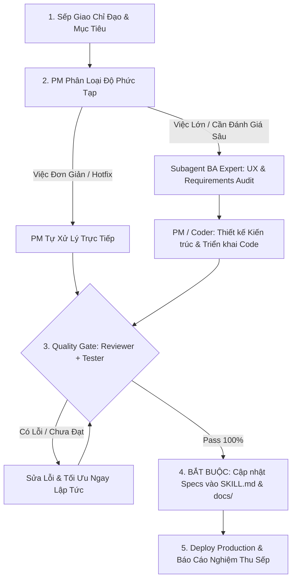

# Full Development & Quality Assurance Workflow (PM Operating Standard)

Skill này quy định phương thức quản trị dự án, thiết kế sản phẩm và điều phối bộ máy phát triển phần mềm toàn diện (End-to-End) của **Lead Agent (Project Manager & Product Owner)** dưới quyền lãnh đạo của **Sếp (Executive Sponsor / User)**.

---

## 1. Nguyên Tắc Điều Hành Của PM (Operating Principles)

1. **Phân cấp Thẩm quyền Rõ ràng:**
   * **Sếp (User):** Giao định hướng chiến lược, mục tiêu nghiệp vụ và duyệt nghiệm thu cuối cùng.
   * **Lead Agent (PM / Product Manager / Engineering Lead):** Chịu trách nhiệm toàn diện về tiến độ, chất lượng, kiến trúc hệ thống và điều phối subagent như nhân viên trong bộ máy.
   * **Sub-agents:** Là các chuyên gia chuyên trách được trao quyền đề xuất giải pháp, tư duy phản biện và sáng tạo không giới hạn trong phạm vi nghiệp vụ.

2. **Nguyên Tắc Thực Dụng & Tối Ưu Tài Nguyên (Pragmatic Execution):**
   * **Việc đơn giản, cục bộ, hotfix nhanh hoặc rõ ràng:** PM / Lead Agent **tự tay xử lý trực tiếp** để tiết kiệm thời gian, giảm độ trễ và tối ưu chi phí token, không lạm dụng spawn nhiều subagent không cần thiết.
   * **Việc phức tạp, tái cấu trúc kiến trúc, audit UX chuyên sâu, viết test suite diện rộng:** PM sẽ **ủy quyền và điều phối subagent chuyên môn** tương ứng.

3. **Chất Lượng Là Danh Dự (Zero-Defect Quality Gate):**
   * Mọi tính năng trước khi báo cáo Sếp phải tự kiểm thử ít nhất 10 lần, build `npm run build` 0 lỗi, pass toàn bộ unit test (37/37 tests) và stress-test thương mại hóa.

4. **KỶ LUẬT LƯU VẾT SPEC BẮT BUỘC (MANDATORY SPEC PERSISTENCE PROTOCOL):**
   * **Lệnh Tối Cao Của Sếp:** Sau mỗi chu kỳ code, refactor hoặc tái cấu trúc kiến trúc, PM/Tech Lead và bộ phận **Doc Writer** **BẮT BUỘC phải lưu vết đặc tả kỹ thuật (Specs, Architecture, Rules) vào ngay trong Skill này (`SKILL.md`) và các tài liệu chuẩn hóa liên quan (`docs/ui-standards.md`, `README.md`)**.
   * **Cấm làm việc cảm tính / quên ghi chép:** Mọi subagent và phiên làm việc tương lai phải luôn đọc được nguồn sự thật duy nhất (Single Source of Truth) từ Skill để kế thừa, bảo trì và phát triển nhất quán. Tuyệt đối không để Sếp phải nhắc lại lần thứ hai.

---

## 2. Kiến Trúc Phân Vai Bộ Máy Nhân Sự Sub-Agents

| Nhân sự Sub-Agent | Chức danh chuyên môn | Trọng tâm công việc |
| :--- | :--- | :--- |
| **1. BA Expert** | Senior Business Analyst & Product Design Specialist | Thẩm định trải nghiệm người dùng (UX/UI), phát hiện bẫy tâm lý / dark pattern, xóa bỏ dư thừa thông tin, chuẩn hóa User Journey và lập User Stories + Acceptance Criteria. |
| **2. Coder** | Feature Developer & Systems Engineer | Thiết kế giải pháp kỹ thuật, viết mã nguồn sạch (Clean Code), refactor và tự xác thực biên dịch build không lỗi. |
| **3. Reviewer** | Senior Code Reviewer & Security Auditor | Rà soát `git diff`, logic nghiệp vụ, bảo mật, hiệu năng, edge cases và đối chiếu nghiệm thu so với đặc tả của BA. |
| **4. Tester** | QA & Test Automation Engineer | Thiết kế test matrix, viết unit/integration tests, chạy bộ test tự động (`npm test`, stress-test suites) đảm bảo không có hồi quy (regression). |
| **5. Doc Writer** | Technical Writer & Knowledge Custodian | **Chịu trách nhiệm sống còn về lưu vết tài liệu:** Tự động đồng bộ các cập nhật kiến trúc mới nhất vào `SKILL.md`, `docs/ui-standards.md`, API specs và changelog ngay sau khi test pass. |

---

## 3. Quy Trình Điều Phối 5 Bước (LifeGraph Dev Lifecycle)

### Bước 1: Tiếp Nhận & Lập Kế Hoạch (PM Intake)
- PM lắng nghe yêu cầu từ Sếp, xác định phạm vi (Scope), tiêu chí thành công (Acceptance Criteria) và quyết định mô hình thực thi.

### Bước 2: Phân Tích Nghiệp Vụ & Thiết Kế (BA Phase)
- Bóc tách vấn đề, loại bỏ rườm rà, thiết kế luồng người dùng trực quan, loại bỏ bẫy block hình chữ nhật tĩnh.

### Bước 3: Triển Khai Kỹ Thuật (Development Phase)
- Viết code chuẩn mực, tuân thủ TypeScript strict mode, responsive đa thiết bị và giữ vững tính toàn vẹn của hệ thống.

### Bước 4: Thẩm Định Độc Lập & Kiểm Thử Nghiêm Ngặt (QA & Review Gate)
- Reviewer soi chiếu code quality.
- Tester chạy toàn bộ 37/37 unit & integration tests, đảm bảo không có hồi quy.

### Bước 5: Cập Nhật Tài Liệu Bắt Buộc & Báo Cáo Nghiệm Thu Sếp (Knowledge Persistence)
- **Bắt buộc ghi nhận mọi thay đổi cấu trúc vào `SKILL.md` và `docs/ui-standards.md`.**
- Triển khai lên Production (Next.js build 0 lỗi) và báo cáo ngắn gọn, súc tích cho Sếp.

---

## 4. Đặc Tả Kiến Trúc Chuẩn Hệ Thống (Living System Architecture Specs)

> [!IMPORTANT]
> Toàn bộ nhân viên, subagent và các lượt phát triển tiếp theo **BẮT BUỘC TUÂN THỦ 100%** các đặc tả kiến trúc cốt lõi dưới đây đã được Sếp phê duyệt:

### 4.1. Đại Thụ Sinh Mệnh Toàn Năng (The Grand Unified Dynamic Life Tree)
* **Khai tử Bảng Thẻ & Tách Rời (Sunset Legacy Card Grid):** Toàn bộ không gian sinh mệnh của game là **Cây Sinh Mệnh Động duy nhất (`DynamicLifeTree.tsx`)**, không còn phân mảnh hay để thất lạc các hệ thống tiến trình.
* **Cấu Trúc Hợp Nhất 3 Trụ Cột Đời Người:**
  1. **Gốc Rễ (Roots - Chân Cây / Hướng Nam):** Gia Đình & Cội Nguồn (Phụ mẫu, Gia phong gia truyền, Tương tác 1-click Bữa cơm +10 HP / Lời khuyên +8 Karma, Nút mở Phả Hệ Dòng Tộc).
  2. **Cành Hoàng Kim (Golden Branch - Đông Bắc):** Tài Sản & Thịnh Vượng (Dòng tiền mặt, Tổng tài sản ròng, Số lượng BĐS/Cổ phiếu, Nút mở Sàn Giao Dịch Tài Sản).
  3. **Nhánh Tinh Hoa (Mystic Branch - Tây Bắc):** Kỹ Năng & Trí Tuệ (Cấp độ nhân sinh Lv, Điểm SP khả dụng, Nút 1-click mở Cây Kỹ Năng RPG, Phím tắt kích hoạt nhanh Lướt Sóng 📈, Thiền Định 🧘, Tiệc VIP 🥂).
  4. **Nhánh Nhân Mạch Quý Nhân (Social Links Branch - Trung Tâm Tán Lá):** Mạng lưới 4 NPC Archetypes (Quý Nhân Bảo Trợ, Chiến Hữu Tri Kỷ, Kình Địch Thương Trường, Hậu Bối Kế Thừa), tương tác 1 AP trò chuyện, tặng quà, và đặc quyền mượn lực giải cứu khi bĩ cực (`request_favor`).
  5. **Lõi Thần Mộc & Tán Lá (Trunk & Canopy - Trung Tâm):** Điểm AP phát quang, Các Node Vệ Tinh Hành Động quay quanh trục bằng đường cong Bezier chuyển động hạt năng lượng theo tuổi (Ấu thơ 0-5t, Học trò 6-17t, Trưởng thành 18+t), Đột Phá Tiên Thiên (2 AP) tại đỉnh cây, Phím tắt chuyển nhanh thời gian.
* **3 Chế Độ Góc Nhìn Sinh Thái Tích Hợp (`treeViewMode`):**
  - `🌿 Vòng Đời & Hành Động`: Lõi thần mộc điều khiển AP và bước ngoặt tuổi tác.
  - `🌟 Cây Kỹ Năng`: Toàn bộ Cây Kỹ Năng 3 nhánh Tri-Branch RPG Build (`SkillTreeTab.tsx`) & Cộng Hưởng Thần Mộc (`TREE_RESONANCES`).
  - `👥 Nhân Mạch Quý Nhân`: Mạng lưới xã hội chuyên sâu (`SocialLinksTab.tsx`) với thanh đo Hảo cảm (Link Level 1 -> 5) và các ân huệ đặc quyền.

### 4.2. Quy Chuẩn Universal Zero-Clipping Tooltips
* Tuyệt đối không để text bị cắt cụt dạng `...` thô kệch trên màn hình.
* 100% địa chỉ nhà ở, tên thành phố, tố chất tiên thiên, chỉ số sinh tồn (Lão hóa, Đột quỵ, Hồi phục AP), hoàn cảnh khởi đầu đều phải bọc bằng component `<Tooltip>` chuẩn hóa.
* Thẻ tố chất gen trong Modal Luân Hồi không được dùng `line-clamp-2` làm mất chữ mô tả của người chơi.

### 4.3. Quy Chuẩn Procedural 3D Avatar Shading
* Bảng màu da thủ tục chân thực theo phân loại quốc gia và lục địa:
  - Tông da sẫm sắc tố Melanin: Somalia, Ethiopia, Sudan, Haiti...
  - Tông da trắng sáng Bắc Âu: Na Uy, Thụy Sĩ...
  - Tông da vàng Á Đông: Việt Nam, Nhật Bản...
* Đôi mắt trẻ thơ 3D phải có điểm sáng catchlight đa tầng, đồng tử có chiều sâu linh hoạt, biểu cảm sinh động theo chỉ số Sinh Lực và Stress.

### 4.4. Quy Tắc Không Trùng Lặp Chỉ Số (Zero Metric Duplication)
* Mỗi thông số lớn (như Khát Vọng Đời Người, Điểm AP) chỉ được có 1 vị trí hiển thị trọng tâm duy nhất trên màn hình, tuyệt đối không lặp lại ở cả Hero Banner lẫn Sidebar gây rối mắt.

### 4.5. Kiến Trúc Đại Thụ Kỹ Năng Tam Vị Nhất Thể (The Trinity Life Mastery RPG Tree)
* Tích hợp 3 trụ cột sinh mệnh RPG:
  - 🌿 **Gia Phong & Huyết Thống (`social`)**: Gốc rễ dòng tộc, chữ hiếu gia phong, nuôi dạy con cháu và thừa kế gia phả bất diệt (`charisma_magnet`, `leverage_power`, `syndicate_kingmaker`).
  - 🪙 **Tư Bản & Sản Nghiệp (`wealth`)**: Thâu tóm sản nghiệp hoàng kim, đàm phán sắc bén, đòn bẩy thị trường và cỗ máy dòng tiền tự động (`market_sense_1`, `negotiation_master`, `capital_engine`).
  - 🔮 **Thân Tâm & Trí Tuệ (`sage`)**: Khắc kỷ tịnh tâm giải tỏa kiệt sức, bách khoa toàn thư thi cử và giác ngộ nghiệp quả trường sinh (`stoic_mind`, `encyclopedic_brain`, `transcendence_sage`).
* **Hệ Thống Cộng Hưởng Tam Giác Sinh Mệnh (Triangle Resonance Synergies)**:
  - 🏛️ *Quỹ Tín Thác Gia Tộc (Gia Phong + Tư Bản)*: Yêu cầu Cấp 2 cả 2 nhánh. Cắt giảm 50% chi phí duy trì dinh thự và bảo lãnh vay vốn 0% lãi suất khi khủng hoảng.
  - 🚀 *Kỳ Lân Đổi Mới (Tư Bản + Trí Tuệ)*: Yêu cầu Cấp 2 cả 2 nhánh. Tăng +15% cổ tức tài chính hàng năm và giảm 30% kiệt sức khi làm việc trí óc.
  - 📜 *Danh Gia Trí Thức (Gia Phong + Trí Tuệ)*: Yêu cầu Cấp 2 cả 2 nhánh. Tích lũy +15 Karma danh vọng gia tộc mỗi năm và tăng tỉ lệ con cái sinh ra mang gen Thần Đồng.
  - 🌟 *Tam Vị Nhất Thể Hoàn Hảo (Đại Cảnh Giới)*: Mở khóa Cấp 3 cả 3 nhánh. Bảo tồn 100% Karma luân hồi, thưởng +25 Karma tối thượng/năm và vĩnh viễn +2 AP khởi đầu mọi kiếp sau.

### 4.6. Quy Chuẩn Độc Quyền Dòng Chảy Nhật Ký Cột Phải (Dedicated Life Chronicle Stream)
* Cột phải (`MultiTabSidebar.tsx`) dành riêng 100% diện tích cho `Nhật Ký Hành Trình Cuộc Đời` (`NarrativeFeed.tsx`).
* Tuyệt đối cấm tạo lại các tab Gia Đình, Tài Sản, Kỹ Năng ở cột phải để tránh phân mảnh dữ liệu với Đại Thụ Sinh Mệnh bên trái. Mọi thao tác tương tác sâu được quy hoạch vào các modal chuyên biệt: `FamilyDetailModal`, `AssetDetailModal`, `SkillTreeModal`.

### 4.7. Khai Tử Thanh Không Gian Sống Dưới Đáy (LivingRoom Backdrop Retirement)
* Đã gỡ bỏ vĩnh viễn thanh ngang phụ `LivingRoomBackdropViewport` (hiển thị "Phòng Trọ Khởi Nghiệp - Ngọn Đèn Khắc Khổ / Cinema Mode").
* Căn cứ: Cột trái đã có nút bấm Phòng Quyết Định 3D màu vàng hổ phách nổi bật ở đỉnh và thanh điều hướng chính. Việc để thanh ngang ở đáy màn hình gây nhiễu thị giác và chiếm dụng không gian hiển thị của Đại Thụ Sinh Mệnh.

### 4.8. Quy Chuẩn Avatar 3D Tràn Banner Không Viền Hộp (Borderless Unified 3D Living Avatar Standard)
* **Khai tử nút chuyển đổi phân tách `[3D] / [SPINE]`:** Hợp nhất một trải nghiệm avatar 3D cao cấp duy nhất, loại bỏ cảm giác phân mảnh giữa 2 chế độ hiển thị rời rạc.
* **Tích hợp hoạt cảnh bộ xương kiểu Spine vào 3D:** Mô hình 3D Procedural Rigging Mesh (`Dynamic3DAvatar.tsx`) sở hữu đầy đủ các tư thế sống động như Spine:
  - MOBA Champion `Gotcha_Pose`: Hai tay chống nạnh tự tin, ngực nở, đầu nghiêng nhẹ, nhịp thở hữu cơ.
  - Tư thế Victory Celebrate: Hai tay vung cao chữ V bật nhảy vui tươi.
  - Tư thế Zen Lotus Mudra: Chắp tay tịnh tâm thiền định.
  - Phản ứng Yếu ớt / Kiệt sức: Tay buông thõng, cơ thể chùng xuống, mắt chớp chậm.
* **Bỏ hoàn toàn viền vuông hộp chữ nhật:** Xóa bỏ khung ảnh thẻ `rounded-2xl border bg-slate-900 overflow-hidden`.
* **Phóng to kích thước & Tràn Banner:** Kích thước mở rộng lên `w-36 h-40 md:w-44 md:h-48 lg:w-48 lg:h-52` với cơ chế `overflow-visible`, cho phép đỉnh đầu, vòng hoa nguyệt quế và hào quang kim quang tràn tự nhiên ra mặt nền Banner.
* **Bệ phóng ba chiều (Holographic Reticle Pedestal):** Mở rộng dưới chân nhân vật (`w-36 md:w-44 lg:w-48 h-8`) với các vòng laser neon cyan/amber xoay đồng tâm, neo giữ nhân vật vững chãi trên sàn tàu không gian/sân khấu số mệnh.

### 4.9. Đặc Tả Toàn Diện Lộ Trình 3 Phase: Dòng Chảy Thời Gian & Đại Thụ Sinh Mệnh Tiến Hóa (Mandatory 3-Phase Seamless Evolution Standard)
> [!IMPORTANT]
> **KỶ LUẬT THI CÔNG BẮT BUỘC THEO LỆNH CỦA SẾP:** Toàn bộ bộ máy phát triển (PM, BA, Coder, Tester, Doc Writer) phải tuân thủ nghiêm ngặt và thi công tuần tự trọn vẹn cả 3 Phase dưới đây. Tuyệt đối không được dừng lại ở Phase 1 hay làm sai lệch kiến trúc tổng thể.

#### 🌟 PHASE 1: Nghi Thức Chiêm Nghiệm Cuối Năm & Gieo Mầm Tâm Nguyện Năm Mới (New Year's Eve Ritual & Annual Pledges)
* **Mục tiêu cốt lõi:** Khai tử cảm giác "tự đi bấm nút già đi khô khan". Tạo khoảng lặng cảm xúc cô đọng sau 1 năm làm việc và truyền cảm hứng chuẩn bị cho năm tiếp theo.
* **Cơ chế kích hoạt:** Tự động kích hoạt khi tiêu thụ hết AP trong năm hoặc khi người chơi chủ động bấm `"🌿 Dưỡng Sinh & Khép Lại Năm Cũ"`.
* **Cấu trúc Nghi Thức Giao Thừa (`YearEndReflectionModal.tsx`):**
  1. *Lắng Đọng Thành Tựu Trong Năm:* Thống kê các node hành động đã hoàn thành, tài chính tích lũy, người thân/quý nhân đã kết giao và AP dư quy đổi thành Dưỡng Sinh (+2 HP/AP, -5% Burnout/AP).
  2. *Nhận Diện Việc Còn Dang Dở:* Ghi lại các node AP chưa chạm tới, cơ hội nghề nghiệp bỏ lỡ hoặc mục tiêu tài chính chưa đạt thành dạng "Hạt Mầm Dở Dang".
  3. *Gieo Mầm Tâm Nguyện Năm Mới (1-Click Annual Pledge):* Người chơi chọn 1 trong 3 định hướng chiến lược nhận buff năm kế tiếp:
     - 📈 **Tâm Nguyện Thịnh Vượng (`pledge_wealth`):** +15% thu nhập cày việc & +10% lợi nhuận đầu tư năm sau.
     - 🧘 **Tâm Nguyện An Yên (`pledge_wellness`):** Kháng 30% Burnout & gấp đôi tốc độ hồi phục HP dưỡng sinh năm sau.
     - 🤝 **Tâm Nguyện Nhân Mạch (`pledge_social`):** Gấp đôi EXP Social Links & giảm 50% chi phí quà tặng/mời cơm năm sau.
* **Dòng chảy chuyển giao:** Sau khi xác nhận tâm nguyện, hệ thống bắn pháo hoa nhẹ nhàng và **tự động bước sang tuổi mới (`character.age += 1`)**, cập nhật giao diện Cockpit mà không cần ấn thêm nút nào khác.

#### 🌳 PHASE 2: Đại Thụ Tiến Hóa Thủ Tục Theo 5 Chặng Tuổi & Vòng Vân Gỗ Đời Người (Morphing Procedural Tree & Annual Growth Rings)
* **Mục tiêu cốt lõi:** Đại Thụ Sinh Mệnh (`DynamicLifeTree.tsx`) không còn là sơ đồ tròn tĩnh, mà thực sự lớn lên từ đất mẹ theo từng chặng đời và ghi dấu năm tháng qua vân gỗ.
* **5 Giai Đoạn Hình Thái Thủ Tục SVG (`growthStage`):**
  1. `sprout` (0 – 5 tuổi / Ấu thơ): Thân mầm non búp măng vươn từ đất mẹ, rễ gắn chặt với phụ mẫu, tán lá chỉ có 3 chồi sữa/tập đi.
  2. `sapling` (6 – 17 tuổi / Học trò): Thân non vươn cành thẳng tắp, đâm chồi nhánh Trí Tuệ học hành và Bạn Bè trang lứa.
  3. `flourishing_oak` (18 – 35 tuổi / Lập nghiệp): Thần mộc bùng nở, cành nhánh to khỏe, phân định 3 Trụ Cột Quang Minh (Kỹ Năng, Nhân Mạch, Tài Sản).
  4. `grand_pillar` (36 – 55 tuổi / Trụ cột đỉnh cao): Đại thụ vững chãi, tán lá sum suê che chở gia đình con cái, rễ đâm sâu vào lòng đất.
  5. `ancient_world_tree` (56+ tuổi / Hoàng hôn di sản): Cổ thụ hoàng kim, thân ánh vàng hổ phách, trổ Quả Ngọt Di Sản truyền thừa kiếp sau.
* **Vòng Vân Gỗ Đời Người (Annual Tree Growth Rings):**
  - Mặt cắt thân gỗ ở gốc cây hiển thị các vòng vân đồng tâm tăng dần theo tuổi (`ringsCount = characterAge`).
  - Hover vào từng vân gỗ hiển thị tooltip ký ức: "Năm {X} tuổi: {Dấu ấn quan trọng nhất}".

#### 🎬 PHASE 3: Tái Cấu Trúc Sân Khấu Tâm Thức & Dòng Chảy Xuyên Suốt Toàn Diện (Crucible of Destiny & End-to-End Pacing)
* **Mục tiêu cốt lõi:** Tinh gọn Phòng Quyết Định 3D, chỉ kích hoạt khi có Biến Cố Ngã Rẽ Thật Sự; kết nối dòng chảy thời gian xuyên suốt giữa Banner Chibi $\leftrightarrow$ Đại Thụ $\leftrightarrow$ Nhật Ký $\leftrightarrow$ Quyết Định.
* **Quy tắc kích hoạt phòng quyết định:**
  - Năm bình yên (Peaceful Year): Không ép vào phòng quyết định. Chơi trên Đại Thụ $\rightarrow$ Nghi Thức Giao Thừa $\rightarrow$ Lên tuổi mới.
  - Năm có Biến Cố Ngã Rẽ Lớn (Threshold Milestones: 6t vào lớp 1, 18t đại học/khởi nghiệp, 28t hôn nhân/nhà cửa, 42t bước ngoặt nghề, 65t di chúc/sinh tử): Mở **Sân Khấu Tâm Thức Trong Gốc Cây** với 3 lăng kính bản ngã (Lý Trí, Trái Tim, Bản Năng).
* **Chuỗi chuyển tiếp tự nhiên:** Giải quyết xong biến cố bằng xúc xắc D20 $\rightarrow$ Tự động chuyển tiếp vào Nghi Thức Chiêm Nghiệm Giao Thừa $\rightarrow$ Bước sang tuổi mới liền mạch.
* **Sự liên kết chỉ số toàn diện:** Ngoại hình Chibi 3D & Linh thú MOBA, độ lớn của Đại Thụ, các sự kiện trên Narrative Feed đều đồng bộ 100% về mặt nhịp thở và câu chuyện.

---

## 5. Quy Chuẩn Sáng Tác Văn Bản & Lời Thoại "Khử Mùi AI" (Anti-AI Copywriting & Narrative Directives)

> [!IMPORTANT]
> **TÔN CHỈ BẤT DI BẤT DỊCH TỪ SẾP:** Mọi nội dung text trong LifeGraph (kịch bản, nhật ký, lời thoại NPC, mô tả vật phẩm, tooltip) phải mang hơi thở cuộc sống trần trụi, chân thực, gai góc và giàu cảm xúc con người. **TUYỆT ĐỐI CẤM NÓNG VỘI SINH CHỮ KIỂU "AI SLOP"** — rỗng tuếch, giáo điều, đạo đức giả và ngập tràn tính từ sáo rỗng.

### 5.1. Bảng Đen Từ Ngữ & Mô Thức Cấm Cửa (AI Slop Blacklist)

| Mô thức cấm (AI Clichés) | Ví dụ vi phạm cấm dùng | Cách viết thay thế chuẩn xác (Human & Gritty) |
| :--- | :--- | :--- |
| **Tính từ văn mẫu sáo rỗng** | *"Bản hòa ca cuộc sống", "Bức tranh muôn màu", "Ngã rẽ định mệnh", "Thắp sáng hy vọng", "Vòng xoáy nghiệt ngã"* | **Dùng chi tiết giác quan cụ thể:** Mùi ngai ngái của bùn non sau cơn mưa rào, tiếng quạt tai voi kêu cọt kẹt trưa hè, ánh đèn huỳnh quang chập chờn góc bếp. |
| **Đạo đức giả & Giảng giải luân lý** | *"Bạn nhận ra rằng tình yêu thương gia đình là ngọn hải đăng soi sáng tâm hồn..."* | **Hành động & phản ứng tự nhiên:** Người cha không nói gì, chỉ lẳng lặng nhét xấp tiền 200 nghìn nhăn nhúm vào đáy balo của bạn trước giờ xe lăn bánh. |
| **Cấu trúc câu đối xứng hoàn hảo, vô hồn** | *"Không chỉ mang lại niềm vui, mà còn mở ra những cơ hội mới..."* | **Khẩu ngữ đứt gãy, đời thường:** *"Ăn thêm nửa bát cơm đi rồi hẵng lo việc. Có thực mới vực được đạo, mày nhịn thế định sống bằng không khí à?"* |
| **Khái quát hóa trừu tượng thay vì số liệu** | *"Bạn kiếm được một khoản tiền kha khá để trang trải cuộc sống khó khăn..."* | **Con số & chi phí cụ thể:** Tiền phòng trọ 1.620 kr, hóa đơn điện tháng này hụt mất 80 kr, ví còn đúng 3 đồng xu lẻ gỉ sét. |

### 5.2. Nguyên Tắc "Show, Don't Tell" Trong Game RPG Đời Thực

1. **Vật chất hóa cảm xúc:** Thay vì viết *"Bạn cảm thấy đau khổ và cô đơn"*, hãy viết: *"Đĩa cơm nguội ngắt để góc bàn từ chiều qua, kiến bắt đầu bu quanh mép chén. Tiếng chuông báo thức 5h sáng lại reo ầm ĩ."*
2. **Khắc họa xã hội phân tầng (Sociolects):**
   - **Tầng lớp lao động:** Khẩu ngữ thô mộc, câu ngắn, nhiều thán từ, thở dài, lo cơm áo gạo tiền sát sườn (`tiền họ`, `tiền đong gạo`, `nợ thẻ cào`, `đổi ca kíp`).
   - **Tầng lớp trung lưu / trí thức:** Câu từ chuẩn mực nhưng ngột ngạt áp lực thi cử, KPI, trả góp chung cư, bằng cấp thạc sĩ.
   - **Tầng lớp tinh hoa / tài phiệt:** Lạnh lùng, nói chuyện bằng chi phí cơ hội, tỷ suất sinh lời rủi ro (Risk-adjusted ROI), mạng lưới quan hệ và vị thế gia tộc.
3. **Thổ nhưỡng & Bản sắc địa phương (Cultural Verisimilitude):**
   - Cốt truyện ở **Bergen (Na Uy)**: Không tả chung chung mà phải có sương muối buốt giá vùng fjord, mùi cá hồi hun khói bến cảng Bryggen, giá cả đắt đỏ bằng đồng Krone (kr).
   - Cốt truyện ở **Mogadishu (Somalia)**: Bụi cát bỏng rát Waberi, tiếng còi xe tuk-tuk inh ỏi, vị trà gia vị đậm đà trong chiếc cốc thủy tinh mẻ miệng.
   - Cốt truyện ở **Hà Nội / Sài Gòn (Việt Nam)**: Tiếng rao bánh mì đêm ngõ sâu, quán cà phê cóc ven đường, tô bún riêu cua dậy mùi giấm bỗng trưa hè.

### 5.3. Quy Trình Kiểm Duyệt Văn Phong Của Sub-agent Doc Writer & Reviewer

* **Checklist 3 câu hỏi trước khi merge text:**
  1. *Nếu đọc to lên bằng giọng người thật, câu này nghe có giống ai đó đang nói chuyện ngoài đời không, hay giống bài văn mẫu cấp 2 do máy viết?*
  2. *Đoạn văn này có chứa chi tiết cụ thể về giác quan (mùi, vị, âm thanh, xúc giác) hoặc số tiền cụ thể không?*
  3. *Có bị dính từ nào trong Blacklist sáo rỗng không?*
* Nếu phát hiện vi phạm, Reviewer có quyền từ chối nghiệm thu và yêu cầu viết lại 100%.
