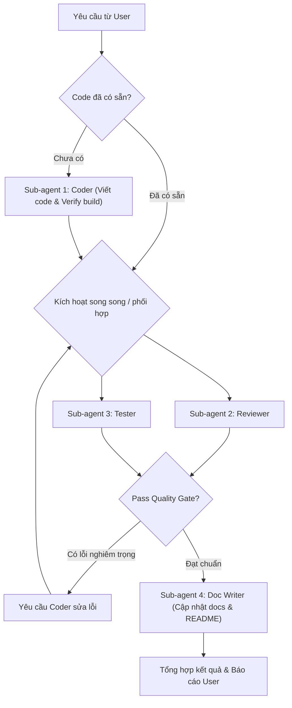

# Full Development & Quality Assurance Workflow

Skill này hướng dẫn Lead Agent điều phối quy trình phát triển và thẩm định chất lượng toàn diện (Dev-to-Done) thông qua các Sub-agent chuyên trách.

---

## 1. Kiến trúc phân vai Sub-Agents

Khi nhận một yêu cầu phát triển mới hoặc tối ưu code, Lead Agent đóng vai trò **Tech Lead / Orchestrator** và điều phối tối đa 4 sub-agent:

| Sub-Agent | Vai trò | Quyền hạn (Capabilities) | Nhiệm vụ chính |
| :--- | :--- | :--- | :--- |
| **1. Coder** *(Tùy chọn nếu code từ đầu)* | Feature Developer | Đọc/Ghi code, chạy build kiểm tra | Phân tích codebase, thiết kế giải pháp và viết code triển khai tính năng. |
| **2. Reviewer** | Senior Code Reviewer | Read-only (Đọc code, git diff) | Phân tích logic, bảo mật, hiệu năng, edge cases và đối chiếu với requirement. |
| **3. Tester** | QA & Test Engineer | Viết file test, chạy lệnh terminal | Bổ sung unit/integration tests cho phần code mới và thực thi kiểm thử (`npm test`, script test). |
| **4. Doc Writer** | Technical Writer | Ghi tài liệu (`docs/`, `README.md`) | Đồng bộ hóa tài liệu kỹ thuật, cập nhật hướng dẫn API, changelog hoặc inline docs. |

> [!NOTE]
> * **Nếu người dùng đã code xong:** Bỏ qua Sub-agent Coder, kích hoạt ngay bộ ba **Reviewer + Tester + Doc Writer**.
> * **Nếu bắt đầu từ yêu cầu mới:** Kích hoạt Coder trước, sau đó kích hoạt 3 sub-agents còn lại.

---

## 2. Quy trình điều phối chi tiết (Step-by-Step)

### Bước 1: Tiếp nhận yêu cầu & Lập kế hoạch (Lead Agent)
- Làm rõ phạm vi yêu cầu (Scope) và xác định xem mã nguồn đã có sẵn hay cần Coder viết mới.
- Phác thảo checklist nghiệm thu (Acceptance Criteria).

### Bước 2: Triển khai Code (Sub-agent Coder)
- Dùng `invoke_subagent` để khởi tạo Coder:
  - Role: `Feature Developer`
  - Workspace: `inherit` hoặc `branch`
  - Yêu cầu: Đọc codebase hiện tại, viết code sạch, tuân thủ conventions và tự xác nhận build không bị lỗi cú pháp.

### Bước 3: Đánh giá chất lượng & Viết kiểm thử (Reviewer & Tester)
Sau khi có mã nguồn (hoặc git diff), Lead Agent spawn đồng thời:
1. **Sub-agent Reviewer**:
   - Chạy lệnh `git diff` hoặc đọc các file thay đổi.
   - Xuất danh sách đánh giá: Bug tiềm ẩn, bảo mật, điểm cần refactor, đánh giá tổng quan (PASS / NEEDS_CHANGES).
2. **Sub-agent Tester**:
   - Kiểm tra thư mục test hiện có của project (ví dụ: `tests/`, `test_*.mjs`, Jest/Mocha).
   - Viết các test case bao phủ logic mới / edge cases.
   - Chạy lệnh test thực tế trong terminal để kiểm tra kết quả pass/fail.

### Bước 4: Vòng lặp phản hồi (Feedback Loop)
- Nếu Reviewer phát hiện lỗi nghiêm trọng (Critical Bug / Security Issue) hoặc Tester báo test fail:
  - Lead Agent gửi phản hồi lại cho Coder để điều chỉnh.
- Nếu cả hai đạt chuẩn (Quality Gate Passed): Chuyển tiếp sang Bước 5.

### Bước 5: Cập nhật tài liệu (Sub-agent Doc Writer)
- Spawn **Sub-agent Doc Writer**:
  - Đối chiếu tính năng mới với các tài liệu trong `docs/` và `README.md`.
  - Cập nhật tài liệu API, hướng dẫn cấu hình hoặc usage guides.

### Bước 6: Tổng kết & Trả kết quả (Lead Agent)
- Thu thập kết quả từ tất cả các sub-agent.
- Tạo một Artifact tổng kết gồm:
  - Tóm tắt thay đổi code.
  - Đánh giá của Reviewer (Kèm đề xuất nếu có).
  - Báo cáo kết quả test (Số lượng test cases, trạng thái pass/fail).
  - Danh sách tài liệu đã được cập nhật.
