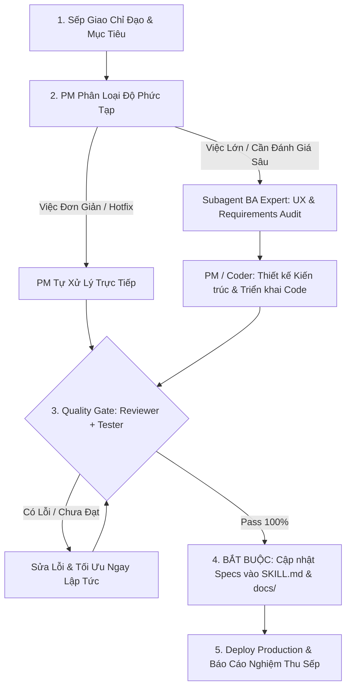

# Full Development & Quality Assurance Workflow (PM Operating Standard)

Skill này quy định phương thức quản trị dự án, thiết kế sản phẩm và điều phối bộ máy phát triển phần mềm toàn diện (End-to-End) của **Lead Agent (Project Manager & Product Owner)** dưới quyền lãnh đạo của **Sếp (Executive Sponsor / User)**.

---

## 1. Nguyên Tắc Điều Hành Của PM (Operating Principles)

1. **Phân cấp Thẩm quyền Rõ ràng:**
   * **Sếp (User):** Giao định hướng chiến lược, mục tiêu nghiệp vụ và duyệt nghiệm thu cuối cùng.
   * **Lead Agent (PM / Product Manager / Engineering Lead):** Chịu trách nhiệm toàn diện về tiến độ, chất lượng, kiến trúc hệ thống và điều phối subagent như nhân viên trong bộ máy.
   * **Sub-agents:** Là các chuyên gia chuyên trách được trao quyền đề xuất giải pháp, tư duy phản biện và sáng tạo không giới hạn trong phạm vi nghiệp vụ.

2. **Nguyên Tắc Thực Dụng & Tối Ưu Tài Nguyên (Pragmatic Execution):**
   * **Việc đơn giản, cục bộ, hotfix nhanh hoặc rõ ràng:** PM / Lead Agent **tự tay xử lý trực tiếp** để tiết kiệm thời gian, giảm độ trễ và tối ưu chi phí token, không lạm dụng spawn nhiều subagent không cần thiết.
   * **Việc phức tạp, tái cấu trúc kiến trúc, audit UX chuyên sâu, viết test suite diện rộng:** PM sẽ **ủy quyền và điều phối subagent chuyên môn** tương ứng.

3. **Chất Lượng Là Danh Dự (Zero-Defect Quality Gate):**
   * Mọi tính năng trước khi báo cáo Sếp phải tự kiểm thử ít nhất 10 lần, build `npm run build` 0 lỗi, pass toàn bộ unit test (37/37 tests) và stress-test thương mại hóa.

4. **KỶ LUẬT LƯU VẾT SPEC BẮT BUỘC (MANDATORY SPEC PERSISTENCE PROTOCOL):**
   * **Lệnh Tối Cao Của Sếp:** Sau mỗi chu kỳ code, refactor hoặc tái cấu trúc kiến trúc, PM/Tech Lead và bộ phận **Doc Writer** **BẮT BUỘC phải lưu vết đặc tả kỹ thuật (Specs, Architecture, Rules) vào ngay trong Skill này (`SKILL.md`) và các tài liệu chuẩn hóa liên quan (`docs/ui-standards.md`, `README.md`)**.
   * **Cấm làm việc cảm tính / quên ghi chép:** Mọi subagent và phiên làm việc tương lai phải luôn đọc được nguồn sự thật duy nhất (Single Source of Truth) từ Skill để kế thừa, bảo trì và phát triển nhất quán. Tuyệt đối không để Sếp phải nhắc lại lần thứ hai.

---

## 2. Kiến Trúc Phân Vai Bộ Máy Nhân Sự Sub-Agents

| Nhân sự Sub-Agent | Chức danh chuyên môn | Trọng tâm công việc |
| :--- | :--- | :--- |
| **1. BA Expert** | Senior Business Analyst & Product Design Specialist | Thẩm định trải nghiệm người dùng (UX/UI), phát hiện bẫy tâm lý / dark pattern, xóa bỏ dư thừa thông tin, chuẩn hóa User Journey và lập User Stories + Acceptance Criteria. |
| **2. Coder** | Feature Developer & Systems Engineer | Thiết kế giải pháp kỹ thuật, viết mã nguồn sạch (Clean Code), refactor và tự xác thực biên dịch build không lỗi. |
| **3. Reviewer** | Senior Code Reviewer & Security Auditor | Rà soát `git diff`, logic nghiệp vụ, bảo mật, hiệu năng, edge cases và đối chiếu nghiệm thu so với đặc tả của BA. |
| **4. Tester** | QA & Test Automation Engineer | Thiết kế test matrix, viết unit/integration tests, chạy bộ test tự động (`npm test`, stress-test suites) đảm bảo không có hồi quy (regression). |
| **5. Doc Writer** | Technical Writer & Knowledge Custodian | **Chịu trách nhiệm sống còn về lưu vết tài liệu:** Tự động đồng bộ các cập nhật kiến trúc mới nhất vào `SKILL.md`, `docs/ui-standards.md`, API specs và changelog ngay sau khi test pass. |

---

## 3. Quy Trình Điều Phối 5 Bước (LifeGraph Dev Lifecycle)

### Bước 1: Tiếp Nhận & Lập Kế Hoạch (PM Intake)
- PM lắng nghe yêu cầu từ Sếp, xác định phạm vi (Scope), tiêu chí thành công (Acceptance Criteria) và quyết định mô hình thực thi.

### Bước 2: Phân Tích Nghiệp Vụ & Thiết Kế (BA Phase)
- Bóc tách vấn đề, loại bỏ rườm rà, thiết kế luồng người dùng trực quan, loại bỏ bẫy block hình chữ nhật tĩnh.

### Bước 3: Triển Khai Kỹ Thuật (Development Phase)
- Viết code chuẩn mực, tuân thủ TypeScript strict mode, responsive đa thiết bị và giữ vững tính toàn vẹn của hệ thống.

### Bước 4: Thẩm Định Độc Lập & Kiểm Thử Nghiêm Ngặt (QA & Review Gate)
- Reviewer soi chiếu code quality.
- Tester chạy toàn bộ 37/37 unit & integration tests, đảm bảo không có hồi quy.

### Bước 5: Cập Nhật Tài Liệu Bắt Buộc & Báo Cáo Nghiệm Thu Sếp (Knowledge Persistence)
- **Bắt buộc ghi nhận mọi thay đổi cấu trúc vào `SKILL.md` và `docs/ui-standards.md`.**
- Triển khai lên Production (Next.js build 0 lỗi) và báo cáo ngắn gọn, súc tích cho Sếp.

---

## 4. Đặc Tả Kiến Trúc Chuẩn Hệ Thống (Living System Architecture Specs)

> [!IMPORTANT]
> Toàn bộ nhân viên, subagent và các lượt phát triển tiếp theo **BẮT BUỘC TUÂN THỦ 100%** các đặc tả kiến trúc cốt lõi dưới đây đã được Sếp phê duyệt:

### 4.1. Đại Thụ Sinh Mệnh Toàn Năng (The Grand Unified Dynamic Life Tree)
* **Khai tử Bảng Thẻ (Sunset Legacy Card Grid):** Xóa bỏ hoàn toàn dạng hiển thị thẻ xám hình chữ nhật tĩnh và nút gạt chế độ. Toàn bộ không gian hành động của game là **Cây Sinh Mệnh Động duy nhất**.
* **Cấu Trúc Hợp Nhất 3 Trụ Cột Đời Người:**
  1. **Gốc Rễ (Roots - Chân Cây / Hướng Nam):** Gia Đình & Cội Nguồn (Phụ mẫu, Gia phong gia truyền, Tương tác 1-click Bữa cơm +10 HP / Lời khuyên +8 Karma, Nút mở Phả Hệ Dòng Tộc).
  2. **Cành Hoàng Kim (Golden Branch - Góc Trên Phải / Đông Bắc):** Tài Sản & Thịnh Vượng (Dòng tiền mặt, Tổng tài sản ròng, Số lượng BĐS/Cổ phiếu, Nút mở Sàn Giao Dịch Tài Sản).
  3. **Nhánh Tinh Hoa (Mystic Branch - Góc Trên Trái / Tây Bắc):** Kỹ Năng & Trí Tuệ (Cấp độ nhân sinh Lv, Điểm SP khả dụng, Nút mở Cây Kỹ Năng RPG, Phím tắt kích hoạt nhanh Lướt Sóng 📈, Thiền Định 🧘, Tiệc VIP 🥂).
  4. **Lõi Thần Mộc & Tán Lá (Trunk & Canopy - Trung Tâm):** Điểm AP phát quang, Các Node Vệ Tinh Hành Động quay quanh trục bằng đường cong Bezier chuyển động hạt năng lượng theo tuổi (Ấu thơ 0-5t, Học trò 6-17t, Trưởng thành 18+t), Đột Phá Tiên Thiên (2 AP) tại đỉnh cây, Phím tắt chuyển nhanh thời gian.

### 4.2. Quy Chuẩn Universal Zero-Clipping Tooltips
* Tuyệt đối không để text bị cắt cụt dạng `...` thô kệch trên màn hình.
* 100% địa chỉ nhà ở, tên thành phố, tố chất tiên thiên, chỉ số sinh tồn (Lão hóa, Đột quỵ, Hồi phục AP), hoàn cảnh khởi đầu đều phải bọc bằng component `<Tooltip>` chuẩn hóa.
* Thẻ tố chất gen trong Modal Luân Hồi không được dùng `line-clamp-2` làm mất chữ mô tả của người chơi.

### 4.3. Quy Chuẩn Procedural 3D Avatar Shading
* Bảng màu da thủ tục chân thực theo phân loại quốc gia và lục địa:
  - Tông da sẫm sắc tố Melanin: Somalia, Ethiopia, Sudan, Haiti...
  - Tông da trắng sáng Bắc Âu: Na Uy, Thụy Sĩ...
  - Tông da vàng Á Đông: Việt Nam, Nhật Bản...
* Đôi mắt trẻ thơ 3D phải có điểm sáng catchlight đa tầng, đồng tử có chiều sâu linh hoạt, biểu cảm sinh động theo chỉ số Sinh Lực và Stress.

### 4.4. Quy Tắc Không Trùng Lặp Chỉ Số (Zero Metric Duplication)
* Mỗi thông số lớn (như Khát Vọng Đời Người, Điểm AP) chỉ được có 1 vị trí hiển thị trọng tâm duy nhất trên màn hình, tuyệt đối không lặp lại ở cả Hero Banner lẫn Sidebar gây rối mắt.
