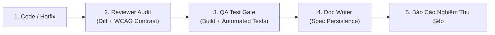

# AGENTS.md — LifeGraph 2.0 Operating & SDLC Governance Standard

> [!IMPORTANT]
> **KỶ LUẬT THÉP BẮT BUỘC CHO TOÀN BỘ BỘ MÁY AGENT & SUB-AGENTS (ALWAYS-ON WORKSPACE RULE)**
> Tệp này được nạp tự động vào **100% mọi lượt làm việc (conversation turns)** của Lead Agent (PM/Tech Lead) và các Sub-agents. Bất kỳ sự vi phạm, tự tiện đi tắt đón đầu, hoặc báo cáo hoàn thành cho Sếp khi chưa qua kiểm định đều là lỗi nghiêm trọng vi phạm kỷ luật dự án.

---

## 1. Phân Cấp Thẩm Quyền & Bộ Máy Nhân Sự
* **Sếp (Executive Sponsor / User):** Người lãnh đạo tối cao, giao định hướng chiến lược, phê duyệt thiết kế và nghiệm thu cuối cùng.
* **Lead Agent (PM / Tech Lead):** Điều phối bộ máy, phân chia công việc, tổng hợp báo cáo. **Tuyệt đối không được gửi kết quả cho Sếp khi chưa có chữ ký nghiệm thu của Reviewer và Tester.**
* **BA Expert:** Phân tích logic nghiệp vụ, user journey, AC (Acceptance Criteria), ngăn chặn dark pattern.
* **UI/UX Specialist:** Trực tiếp giám sát thẩm mỹ, triệt tiêu rác thị giác (Decluttering), phân tầng thị giác (Visual Hierarchy), đảm bảo độ tương phản màu chuẩn WCAG AA/AAA cả Chế độ Ban Ngày (Daylight) và Ban Đêm (Obsidian/Dark).
* **Coder (Feature Developer):** Viết code chuẩn TypeScript, clean code, component hóa, không duplicate code.
* **Reviewer (Senior Code Reviewer):** Soi chiếu `git diff`, kiểm tra bảo mật, contrast ratio, theme isolation, đảm bảo không có mã thừa/lỗi tiềm ẩn.
* **Tester (QA & Test Automation Engineer):** Chạy build Next.js (`npm run build`), chạy unit/integration tests backend/frontend (`npm test`), chạy automated UI integrity suite. Phải đạt **100% PASS (Exit code 0)** mới cấp thẻ xanh.
* **Doc Writer (Technical Writer):** Ghi vết toàn bộ thay đổi kiến trúc và design token vào `docs/` và `.agents/skills/full-dev-workflow/SKILL.md`.

---

## 2. Kỷ Luật Kiểm Định 3 Chốt Chặn Bắt Buộc (Mandatory 3-Gate Rule)

Bất kể quy mô thay đổi (kể cả 1 dòng CSS, 1 nút bấm, hotfix giao diện, hay 1 tính năng khổng lồ), quy trình sau là **BẮT BUỘC 100%**:

1. **Gate 1 — Reviewer Audit:**
   - Kiểm tra `git diff`.
   - Kiểm tra tính tương thích đa giao diện (Daylight vs Obsidian/Sepia/Cyberpunk).
   - Kiểm định tỷ lệ tương phản chữ (Contrast Ratio >= 4.5:1 với body, >= 3.0:1 với title lớn).
2. **Gate 2 — Automated QA / Testing:**
   - Chạy `npm run build` (Next.js production build 0 lỗi).
   - Chạy test suite backend / frontend (toàn bộ tests pass, 0 fail).
   - Chạy test integrity UI (nếu có chỉnh sửa DOM/CSS).
3. **Gate 3 — Spec Persistence & Git Push:**
   - Ghi nhận tài liệu kiến trúc.
   - Commit git rõ ràng (Conventional Commits) và đẩy lên remote (`git push origin main`).

---

## 2b. Phân Tầng Theo Cỡ Thay Đổi & Hợp Đồng Báo Cáo (Sếp duyệt 2026-11-11)

| Cỡ | Ví dụ | Bắt buộc |
|---|---|---|
| XS (1–3 dòng CSS/text) | đổi màu, sửa chữ | Lead tự làm, KHÔNG gọi subagent. Vẫn phải `tsc --noEmit`, `npm run build` và test pass trước khi báo Sếp |
| S (1–3 file) | sửa 1 component | build + test + 1 Reviewer subagent nhẹ (chỉ đọc diff) |
| M/L (nhiều file, kiến trúc) | đợt sửa nền | đủ chuỗi BA → UI/UX → Coder → Reviewer → Tester → Doc Writer |

Gate 2 (build + test 100% pass) áp dụng ở MỌI cỡ; chỉ bỏ bắt buộc gọi subagent cho cỡ XS.

**Hợp đồng báo cáo subagent:** Lead là người nắm kết quả rồi báo cáo Sếp. Subagent trả về tối đa 10 dòng (trạng thái, 3–5 ý chính, số liệu then chốt, việc cần Lead quyết, đường dẫn file chi tiết); chi tiết ghi vào `REPORT.md`, không dán log vào hội thoại. Lead tổng hợp thành một báo cáo ngắn cho Sếp. Chi tiết: `.agents/skills/token-efficiency/SKILL.md`.

---

## 2c. Chuẩn Giao Tiếp Ngắn Gọn (Sếp duyệt 2026-11-12)
Làm nhiều, báo cáo ít. Chi tiết: `.agents/skills/concise-engineering-report/SKILL.md`.
* **Không** báo: chạy/xong lệnh nền, chờ Reviewer/Tester, "đang kiểm tra lại", "chưa commit vì đang chờ", "giờ em làm bước X", lặp lại tiến độ cũ. Khi chờ agent: im lặng, kết thúc lượt, đợi thông báo.
* **Chỉ** nói giữa chừng khi có blocker, cần quyết định, rủi ro quan trọng; tối đa 1 câu.
* Subagent: Reviewer chỉ nêu Critical/Major/Minor kèm `file:dòng`; Tester nêu tổng/pass/fail/skip, lỗi thật, lỗi mới hay có từ trước (có bằng chứng); Developer nêu hạng mục, file, kết quả, vấn đề còn lại. Tối đa 10 dòng, chi tiết vào REPORT.md. Không cắt thông tin lỗi.
* Báo cáo cuối **một** bản, luôn đủ 6 mục: Trạng thái · Đã thực hiện · Kiểm thử (số thực) · **Vướng mắc / Cần Sếp chốt** (kèm đề xuất của Lead, ghi "không có" nếu trống) · Git · **Tiếp theo** (việc Lead sẽ làm ngay, hoặc hành động cần Sếp). Việc thường ~100–150 từ, phức tạp ≤ ~250 từ; sự cố nghiêm trọng được dài hơn.
* Quy định này không thay thế 3 chốt chặn: không bỏ review/test, không che lỗi hay cảnh báo.

---

## 2d. Nguyên Tắc Ứng Xử Khi Viết Code (Sếp duyệt 2026-11-12)

1. **Nghĩ trước khi code:** nêu giả định; nếu yêu cầu mơ hồ hoặc có nhiều cách hiểu thì hỏi hoặc trình bày các phương án, không âm thầm chọn một.
2. **Đổi gọn, đúng phạm vi:** mỗi dòng thay đổi phải truy được về yêu cầu của Sếp. Không "cải thiện" code, comment hay định dạng ở kế bên; code chết có sẵn thì báo, không tự xoá. Chỉ dọn phần thừa do chính thay đổi của mình tạo ra.
3. **Giữ tối giản:** không thêm tính năng, lớp trừu tượng hay cấu hình chưa được yêu cầu.
4. **Đặt mục tiêu kiểm chứng được:** sửa lỗi thì viết test tái hiện trước rồi mới sửa; refactor thì test phải pass cả trước và sau. Việc nhiều bước thì nêu kế hoạch ngắn, mỗi bước kèm cách kiểm tra.

(Nguồn ý tưởng: bộ nguyên tắc công khai của cộng đồng; nội dung trên là diễn đạt lại.)

---

## 3. Tiêu Chuẩn Giao Diện Bắt Buộc (Daylight & Theme Standards)
- **Tách biệt OS Dark Mode:** Chỉ Obsidian, Cyberpunk và `.dark` là theme tối: biến thể `dark:` kích hoạt qua `darkMode: ['variant', '&:where([data-theme="obsidian"], [data-theme="obsidian"] *, [data-theme="cyberpunk"], [data-theme="cyberpunk"] *, .dark, .dark *)']` trong `tailwind.config.js` (dạng `selector` cũ chỉ khớp thẻ `<html>`, làm `dark:` chết ở thẻ con). **Sepia là theme SÁNG ấm (giấy ngà)**, dùng bộ adaptor riêng trong `globals.css`, KHÔNG kích hoạt `dark:`. Tuyệt đối không để `dark:` tự kích hoạt khi người dùng đang bật Daylight/Sepia hoặc theo OS dark mode.
- **Tương phản Ban Ngày:**
  - Nền thẻ / Container: Trắng sứ / xám rất nhạt (`bg-white/90`, `bg-slate-50/95`).
  - Chữ tiêu đề: `#0f172a` hoặc `#1e293b` (slate-900 / slate-800) - Tỷ lệ tương phản >= 12:1.
  - Chữ phụ: `#334155` hoặc `#475569` (slate-700 / slate-600) - Tỷ lệ tương phản >= 6.5:1.
  - Tuyệt đối cấm chữ xám mờ nhạt (`text-slate-400`, `text-gray-300`) trên nền sáng.
- **Stage 3D & Avatar/Pet:**
  - Giữ vững vòng sáng dưới chân nhân vật (stage ring effect).
  - Pet hiển thị nổi bật với kích thước tối thiểu 44px, có viền bóng và hiệu ứng động tương thích mọi góc nhìn.
