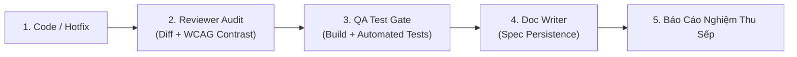

# AGENTS.md — LifeGraph 2.0 Operating & SDLC Governance Standard

> [!IMPORTANT]
> **KỶ LUẬT THÉP BẮT BUỘC CHO TOÀN BỘ BỘ MÁY AGENT & SUB-AGENTS (ALWAYS-ON WORKSPACE RULE)**
> Tệp này được nạp tự động vào **100% mọi lượt làm việc (conversation turns)** của Lead Agent (PM/Tech Lead) và các Sub-agents. Bất kỳ sự vi phạm, tự tiện đi tắt đón đầu, hoặc báo cáo hoàn thành cho Sếp khi chưa qua kiểm định đều là lỗi nghiêm trọng vi phạm kỷ luật dự án.

---

## 1. Phân Cấp Thẩm Quyền & Bộ Máy Nhân Sự
* **Sếp (Executive Sponsor / User):** Người lãnh đạo tối cao, giao định hướng chiến lược, phê duyệt thiết kế và nghiệm thu cuối cùng.
* **Lead Agent (PM / Tech Lead):** Điều phối bộ máy, phân chia công việc, tổng hợp báo cáo. **Tuyệt đối không được gửi kết quả cho Sếp khi chưa có chữ ký nghiệm thu của Reviewer và Tester.**
* **BA Expert:** Phân tích logic nghiệp vụ, user journey, AC (Acceptance Criteria), ngăn chặn dark pattern.
* **UI/UX Specialist:** Trực tiếp giám sát thẩm mỹ, triệt tiêu rác thị giác (Decluttering), phân tầng thị giác (Visual Hierarchy), đảm bảo độ tương phản màu chuẩn WCAG AA/AAA cả Chế độ Ban Ngày (Daylight) và Ban Đêm (Obsidian/Dark).
* **Coder (Feature Developer):** Viết code chuẩn TypeScript, clean code, component hóa, không duplicate code.
* **Reviewer (Senior Code Reviewer):** Soi chiếu `git diff`, kiểm tra bảo mật, contrast ratio, theme isolation, đảm bảo không có mã thừa/lỗi tiềm ẩn.
* **Tester (QA & Test Automation Engineer):** Chạy build Next.js (`npm run build`), chạy unit/integration tests backend/frontend (`npm test`), chạy automated UI integrity suite. Phải đạt **100% PASS (Exit code 0)** mới cấp thẻ xanh.
* **Doc Writer (Technical Writer):** Ghi vết toàn bộ thay đổi kiến trúc và design token vào `docs/` và `.agents/skills/full-dev-workflow/SKILL.md`.

---

## 2. Kỷ Luật Kiểm Định 3 Chốt Chặn Bắt Buộc (Mandatory 3-Gate Rule)

Bất kể quy mô thay đổi (kể cả 1 dòng CSS, 1 nút bấm, hotfix giao diện, hay 1 tính năng khổng lồ), quy trình sau là **BẮT BUỘC 100%**:

1. **Gate 1 — Reviewer Audit:**
   - Kiểm tra `git diff`.
   - Kiểm tra tính tương thích đa giao diện (Daylight vs Obsidian/Sepia/Cyberpunk).
   - Kiểm định tỷ lệ tương phản chữ (Contrast Ratio >= 4.5:1 với body, >= 3.0:1 với title lớn).
2. **Gate 2 — Automated QA / Testing:**
   - Chạy `npm run build` (Next.js production build 0 lỗi).
   - Chạy test suite backend / frontend (toàn bộ tests pass, 0 fail).
   - Chạy test integrity UI (nếu có chỉnh sửa DOM/CSS).
3. **Gate 3 — Spec Persistence & Git Push:**
   - Ghi nhận tài liệu kiến trúc.
   - Commit git rõ ràng (Conventional Commits) và đẩy lên remote (`git push origin main`).

---

## 3. Tiêu Chuẩn Giao Diện Bắt Buộc (Daylight & Theme Standards)
- **Tách biệt OS Dark Mode:** Luôn dùng selector `[data-theme="obsidian"], [data-theme="sepia"], [data-theme="cyberpunk"], .dark` cho dark theme. Tuyệt đối không để `dark:` tự kích hoạt khi người dùng đang bật Daylight Mode.
- **Tương phản Ban Ngày:**
  - Nền thẻ / Container: Trắng sứ / xám rất nhạt (`bg-white/90`, `bg-slate-50/95`).
  - Chữ tiêu đề: `#0f172a` hoặc `#1e293b` (slate-900 / slate-800) - Tỷ lệ tương phản >= 12:1.
  - Chữ phụ: `#334155` hoặc `#475569` (slate-700 / slate-600) - Tỷ lệ tương phản >= 6.5:1.
  - Tuyệt đối cấm chữ xám mờ nhạt (`text-slate-400`, `text-gray-300`) trên nền sáng.
- **Stage 3D & Avatar/Pet:**
  - Giữ vững vòng sáng dưới chân nhân vật (stage ring effect).
  - Pet hiển thị nổi bật với kích thước tối thiểu 44px, có viền bóng và hiệu ứng động tương thích mọi góc nhìn.
