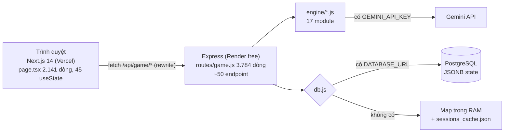
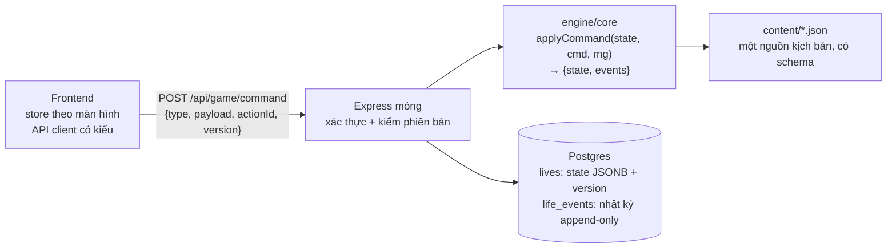

# LifeGraph 2.0 — Đánh Giá Kiến Trúc, Logic Game & Phương Án Đại Tu

> Ngày: 2026-11-12 · Mã nguồn tại commit `9c6c51c` (nhánh `claude/ecstatic-heisenberg-v43ggn`).
> Trạng thái: **đề xuất, chưa triển khai**. Bổ sung cho `docs/game-experience-spec.md` (tài liệu đó lo phần trải nghiệm người chơi; tài liệu này lo phần móng kỹ thuật và luật chơi).

## 0. Cơ sở đánh giá và giới hạn

- **Đã làm:** đọc code backend (`index.js`, `db/db.js`, `routes/game.js`, `middleware/sessionMutations.js`, `security/securityEngine.js`, các engine chính), `frontend/app/layout.tsx`, `page.tsx`, `render.yaml`, `.gitignore`; đếm số liệu bằng grep; chạy `npm test` backend: **39/39 pass**.
- **Chưa làm:** chưa xem biến môi trường thật trên Render/Vercel, chưa đo cân bằng kinh tế bằng mô phỏng, chưa chạy build frontend trong đợt này (không đổi code).
- Mục nào phụ thuộc cấu hình production sẽ ghi rõ **"cần xác nhận"**.

## 1. Tóm tắt cho Sếp

1. **Game có nội dung và ý tưởng tốt, nhưng móng kỹ thuật đang là bản prototype phình to.** Luật chơi nằm rải trong một file route 3.784 dòng, không có lõi luật thống nhất.
2. **Có 3 rủi ro cần xử lý trước mọi tính năng mới:** mất dữ liệu người chơi, chiếm phiên chơi của người khác, và dữ liệu phiên chơi đang bị commit vào git.
3. **Không nên viết lại từ đầu.** Nên đại tu kiểu "thay ruột dần" (strangler): dựng một lõi luật chơi thuần, có seed ngẫu nhiên, rồi chuyển từng hành động sang lõi mới. Người chơi không bị gián đoạn.
4. **Về luật chơi:** quá nhiều hệ thống và loại "tiền" song song. Nên gom lại còn 4 chỉ số lõi + 1 tiền tệ meta, và lấy "một lựa chọn khó mỗi năm" làm trọng tâm.

## 2. Kiến trúc hiện tại

| Lớp | Hiện trạng | Đánh giá |
|---|---|---|
| Frontend | Next.js 14, React 18, three.js. `page.tsx` 2.141 dòng, 45 `useState`. 3 component trên 2.100 dòng (`DynamicLifeTree` 3.616, `Dynamic3DAvatar` 2.207, `InteractiveScene2D` 2.178). Không có script test frontend. | Đẹp nhưng khó bảo trì; mọi trạng thái game dồn vào một trang. |
| Giao tiếp | `layout.tsx` ghi đè `window.fetch` toàn cục để gắn `x-session-id` / `x-session-token`. Không có kiểu dữ liệu API dùng chung. | Dễ vỡ ngầm; frontend và backend có thể lệch định dạng mà không ai báo. |
| API | ~50 endpoint, mỗi hành động một endpoint (`/action/overtime`, `/action/gamble`, `/pets/buy`…). Có middleware tuần tự hoá thao tác theo phiên và chống gửi trùng (`x-action-id`) — **điểm tốt**. | Luật chơi viết thẳng trong handler: **204 chỗ** sửa trực tiếp `cash/vitality/karma/burnout`. |
| Lõi luật | 17 engine module; `tickEngine` xử lý pha thụ động cuối năm. **61 lần gọi `Math.random()`** rải khắp route và engine. | Không tái lập được ván chơi, khó test cân bằng, không làm được tính năng "Nếu như…". |
| Nội dung | 6 content pack JSON có `schema.json` + `validator.js` (**điểm tốt**), nhưng `scenarioBank.js` 1.813 dòng kịch bản viết cứng trong JS, cộng bộ sinh thủ tục. | Hai nguồn sự thật cho kịch bản. |
| Lưu trữ | 2 chế độ: Postgres (JSONB) hoặc Map trong RAM ghi ra `backend/data/sessions_cache.json`. Không có transaction (0 `BEGIN`). | Xem rủi ro C1, H3. |
| Bảo mật | Header bảo mật, rate limit 120/phút, HMAC token, giới hạn body 200 KB. | Có khung, nhưng có lỗ hổng gốc (C2). |

## 3. Phát hiện theo mức độ

### Nghiêm trọng (làm trước mọi việc khác)

**C1 — Nguy cơ mất toàn bộ tiến trình người chơi (cần xác nhận).**
`render.yaml` không khai báo `DATABASE_URL`. Nếu trên Render cũng không đặt biến này, backend chạy chế độ RAM + file `sessions_cache.json` trên ổ đĩa tạm của gói free. Ổ đĩa đó bị xoá khi deploy lại hoặc khi máy khởi động lại, nên toàn bộ kiếp sống, gia phả, Karma của người chơi mất theo.
→ Cần Sếp kiểm tra Render dashboard: có `DATABASE_URL` chưa.

**C2 — Ai biết mã phiên là chiếm được phiên chơi.**
`index.js` nhận mã phiên thô (`x-session-id`) **không cần chữ ký**, rồi còn ký trả lại token hợp lệ. Như vậy chữ ký HMAC không bảo vệ gì. Mã phiên do trình duyệt tự sinh bằng `Math.random` (không phải nguồn ngẫu nhiên an toàn). Ngoài ra khoá ký có giá trị mặc định viết cứng trong code (`securityEngine.js:4`) và `render.yaml` không đặt `SESSION_SECRET`, nên ai đọc repo cũng tự ký được token.

**C3 — Dữ liệu phiên chơi bị commit vào git.**
`backend/data/sessions_cache.json` (23 phiên, ~48.000 dòng) đang được git theo dõi và bị đóng gói lên server. Cùng đợt: `tools/cloudflared.exe` (file nhị phân) cũng nằm trong git.

### Cao

**H1 — Luật chơi rải rác, không có lõi thống nhất.** Mỗi endpoint tự cộng trừ chỉ số, tự kẹp giới hạn theo kiểu riêng (ví dụ nhánh SPECTRUM kẹp sinh lực tối thiểu 10, chỗ khác kẹp 0). Muốn chỉnh cân bằng phải sửa nhiều chỗ; khó viết test cho luật.

**H2 — Không tái lập được.** 61 lời gọi `Math.random()` không có seed. Hệ quả: không replay được lỗi người chơi báo, không chạy được mô phỏng cân bằng ổn định, và **không làm được Ý tưởng 2 "Nếu như…"** trong `game-experience-spec.md` (cần chạy lại cùng đời với một lựa chọn khác).

**H3 — Chỉ chạy được một tiến trình.** Hàng đợi thao tác theo phiên, rate limit và session đều nằm trong RAM. Nhánh Postgres đọc-sửa-ghi nhiều câu lệnh mà không có transaction hay kiểm tra phiên bản, nên hai request đồng thời (hai tab) có thể ghi đè nhau khi chạy nhiều instance.

**H4 — Kết quả minigame do client tự khai.** `/action/minigame-result` tin `outcome: "success"` từ trình duyệt. Hiện là game đơn nên ảnh hưởng nhỏ, nhưng sẽ thành lỗ hổng ngay khi có gia phả liên người chơi hoặc bảng xếp hạng.

### Trung bình

- **M1:** `page.tsx` giữ toàn bộ trạng thái game bằng 45 `useState`; mọi thay đổi màn hình đều đụng file này.
- **M2:** Không có kiểu dữ liệu API dùng chung giữa frontend (TypeScript) và backend (JS thuần).
- **M3:** Frontend chưa có test tự động ngoài bộ `ui_audit` (Playwright) và các script `.mjs` ở gốc repo.
- **M4:** Hai nguồn kịch bản (JSON pack và `scenarioBank.js`); trong 6 pack mỗi kiểu tương tác (`CRAFT`, `DIPLOMACY`, `NEGOTIATION`…) chỉ xuất hiện 1 lần, nên schema có nhưng chưa được khai thác.

### Điểm tốt nên giữ

Middleware tuần tự hoá + chống gửi trùng; validator content pack; `delayed_flags` (hệ quả trễ); chống lặp bằng cosine similarity; bộ test backend 39 ca; bộ mô phỏng sẵn có (`test_1000_users_simulation.mjs`, `tools/simulate_*`).

## 4. Đánh giá logic game

### 4.1 Vòng lặp hiện tại

Mỗi năm: nhận AP (mặc định 3, cộng thêm theo gen) → tiêu AP vào hành động hoặc kịch bản → "sang năm" chạy pha thụ động (`processPassivePhase`: lão hoá, thu chi, sự kiện) → kiểm tra chết (`evaluateReaperRoll`) → lặp lại. Chết thì nhận Karma, tái sinh hoặc nối dõi.

### 4.2 Vấn đề

1. **Quá nhiều hệ thống song song.** Đếm được: AP, Karma (trong kiếp và meta), cash, family endowment, vitality/max vitality, burnout, RPG EXP, kỹ năng (2 hệ: `skills` và `unlocked_skills`/`rpg_skills`), thú cưng, tài sản, nhà ở, khát vọng (aspiration), đột phá (breakthrough), tâm nguyện cuối năm, chúc phúc, siêu nhân hoá, 8 minigame, thời tiết MMO, đồng bộ thế giới thật. Người chơi mới không thể nắm hết. `game-experience-spec.md` đã chấm "Dễ hiểu 30 giây đầu" 4/10, khớp với đây.
2. **Lựa chọn thiên về tối ưu số hơn là đánh đổi.** Nhiều hành động là "+X chỉ số, −Y chỉ số" có lời rõ ràng; ít lựa chọn mà mọi phương án đều mất một thứ quan trọng.
3. **Cái chết có 2 đường, cả hai đều thô.** (a) Sinh lực về 0 ở bất kỳ tuổi nào (`tickEngine.js` ~dòng 559). (b) `evaluateReaperRoll`: trước 70 tuổi không gây chết, sau đó là bảng xác suất cố định theo tuổi, lối sống chỉ tác động qua ngưỡng sinh lực dưới 25 (+20%). Nguy cơ là "sống tốt" và "sống ẩu" kết thúc giống nhau nếu sinh lực không chạm 0. **Chưa đo tần suất từng nguyên nhân chết**; GĐ1 sẽ đo bằng mô phỏng.
4. **Cân bằng kinh tế chưa được kiểm chứng.** Pha thụ động có ít nhất 9 nguồn cộng tiền (cổ tức, tâm nguyện, thú cưng, kỹ năng…). Chưa có mô phỏng cho thấy đường tiền theo tuổi. **Cần đo trước khi kết luận** (xem Giai đoạn 1).

### 4.3 Định hướng luật chơi mới (đề xuất)

| Thành phần | Đề xuất |
|---|---|
| Chỉ số lõi | **4:** Sức Khoẻ, Tài Chính, Gắn Kết (quan hệ), Tâm An (thay burnout, đảo chiều cho dễ hiểu). Các thứ khác là nguồn tác động lên 4 chỉ số này, không phải thanh riêng. |
| Tiền tệ meta | **1:** Phúc Đức (gộp Karma meta). Dùng để mở gen/đặc ân cho kiếp sau. |
| Nhịp mỗi năm | 1 **Khoảnh Khắc** (lựa chọn khó, có hệ quả trễ) + AP cho hành động thường. Khoảnh khắc là trọng tâm màn hình. |
| Hệ quả | Mở rộng `delayed_flags` thành "hạt giống": lựa chọn hôm nay nở thành sự kiện 3–20 năm sau, có báo lại người chơi đã gieo gì. |
| Cái chết | Xác suất theo **tuổi × lối sống** (sức khoẻ tích luỹ, tâm an, tai nạn theo hành động rủi ro), để mỗi đời kết thúc khác nhau và có lý do. |
| Hệ thống phụ | Thú cưng, minigame, đột phá, siêu nhân hoá giữ lại nhưng mở khoá dần theo tuổi hoặc kiếp; không hiện cùng lúc. Chờ Sếp chọn hệ thống nào bỏ hẳn (mục 7). |

## 5. Các phương án đại tu

| Phương án | Mô tả | Ưu | Nhược | Khuyến nghị |
|---|---|---|---|---|
| A. Vá tại chỗ | Sửa C1–C3, tách vài file lớn, giữ cấu trúc | Nhanh, ít rủi ro | Không giải quyết H1, H2; tính năng mới vẫn khó | Chỉ làm phần an toàn (Giai đoạn 0) |
| B. Viết lại toàn bộ | Dựng mới frontend + backend | Sạch | Mất 2–3 tháng không có tính năng mới, rủi ro mất nội dung và cảm giác game hiện có | Không nên |
| **C. Thay ruột dần (strangler)** | Dựng lõi luật thuần có seed, chuyển từng hành động sang; endpoint cũ thành lớp chuyển tiếp | Game vẫn chạy suốt quá trình; mỗi bước có test; mở đường cho "Nếu như…" và gia phả chung | Tốn công hơn A; giai đoạn giữa có hai đường code song song | **Nên chọn** |

### 5.1 Kiến trúc đích (phương án C)

1. **Lõi luật thuần:** `applyCommand(state, command, rng)` không đọc DB, không gọi mạng, không dùng `Math.random`. Mọi luật cộng trừ chỉ số đi qua một chỗ, có hàm kẹp giới hạn chung.
2. **Ngẫu nhiên có seed:** seed lưu trong state của kiếp. Cùng seed + cùng chuỗi lệnh = cùng kết quả. Đây là nền cho replay lỗi, mô phỏng cân bằng, và "Nếu như…".
3. **Nhật ký sự kiện:** lưu mỗi lệnh vào bảng `life_events`. Tua lại cuộc đời, video tổng kết và "Nếu như…" đều đọc từ đây.
4. **Một endpoint lệnh** + `version` để chống ghi đè (optimistic concurrency), thay cho hàng đợi trong RAM. Endpoint cũ giữ lại, chỉ chuyển lệnh sang lõi mới cho tới khi frontend chuyển xong.
5. **Phiên chơi:** server sinh mã bằng `crypto.randomUUID()`, chỉ chấp nhận token có chữ ký; `SESSION_SECRET` bắt buộc ở production (thiếu thì không khởi động). Có đường nâng cấp sang tài khoản thật sau.
6. **Kiểu dùng chung:** thư mục `shared/` chứa định nghĩa lệnh và state (TypeScript hoặc JSDoc), frontend và backend cùng dùng.
7. **Frontend:** tách `page.tsx` thành các màn (Trang chủ, Năm hiện tại, Tổng kết, Gia phả) với một store chung; bỏ việc ghi đè `window.fetch` toàn cục, thay bằng API client.

## 6. Lộ trình đề xuất

Cỡ theo bảng 2b trong `AGENTS.md`. Gate 2 (build + test 100% pass) áp dụng ở mọi giai đoạn.

| GĐ | Nội dung | Cỡ | Tiêu chí nghiệm thu |
|---|---|---|---|
| **0. An toàn** | Xác nhận/đặt `DATABASE_URL`, `SESSION_SECRET` trên Render; bỏ chấp nhận mã phiên thô (có lộ trình chuyển cho người chơi hiện tại); bỏ khoá mặc định; gỡ `sessions_cache.json` và `cloudflared.exe` khỏi git + thêm vào `.gitignore` | S | Test mới: request với mã phiên thô bị từ chối; server không khởi động khi thiếu secret ở production; deploy lại không mất tiến trình |
| **1. Đo trước khi sửa** | RNG có seed (`createRng(seed)`), thay dần `Math.random`; viết **test hồi quy vàng**: chạy 50 đời với seed cố định, chụp kết quả; mô phỏng 1.000 đời, xuất đường tiền/sinh lực/tuổi chết | M | Cùng seed chạy 2 lần ra kết quả giống hệt; có báo cáo cân bằng trong `docs/` |
| **2. Lõi luật** | Tạo `engine/core`; chuyển lần lượt: sang năm → hành động thường → kịch bản → minigame (chuyển phán quyết thắng/thua về server, client chỉ gửi thao tác); `game.js` mỏng dần | L | Test vàng GĐ1 vẫn pass sau mỗi bước (trừ thay đổi có chủ đích, ghi rõ); số chỗ sửa chỉ số trong route giảm từ 204 về 0 |
| **3. Luật chơi mới** | 4 chỉ số lõi, 1 tiền tệ meta, "Khoảnh Khắc" mỗi năm, cái chết theo lối sống; gộp `scenarioBank.js` vào JSON pack | L | Sếp duyệt bảng cân bằng; playtest 5 người mới: hiểu luật trong 1 phút |
| **4. Frontend** | Store + API client có kiểu; tách `page.tsx`; lưu trạng thái giao diện theo màn | M | `page.tsx` < 400 dòng; `npm run build` + `ui_audit` pass 4 theme × 4 viewport |
| **5. Tính năng đột phá** | Xây trên lõi mới: "Nếu như…" (đọc nhật ký + seed), Hồ Sơ Đời chia sẻ, Gia Phả liên người chơi (cần GĐ0 + chống gian lận GĐ2) | L | Theo `game-experience-spec.md` |

Thứ tự bắt buộc: **0 → 1 → 2**. Giai đoạn 3 và 4 có thể chạy song song sau khi xong 2. Giai đoạn 0 nên làm ngay, không phụ thuộc quyết định đại tu.

## 7. Cần Sếp quyết định

1. **Chọn phương án:** C (khuyến nghị), A, hay khác?
2. **Kiểm tra Render:** đã có `DATABASE_URL` và `SESSION_SECRET` chưa? (Em không xem được dashboard.)
3. **Người chơi hiện tại:** khi siết xác thực phiên (GĐ0), giữ tiến trình cũ bằng cách chuyển đổi một lần, hay chấp nhận reset?
4. **Gọn hệ thống (GĐ3):** trong thú cưng, siêu nhân hoá, đột phá, thời tiết MMO, đồng bộ thế giới thật, minigame — hệ thống nào bỏ, hệ thống nào chỉ mở khoá muộn?
5. **Có cần tài khoản thật (đăng nhập)** trước khi làm Gia Phả liên người chơi không?

## 8. Kiểm định khi triển khai

Theo `AGENTS.md` mục 2, 2b, 2c: viết test tái hiện trước khi sửa lỗi (đặc biệt C2), refactor phải giữ test vàng pass trước và sau, mỗi giai đoạn qua Reviewer → Tester → Doc Writer trước khi báo Sếp.
