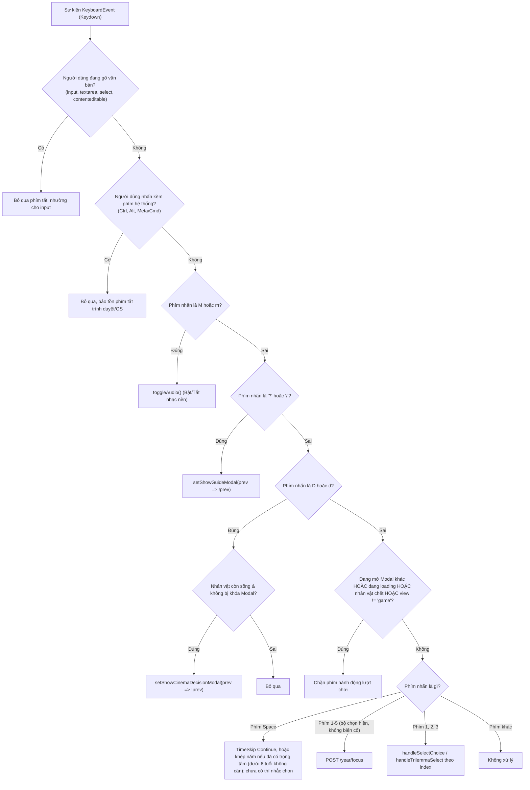
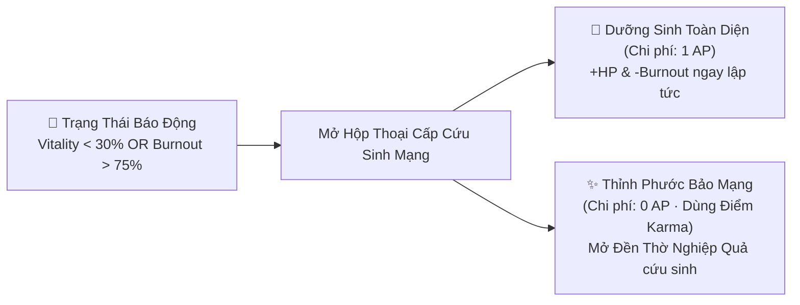

# ⌨️ Hệ Thống Phím Tắt Toàn Cục & HUD Điều Khiển (Global Keyboard Controls & Command HUD)

Tài liệu kỹ thuật và hướng dẫn người dùng chi tiết về hệ thống phím tắt toàn cục (**Global Keyboard Hotkeys**), **Thanh Điều Khiển Trung Tâm (CommandBarHUD)** và **Trung Tâm Cấp Cứu Khẩn Cấp (Emergency Rescue SOS)** trong LifeGraph RPG.

---

## 1. Tổng Quan Kiến Trúc (Architecture Overview)

Trong các tựa game mô phỏng cuộc đời dạng lượt (Turn-based Life Simulation), việc liên tục phải di chuột và nhấp vào từng lựa chọn làm giảm tính nhập vai và nhịp điệu cốt truyện. Nhằm tạo nên trải nghiệm điều khiển "mượt như phim điện ảnh", LifeGraph tích hợp bộ phím tắt toàn cục cấp độ hệ thống (`window.addEventListener('keydown')`) với 3 nguyên tắc cốt lõi:

1. **Không ma sát (Zero Friction):** Điều khiển toàn bộ vòng lặp kiếp sống — từ việc bước sang năm mới, lựa chọn ngã rẽ cuộc đời, mở phòng điện ảnh 21:9 đến bật tắt âm nhạc — chỉ bằng bàn phím.
2. **Cách ly nhập liệu an toàn (Safe Input Isolation):** Tuyệt đối không can thiệp hay cản trở việc gõ văn bản của người chơi trong các ô thoại, chatbox NPC, form đặt tên hay các tổ hợp phím hệ thống của trình duyệt (`Ctrl`, `Alt`, `Meta`).
3. **Phản hồi trực quan tức thời (Visual Affordance):** Mọi phím tắt đều được gắn nhãn `<kbd>` nổi bật ngay trên card tương tác và thanh HUD trung tâm.

---

## 2. Bảng Tra Cứu Phím Tắt Toàn Cục (Hotkey Matrix)

| Phím | Tên Thao Tác | Phân Loại | Ngữ Cảnh Hoạt Động | Điều Kiện Ràng Buộc | Mã Màu Ký Hiệu |
| :---: | :--- | :--- | :--- | :--- | :--- |
| <kbd>Space</kbd> | **Khép Năm / Tiếp Tục** | Tiến Trình | Buồng Lái Kiếp Sống (`activeView === 'game'`) | Nhân vật còn sống, không có modal che phủ, không gõ phím. Từ 6 tuổi chỉ khép năm khi đã chọn trọng tâm năm; chưa chọn thì Space chỉ nhắc và đưa tiêu điểm về bộ chọn | Xanh ngọc lục bảo (`emerald`) |
| <kbd>1</kbd>–<kbd>5</kbd> | **Chọn Trọng Tâm Năm** | Nhịp Năm | Buồng Lái Kiếp Sống, bộ chọn trọng tâm đang hiện | Từ 6 tuổi, chưa chọn trọng tâm, không có biến cố chờ (1 Sự nghiệp, 2 Gia đình, 3 Sức khỏe, 4 Học hỏi, 5 Trải nghiệm). Khi có biến cố thì 1–3 chọn phương án | Vàng hổ phách (`amber`) |
| <kbd>1</kbd> | **Chọn Lựa Chọn 1** | Quyết Định | Ngã rẽ / Đối thoại / Tam giác / Mind Stage 21:9 | Có biến cố đang chờ lựa chọn phương án | Vàng hổ phách (`amber`) |
| <kbd>2</kbd> | **Chọn Lựa Chọn 2** | Quyết Định | Ngã rẽ / Đối thoại / Tam giác / Mind Stage 21:9 | Có biến cố đang chờ lựa chọn phương án | Vàng hổ phách (`amber`) |
| <kbd>3</kbd> | **Chọn Lựa Chọn 3** | Quyết Định | Tam giác nghịch lý / Mind Stage 21:9 | Có ít nhất 3 lựa chọn khả dụng | Vàng hổ phách (`amber`) |
| <kbd>D</kbd> | **Phòng Quyết Định 21:9** | Trải Nghiệm | Buồng Lái Kiếp Sống | Nhân vật còn sống, không trong các modal quan trọng | Tím hoàng gia (`purple`) |
| <kbd>M</kbd> | **Bật/Tắt Âm Thanh / Mở Mind Stage** | Tiện Ích / Nhập Vai | Toàn cầu (Cockpit) / Phòng Điện Ảnh 21:9 | Nhấn ở Cockpit = Mute; Nhấn trong Phòng 21:9 = Mở Mind Stage | Xanh lơ / Tím (`cyan / purple`) |
| <kbd>J</kbd> | **Mở Sổ Tay Manh Mối (Journal)** | Nhập Vai | Phòng Quyết Định 21:9 | Đang ở chế độ xem rạp chiếu 21:9 | Hổ phách (`amber`) |
| <kbd>Esc</kbd> | **Đóng Bảng / Về Buồng Lái** | Điều Hướng | Phòng Quyết Định 21:9 | Đóng Mind Stage/Journal hoặc thoát về Cockpit | Xám thép (`slate`) |
| <kbd>A / D</kbd> | **Di Chuyển Nhân Vật 3D** | Tương Tác | Phòng Quyết Định 21:9 | Bước đi trên sàn tương tác 3D | Xanh ngọc (`emerald`) |
| <kbd>?</kbd> hoặc <kbd>/</kbd> | **Mở Sổ Tay & Phím Tắt** | Trợ Giúp | Toàn cầu (Bất kỳ màn hình nào) | Không gõ phím | Tím chàm (`indigo`) |

---

## 3. Sơ Đồ Xử Lý Sự Kiện Phím Bấm (Keydown Event Flowchart)

Biểu đồ dưới đây mô tả chuỗi lọc an toàn (Security Filter Pipeline) khi sự kiện `keydown` được kích hoạt trên cửa sổ trình duyệt:



---

## 4. Thanh Điều Khiển Trung Tâm (CommandBarHUD)

> **Đã gỡ (2026-11-12):** component này không còn được render trong ứng dụng và đã bị xoá khỏi mã nguồn; mô tả dưới đây chỉ còn giá trị lịch sử. Phím tắt hiện nằm ở `KeyboardShortcutsModal`, thông báo ở `UnifiedNotificationCenter`, thiết lập ở `SystemSettingsPopover`.

Thanh công cụ `CommandBarHUD` được ghim cố định ở vị trí `sticky top-[53px]` ngay dưới thanh điều hướng chính, chia làm 3 phân khu rõ rệt:

```text
┌───────────────────────────────────────────────────────────────────────────────────────────────────┐
│ [👁️ Chế Độ Xem Nhanh]  [🎬 Phòng Điện Ảnh D]  │  [⌨️ Phím Tắt: [1-5] | [Space] khép năm ?]  │  [🚨 CẤP CỨU KHẨN CẤP HP 24%] │
│          (Vùng Trái - Góc Nhìn)                │          (Vùng Giữa - Phím Tắt)       │         (Vùng Phải - Cứu Nguy)         │
└───────────────────────────────────────────────────────────────────────────────────────────────────┘
```

### 4.1. Vùng Trái — Điều Hướng Nhanh & Điện Ảnh
- **Nút Chế Độ Xem Nhanh (`onToggleQuickView`):**
  - Chuyển tức thì giữa **Buồng Lái Kiếp Sống (RPG View)** và **Trang Chủ Gia Phả Tiền Nhân (Family Lineage Portal)** mà không cần điều hướng qua menu phức tạp.
- **Nút Phòng Điện Ảnh 21:9 (`onOpenCinema`):**
  - Kèm badge huy hiệu phím nóng <kbd>D</kbd>.
  - Mở không gian toàn cảnh rạp chiếu bóng tỷ lệ 21:9 giúp người chơi tập trung tối đa vào bối cảnh kịch tính của ngã rẽ cuộc đời.

### 4.2. Vùng Giữa — Cụm Phím Tắt Nóng (Hotkey Affordance Hub)
- Tích hợp sẵn các huy hiệu phím <kbd>1</kbd>–<kbd>5</kbd>, <kbd>Space</kbd> (khép năm) và <kbd>?</kbd>.
- Khi người dùng nhấp vào cụm này, hệ thống mở modal `KeyboardShortcutsModal` liệt kê đầy đủ hướng dẫn tra cứu phím tắt.

### 4.3. Vùng Phải — Nút Cấp Cứu Khẩn Cấp (Emergency Rescue SOS)
- Chỉ xuất hiện khi:
  $$\text{Vitality} < 30 \quad \text{HOẶC} \quad \text{Burnout} > 75$$
- Hiển thị hiệu ứng nhịp tim đập `animate-pulse`, viền phát sáng màu đỏ rực `border-rose-400`, và badge số liệu nguy kịch (ví dụ: `HP 24%` hoặc `Burnout 88%`).
- Nhấp vào nút sẽ mở ngay `EmergencyRescueModal`.

---

## 5. Trung Tâm Cấp Cứu Khẩn Cấp (Emergency Rescue SOS)

Khi nhân vật rơi vào ranh giới giữa sự sống và cái chết, cơ chế cấp cứu cung cấp hai phương án can thiệp tức thì:



### Chi Tiết Hai Phương Án Cứu Mạng:
1. **Dưỡng Sinh Phục Hồi Toàn Diện (Wellness Recovery — 1 AP):**
   - Tiêu hao 1 Điểm Hành Động (`action_points`).
   - Phục hồi chỉ số Sinh Lực thể chất (+HP) và xoa dịu tổn thương tâm lý (giảm mạnh % Burnout) ngay trong năm hiện tại.
2. **Thỉnh Phước Bảo Mạng (Karma Sanctum Blessing — 0 AP):**
   - Dành riêng cho tình huống ngặt nghèo nhất: khi người chơi đã **hết sạch AP (0 AP)** và không thể tự dưỡng sinh.
   - Kết nối trực tiếp vào Đền Thờ Nghiệp Quả Tiền Kiếp để đổi điểm phúc đức tổ tiên lấy bùa hộ mệnh hoặc phước lành tái sinh bảo toàn mạng sống.

---

## 6. Trực Quan Hóa Phím Tắt Trên Các Thành Phần Giao Diện (UI Affordances)

Hệ thống phím tắt được nhúng trực tiếp vào các component giao diện thông qua thẻ `<kbd>` phong cách Monospace hiện đại:

### 6.1. Ngã Rẽ Cuộc Đời (EventCard), AP Trợ Lực & Thử Thách Xúc Xắc
- **Phím chọn phương án:** Các nút hành động được đánh số phím <kbd>1</kbd>, <kbd>2</kbd>, <kbd>3</kbd> ở góc trái cùng với nhãn phong thái nhập vai (Roleplay Stance).
- **Kết hợp chuột & phím với AP Trợ Lực (`+1 AP`):**
  - Người chơi có thể nhấp chuột vào nút `[+1 AP Trợ Lực]` trên bất kỳ phương án nào để đầu tư thêm điểm hành động, sau đó nhấn phím số <kbd>1</kbd>, <kbd>2</kbd>, <kbd>3</kbd> để kích hoạt phương án kèm điểm cộng hưởng.
- **Tương tác bàn phím với Cảnh Báo AP Dư (Smart Unspent AP Warning):**
  - Khi người chơi bấm phím số <kbd>1</kbd>, <kbd>2</kbd>, <kbd>3</kbd> mà nhân vật vẫn còn AP dư (`unspentAP > 0`), hệ thống sẽ dừng lại hiển thị Banner cảnh báo thông minh màu hổ phách để người chơi quyết định: quay lại dùng nốt AP hoặc bấm "Vẫn Chốt Năm" để chuyển hóa AP thành Máu (+2 HP & -5% Burnout per AP).
- **Màn hình Gieo Quẻ Xúc Xắc Số Phận (FateDiceCheck):**
  - Khi phương án được chọn có rủi ro (`risk >= 30%`) hoặc có AP trợ lực, hệ thống tự động mở màn hình gieo quẻ D20.
  - Người chơi có thể nhấn phím <kbd>Space</kbd> hoặc click **"Gieo Xúc Xắc D20"** để tung quẻ.
  - Huy hiệu `⚡ Trợ lực AP: +X điểm gieo quẻ` hiển thị nổi bật điểm cộng trực tiếp (+2 điểm/AP) giúp vượt qua DC Threshold dễ dàng.
  - Nhấn <kbd>Space</kbd> hoặc click **"Xác Nhận Kết Quả"** để hoàn tất lượt và chuyển tiếp kiếp sống.

### 6.2. Tam Giác Nghịch Lý (TrilemmaCard)
- 3 cột lựa chọn tương ứng với 3 phím <kbd>1</kbd>, <kbd>2</kbd>, <kbd>3</kbd> hiển thị nổi bật ở góc trên bên phải của từng thẻ lựa chọn.

### 6.3. Bỏ Qua Thời Gian & Tích Lũy (TimeSkipCard)
- Lựa chọn 1: Cày tiền & học tập gắn phím <kbd>1</kbd>.
- Lựa chọn 2: Nghỉ ngơi & gia đình gắn phím <kbd>2</kbd>.
- Nhấn phím <kbd>Space</kbd> để tiếp tục nhanh theo phương án tích lũy mặc định.

### 6.4. Đối Thoại NPC (NPCDialogCard)
- Các lựa chọn đối thoại và thương lượng với NPC được gắn phím <kbd>1</kbd>, <kbd>2</kbd>, <kbd>3</kbd> cho phép phản hồi thần tốc.

### 6.5. Điều Khiển Âm Thanh (AudioVolumeControl)

> **Đã gỡ (2026-11-12):** component này không còn được render trong ứng dụng và đã bị xoá khỏi mã nguồn; mô tả dưới đây chỉ còn giá trị lịch sử. Phím tắt hiện nằm ở `KeyboardShortcutsModal`, thông báo ở `UnifiedNotificationCenter`, thiết lập ở `SystemSettingsPopover`.
- Tooltip và nút nhạc nền hiển thị huy hiệu <kbd>M</kbd> nhắc nhở người chơi có thể tắt/bật âm thanh bất cứ lúc nào.

### 6.6. Phòng Quyết Định Điện Ảnh 21:9 (InteractiveScene2D)
Trong không gian điện ảnh toàn cảnh tỷ lệ 21:9, hệ thống kích hoạt bộ phím tắt chuyên sâu phục vụ tương tác 3D và đối thoại:
* **<kbd>M</kbd> — Mở Sân Khấu Tâm Thức (Mind Stage):** Bung mở giao diện lăng kính 3 Bản Ngã (Lý Trí, Trái Tim, Sinh Tồn) để lắng nghe lời khuyên nội tâm.
* **<kbd>J</kbd> — Mở Sổ Tay Manh Mối (Journal):** Xem danh sách manh mối và tri thức thu thập được từ các nhân vật trong cảnh.
* **<kbd>1</kbd>, <kbd>2</kbd>, <kbd>3</kbd> — Chọn Phương Án Ngã Rẽ:** Lựa chọn phương án hành động trực tiếp ngay trên Mind Stage mà không cần dùng chuột.
* **<kbd>Esc</kbd> — Thoát / Đóng Bảng:** Khi đang mở Mind Stage hoặc Sổ tay manh mối, nhấn <kbd>Esc</kbd> để đóng bảng; khi ở màn hình 21:9 chính, nhấn <kbd>Esc</kbd> để trở về Buồng Lái Kiếp Sống (Cockpit View).
* **<kbd>A</kbd> / <kbd>D</kbd> hoặc Phím Mũi Tên <kbd>←</kbd> / <kbd>→</kbd>:** Di chuyển nhân vật 3D trên sàn nhà để tiếp cận các quả cầu Hologram Hotspot.

---

## 7. Hướng Dẫn Mở Rộng Dành Cho Lập Trình Viên (Developer Guide)

Nếu bạn muốn bổ sung phím tắt mới vào LifeGraph, hãy làm theo các bước sau trong `frontend/app/page.tsx`:

### Bước 1: Kiểm Tra Trạng Thái Loại Trừ (Exclusion Checks)
Luôn đặt logic phím bấm sau hai bộ lọc an toàn đầu hàm:

```typescript
// 1. Kiểm tra không gõ văn bản
const target = e.target as HTMLElement | null;
if (target) {
  const tagName = target.tagName ? target.tagName.toLowerCase() : '';
  if (tagName === 'input' || tagName === 'textarea' || tagName === 'select' || target.isContentEditable) {
    return;
  }
}

// 2. Không can thiệp phím bổ trợ hệ thống
if (e.ctrlKey || e.metaKey || e.altKey) {
  return;
}
```

### Bước 2: Đăng Ký Phím Tắt Mới
Ví dụ: Thêm phím tắt <kbd>K</kbd> để mở nhanh Đền Thờ Nghiệp Quả Karma:

```typescript
if (key === 'k' || key === 'K') {
  if (character && !character.is_deceased && !hasBlockingModal) {
    e.preventDefault();
    setShowKarmaModal(prev => !prev);
    return;
  }
}
```

### Bước 3: Đồng Bộ Vào Modal và HUD
Cập nhật danh sách phím trong `frontend/app/components/KeyboardShortcutsModal.tsx` và `frontend/app/components/CommandBarHUD.tsx` để người chơi nắm được thông tin phím mới.

---

## 8. Danh Mục Kiểm Thử Hệ Thống Phím Tắt (Test Checklist)

| STT | Kịch Bản Kiểm Thử | Hành Động Thực Hiện | Kết Quả Kỳ Vọng | Trạng Thái |
| :---: | :--- | :--- | :--- | :---: |
| 1 | Bấm <kbd>Space</kbd> tại buồng lái | Nhấn Space khi có sự kiện bình thường | Năm tăng lên 1 tuổi, vòng lặp tiến triển | ✅ Đạt |
| 2 | Bấm <kbd>1</kbd>, <kbd>2</kbd>, <kbd>3</kbd> tại ngã rẽ | Nhấn số tương ứng | Chọn chính xác phương án ngã rẽ tương ứng | ✅ Đạt |
| 3 | Bấm <kbd>D</kbd> mở rạp chiếu 21:9 | Nhấn D khi đang chơi | Mở modal Cinema 21:9; nhấn lại đóng | ✅ Đạt |
| 4 | Bấm <kbd>M</kbd> tắt/bật nhạc | Nhấn M ở bất kỳ trang nào | Âm thanh chuyển đổi trạng thái Play/Pause | ✅ Đạt |
| 5 | Bấm <kbd>?</kbd> mở cẩm nang | Nhấn ? hoặc / | Modal Sổ tay sinh tồn hiển thị | ✅ Đạt |
| 6 | Nhập text trong ô chat NPC | Gõ chữ "1 2 3 space d m" vào input | Chữ xuất hiện trong input, không kích hoạt hotkey | ✅ Đạt |
| 7 | Nhấn <kbd>Ctrl+C</kbd> / <kbd>Alt+Tab</kbd> | Bấm phím kết hợp | Hệ điều hành xử lý bình thường, không bị chặn | ✅ Đạt |
| 8 | Báo động SOS khi HP < 30 | Đưa HP về 25% | Nút SOS Cấp Cứu hiển thị nhấp nháy trên HUD | ✅ Đạt |
| 9 | Bấm phím số <kbd>1, 2, 3</kbd> khi còn AP | Nhấn số lựa chọn khi AP > chi phí | Hiển thị Banner Smart Unspent AP Warning màu hổ phách | ✅ Đạt |
| 10 | Bấm <kbd>Space</kbd> tại màn hình xúc xắc D20 | Nhấn Space khi FateDiceCheck mở | Lắc xúc xắc D20 và cộng dồn điểm AP Trợ Lực (+2/AP) | ✅ Đạt |
| 11 | Bấm <kbd>M</kbd> trong Phòng Điện Ảnh 21:9 | Nhấn M khi đang ở màn hình 21:9 | Mở Sân Khấu Tâm Thức (Mind Stage) lăng kính 3 Bản Ngã | ✅ Đạt |
| 12 | Bấm <kbd>J</kbd> trong Phòng Điện Ảnh 21:9 | Nhấn J khi đang ở màn hình 21:9 | Bật/tắt Sổ tay manh mối (Journal) | ✅ Đạt |
| 13 | Bấm <kbd>1, 2, 3</kbd> trong Mind Stage 21:9 | Nhấn số khi Mind Stage mở | Chọn phương án ngã rẽ tương ứng | ✅ Đạt |
| 14 | Bấm <kbd>Esc</kbd> trong Phòng Điện Ảnh 21:9 | Nhấn Esc khi mở bảng hoặc cảnh chính | Đóng bảng hoặc trở về Buồng Lái Kiếp Sống | ✅ Đạt |
