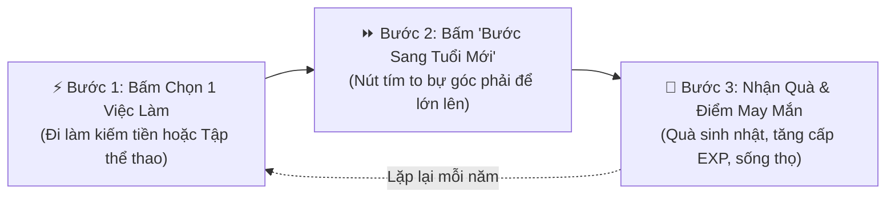
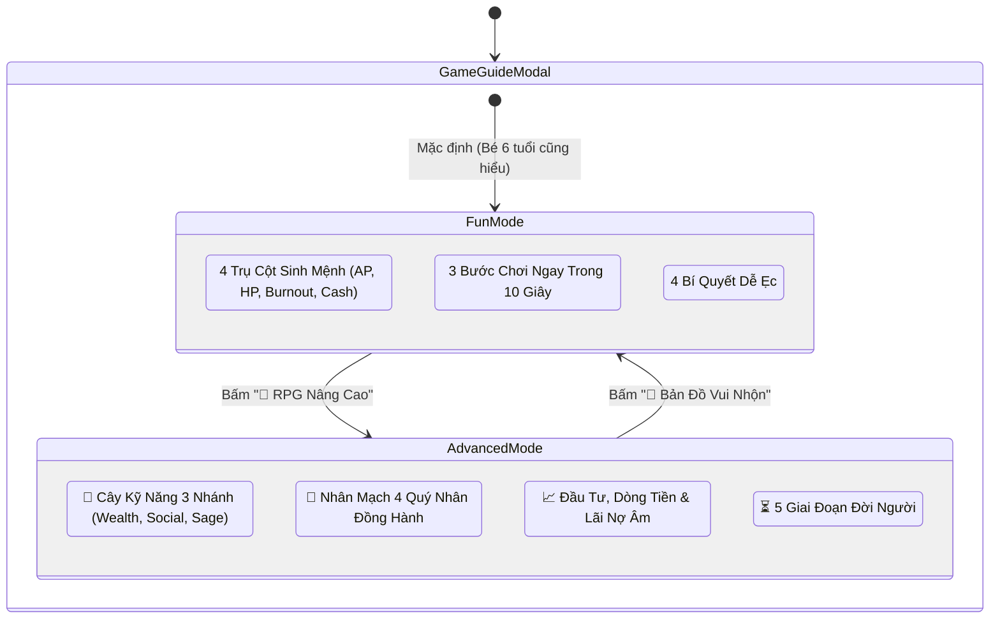
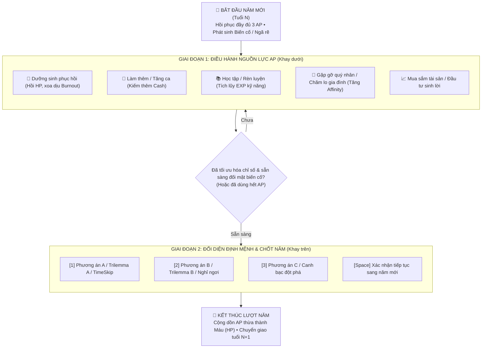
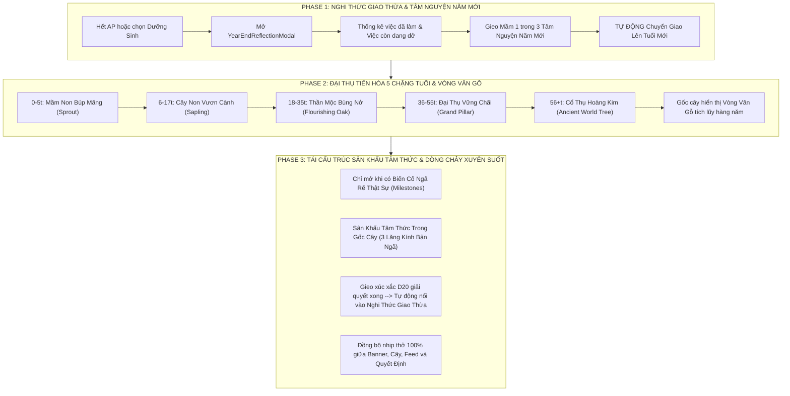

# LifeGraph — Quy Chuẩn Thiết Kế Giao Diện & Trải Nghiệm Người Dùng (UI/UX Standards v2.0)

> **Tài liệu quy chuẩn sản phẩm áp dụng cho trò chơi mô phỏng cuộc đời LifeGraph RPG.**  
> Mục tiêu cốt lõi: Đảm bảo tính nhất quán thẩm mỹ, khả năng tiếp cận toàn diện (Accessibility), phản hồi trực giác tức thời và khả năng thân thiện tối đa với mọi đối tượng người chơi — từ trẻ nhỏ 6 tuổi đến game thủ hardcore RPG.

---

## 1. Triết Lý Thiết Kế Trực Quan Hóa (Visual-First & Kid-Friendly Standard)

Giao diện của LifeGraph được xây dựng trên tôn chỉ **"Giảm tối đa gánh nặng đọc hiểu (Zero-Reading Friction)"**. Người chơi mới hoặc trẻ em có thể nắm bắt trạng thái cuộc sống chỉ trong 3 giây thông qua màu sắc, biểu tượng cảm xúc (Emoji/Icons) và đồ họa trực giác.

### 1.1. Chuẩn Hóa 4 Trụ Cột Sinh Mệnh (The 4 Life Pillars)

Mọi biến số trong game được quy về **4 Đồ chơi Sinh mệnh cốt lõi**. Mỗi trụ cột bắt buộc tuân theo bảng chuẩn màu sắc, biểu tượng và ngữ nghĩa sau:

| Trụ Cột Sinh Mệnh | Biểu Tượng | Thang Màu Chủ Đạo | Giới Hạn & Ngưỡng An Toàn | Ý Nghĩa Trực Quan (Ngôn ngữ Trẻ Em) | Hành Động Điều Chỉnh Tương Ứng |
| :--- | :---: | :--- | :--- | :--- | :--- |
| **Tia Sét Năng Lượng (AP)** | ⚡ | **Amber (Vàng hổ phách)**<br>`from-amber-950/30`<br>`border-amber-500/40` | 3 – 5 AP/năm.<br>Hết điểm = Hết lượt hành động | *Tia sét sức lực*: Dùng để làm việc, đi chơi, khám bệnh. Thừa sét cuối năm tự biến thành máu! | Đi làm, học tập, dưỡng sinh, giao lưu bạn bè |
| **Trái Tim Khỏe Mạnh (HP)** | ❤️ | **Rose (Hồng ngọc / Đỏ)**<br>`from-rose-950/30`<br>`border-rose-500/40` | 0 – 100%.<br>**Báo động khi < 30%**.<br>Về 0% = Tử vong ngay | *Trái tim đập thình thịch*: Hết tim là ngủm! Nhớ ăn ngon ngủ kỹ và đi bác sĩ kịp thời. | Khám bệnh, nâng cấp nhà ở, nghỉ dưỡng, thể thao |
| **Ngọn Lửa Áp Lực (Burnout)** | 💥 / 🔥 | **Orange (Cam rực lửa)**<br>`from-orange-950/30`<br>`border-orange-500/40` | 0 – 100%.<br>**Báo động khi > 75%**.<br>> 80% = Bắt đầu trừ máu trần | *Ngọn lửa mệt mỏi*: Lửa bốc cao quá là kiệt sức xỉu liền! Cần uống cà phê, thư giãn để dập lửa. | Nghỉ ngơi, du lịch, giảm bớt việc làm thêm |
| **Túi Tiền Tiết Kiệm (Cash)** | 💰 | **Emerald (Xanh lục bảo)**<br>`from-emerald-950/30`<br>`border-emerald-500/40` | $ USD.<br>Âm tiền = Phạt lãi nợ 4.5%/năm & +25% Stress | *Túi tiền đồ chơi*: Đi làm gom tiền mua nhà to, mua đồ chơi và chăm sóc ba mẹ. | Cày việc, đầu tư BĐS/cổ phiếu, tối ưu chi phí |

> [!IMPORTANT]
> **Quy Tắc Nhất Quán Trụ Cột (Pillar Consistency Rule):**
> * Tuyệt đối không hoán đổi màu sắc giữa 4 trụ cột (ví dụ: không dùng màu đỏ cho Năng Lượng hay màu vàng cho Máu).
> * Khi chỉ số ở trạng thái nguy hiểm (Máu < 30% hoặc Lửa > 75%), luôn kích hoạt hiệu ứng đập nhịp tim (`animate-pulse` hoặc `animate-bounce`) để thu hút sự chú ý của người chơi.

---

### 1.2. Chuẩn Hóa Vòng Lặp "3 Bước Chơi Ngay Trong 10 Giây" (3-Step Micro-Loop)

Mọi hướng dẫn người mới đều phải quy về vòng lặp hành vi đơn giản nhất:



* **Thiết kế Micro-card 3 bước:**
  * Mỗi bước đặt trong khung thẻ bo góc `rounded-2xl` với biểu tượng kích thước lớn (40x40px).
  * Sử dụng nhãn định danh ngắn: `BƯỚC 1`, `BƯỚC 2`, `BƯỚC 3` bằng font monospace in đậm kèm màu sắc phân biệt (Amber ➔ Purple ➔ Emerald).
  * Lời giải thích dưới 15 chữ, tập trung vào nút bấm cụ thể người chơi cần nhấn.

---

### 1.3. Bộ Flashcard Mẹo Vàng Sinh Tồn (Pro-Tip Visual Flashcards)

Các bài học kinh nghiệm sinh tồn được trình bày theo dạng thẻ bỏ túi (Flashcard) trực quan với 4 biểu tượng cuộc sống:
1. 🏡 **Nâng Cấp Chỗ Ở:** Đổi phòng trọ lên chung cư/biệt thự để ngủ ngon và ít ốm vặt.
2. ☕ **Thư Giãn Đúng Lúc:** Thấy ngọn lửa đỏ > 80% là phải dừng cày cuốc, đi dưỡng sinh ngay.
3. 🤝 **Kết Thân Bạn Bè:** Tương tác với người thân và quý nhân để được cứu nguy khi hoạn nạn.
4. 👶 **Sinh Con Nối Dõi:** Sinh con và lập quỹ tín thác để con cháu tiếp tục cơ nghiệp kiếp sau.

---

## 2. Kiến Trúc Trải Nghiệm Kép (Dual-Mode UX Architecture)

Để phục vụ hài hòa cả người chơi đại chúng/trẻ em lẫn những người chơi RPG chuyên sâu muốn tính toán chi li chỉ số (min-maxers), LifeGraph áp dụng **Kiến Trúc Trải Nghiệm Kép (Dual-Mode UX)** trong hệ thống hướng dẫn và giao diện quản lý.



### 2.1. Phân Tách Hai Chế Độ Trải Nghiệm

| Tiêu Chí | Chế Độ 1: 🧸 Bản Đồ Vui Nhộn (Fun Mode) | Chế Độ 2: 📖 Cẩm Nang Tra Cứu RPG (Advanced Mode) |
| :--- | :--- | :--- |
| **Đối Tượng Mục Tiêu** | Trẻ em (6+), người mới chơi lần đầu, người chơi giải trí casual | Game thủ RPG, người thích tính toán tối ưu tài chính, cày cấp |
| **Khối Lượng Chữ** | Cực ngắn (micro-copy < 2 dòng/thẻ), ưu tiên hình vẽ và emoji | Đầy đủ thông số kỹ thuật, tỷ lệ %, chi phí SP, công thức tính |
| **Bố Cục Trình Bày** | Grid thẻ card lớn `rounded-3xl`, viền màu nổi bật, nút bấm to bự | Tab điều hướng đa tầng, danh sách chỉ số, bảng phân cấp Tier |
| **Thuật Ngữ Sử Dụng** | Đời thường: "Tia sét", "Trái tim", "Lửa mệt mỏi", "Túi tiền" | Thuật ngữ RPG: "Action Points", "Affinity Cấp 3", "Lãi phạt", "Karma" |

### 2.2. Quy Chuẩn Nút Chuyển Đổi Chế Độ (Mode Switcher Toggle)
* **Vị trí:** Luôn nằm tại vị trí trang trọng ở Header bên cạnh tiêu đề modal.
* **Hình thức:** Container dạng viên thuốc viền kép (`bg-slate-950/80 p-1 rounded-2xl border border-slate-800`).
* **Trạng thái Active:** Áp dụng hiệu ứng Gradient rực rỡ (`amber-to-rose` cho Fun Mode, `purple-to-indigo` cho Advanced Mode) kèm đổ bóng màu đặc trưng (`shadow-md shadow-rose-500/30`).
* **Hiệu ứng chuyển cảnh:** Nội dung body chuyển đổi mượt mà với lớp animation `animate-in fade-in duration-200`.

---

## 3. Hệ Thống Thanh Lệnh HUD & Trạng Thái Nguy Cấp (CommandBarHUD & Emergency SOS)

Thanh công cụ `CommandBarHUD` đóng vai trò là bảng điều khiển gắn cố định (Sticky Cockpit Bar) trên buồng lái, giúp người chơi phản xạ nhanh mà không che khuất màn hình chơi.

### 3.1. Bố Cục Phân Vùng Lệnh (Command Bar Layout)

```text
+----------------------------------------------------------------------------------------------------+
| [👁️ Xem Nhanh] [🎬 Cinema D]  |  [⌨️ Phím Tắt: 1 2 3 | Space | ?]  |  [🚨 CẤP CỨU KHẨN CẤP (HP 20%)] |
|        (Trái: Góc Nhìn)        |        (Giữa: Hotkey Badges)       |       (Phải: Cảnh Báo Sinh Tử)     |
+----------------------------------------------------------------------------------------------------+
```

* **Vị trí:** Cố định bên dưới thanh Navigation chính: `sticky top-[53px] z-40`.
* **Hiệu ứng nền:** Thủy tinh mờ `bg-slate-900/80 backdrop-blur-md border-b border-slate-800/80`.
* **Chiều cao:** Tối ưu mỏng nhẹ (40–44px) để bảo toàn diện tích hiển thị sân khấu 3D.

---

### 3.2. Quy Chuẩn Cảnh Báo Sinh Mệnh & Cấp Cứu Khẩn Cấp (Emergency SOS)

Hệ thống liên tục giám sát hai ngưỡng sinh tử của nhân vật:

$$\text{Trạng thái Nguy Cấp} \iff (\text{Vitality} < 30\%) \lor (\text{Burnout} > 75\%)$$

Khi thỏa mãn điều kiện nguy cấp:
1. **Nút SOS Cấp Cứu Khẩn Cấp tự động xuất hiện** ở góc phải thanh HUD:
   * Nền Gradient cảnh báo: `bg-gradient-to-r from-rose-600 via-rose-500 to-amber-600`.
   * Hiệu ứng đập nhịp tim: `animate-pulse` toàn nút và `animate-bounce` trên biểu tượng `<HeartPulse />`.
   * Badge hiển thị chỉ số nguy kịch: `[HP 24%]` hoặc `[Burnout 82%]`.
2. **Nguyên tắc "Cảnh báo đi kèm Hành động (Actionable Alarm)":**
   * Tuyệt đối không chỉ hiển thị chữ cảnh báo tĩnh gây hoang mang.
   * Khi bấm vào nút SOS, lập tức mở hộp thoại cứu trợ sinh mạng với 2 đường thoát cụ thể:
     * **Phương án 1 (Khi còn AP):** Dưỡng Sinh Phục Hồi Toàn Diện (Tốn 1 AP, giảm ngay 40% Stress & hồi 25 HP).
     * **Phương án 2 (Khi cạn sạch 0 AP):** Thỉnh Phước Bảo Mạng tại Đền Thờ Nghiệp Quả Karma (Đổi điểm tích đức tiền kiếp để bảo toàn tính mạng).

---

## 4. Khoang Quyết Định & Hành Động Năm Hợp Nhất (Unified Annual Decision & Action Stage)

Nhằm khắc phục tình trạng phân mảnh thị giác giữa biến cố cuộc đời và khay công cụ hành động, LifeGraph áp dụng kiến trúc **Khoang Quyết Định & Hành Động Năm Hợp Nhất (Unified Annual Decision & Action Stage)**. Thay vì để thẻ biến cố (Dilemma Card) và khay hành động (Action Dock) tách rời thành hai khối hộp riêng biệt gây cảm giác rời rạc và rối mắt, toàn bộ tiến trình của một năm đời được gom chung vào một cấu trúc khung bao bọc hợp nhất nguyên khối.

### 4.1. Thiết Kế Khung Bao Bọc Hợp Nhất (Unified Container & Anti-Clutter Design)

```text
┌───────────────────────────────────────────────────────────────────────────────────────────────────┐
│ 🎯 Vòng Đời Năm Nay (Tuổi 28) — Dùng AP trước khi đưa ra quyết định chốt năm        ⚡ 2 / 3 AP  │
├───────────────────────────────────────────────────────────────────────────────────────────────────┤
│                                                                                                   │
│  [KHU VỰC TRÊN: BIẾN CỐ NĂM — renderInteractionComponent()]                                       │
│  • Thẻ ngã rẽ cuộc đời (Dilemma / Trilemma / TimeSkip / NPC Dialogue Duel / Crisis Survival)      │
│  • Trực quan hóa 3 Bản Ngã & Lựa chọn định mệnh [1], [2], [3]                                     │
│                                                                                                   │
├─────────────────────── ⚡ ĐIỀU HÀNH NGUỒN LỰC AP & HOẠT ĐỘNG NĂM ──────────────────────────────────┤
│                                                                                                   │
│  [KHU VỰC DƯỚI: KHAY HÀNH ĐỘNG — ActionPointHub (isEmbedded={true})]                              │
│  • Danh mục tab hoạt động: Dưỡng sinh, Làm thêm, Học tập, Gia đình, Nhân mạch, Tài sản           │
│  • Tự do sử dụng AP để chuẩn bị thể lực, dòng tiền trước khi chốt năm                             │
│                                                                                                   │
└───────────────────────────────────────────────────────────────────────────────────────────────────┘
```

* **Khung bao bọc ngoài cùng (Outer Unified Card):**
  * Sử dụng container bo góc lớn `w-full rounded-3xl border border-slate-800/90 bg-slate-950/85 backdrop-blur-2xl shadow-2xl overflow-hidden flex flex-col`.
  * Đảm bảo tính liền mạch, sang trọng, mang phong cách buồng lái tương lai (Sci-fi Cockpit).
* **Header hợp nhất định hướng lượt chơi:**
  * Lớp nền `bg-gradient-to-r from-slate-900/95 via-indigo-950/40 to-slate-900/95 border-b border-slate-800/80`.
  * Hiển thị độ tuổi hiện tại (`🎯 Vòng Đời Năm Nay (Tuổi {age})`), thông điệp hướng dẫn ngắn gọn cho người chơi (`— Dùng AP trước khi đưa ra quyết định chốt năm`), và badge đếm số AP khả dụng (`⚡ {action_points} / {total_ap} AP`).
* **Cầu nối chiến lược (Strategic Visual Divider):**
  * Dải phân cách phát sáng tinh tế `bg-gradient-to-r from-transparent via-indigo-500/40 to-transparent` với huy hiệu trung tâm `bg-slate-950 border border-indigo-500/30 text-[10px] font-mono text-indigo-300`.
  * Nhấn mạnh ranh giới giữa việc "chuẩn bị nội lực" và việc "đối mặt với thử thách số phận".

---

### 4.2. Quy Chuẩn Thuộc Tính `isEmbedded` trong `ActionPointHub.tsx`

Một trong những vấn đề nghiêm trọng của thiết kế lồng ghép UI là hiện tượng **"viền lồng viền (nested border clutter)"** và khoảng đệm kép (double padding/margin), khiến giao diện trông chật chội và kém thẩm mỹ.

Thuộc tính `isEmbedded: boolean` được chuẩn hóa trong `ActionPointHubProps` nhằm giải quyết triệt để vấn đề này:

```typescript
// Định nghĩa props trong ActionPointHub.tsx
interface ActionPointHubProps {
  isEmbedded?: boolean; // Cờ kích hoạt chế độ nhúng vào khoang hợp nhất
  actionPoints: number;
  totalAp?: number;
  // ... các props khác
}
```

* **Hành vi khi `isEmbedded === true` (Chế độ nhúng hợp nhất):**
  ```tsx
  className={`w-full ${
    isEmbedded
      ? 'bg-transparent border-0 p-0 shadow-none'
      : 'bg-slate-900/95 border border-amber-500/30 rounded-3xl p-3 md:p-4 shadow-xl backdrop-blur-xl'
  }`}
  ```
  * Loại bỏ hoàn toàn viền (`border-0`), nền đệm trong suốt (`bg-transparent`), xóa bỏ padding thừa (`p-0`) và triệt tiêu bóng đổ lồng (`shadow-none`).
  * Khay hành động hòa quyện 100% vào cấu trúc của khoang hợp nhất, tạo cảm giác như một phân vùng tự nhiên của màn chơi.
* **Hành vi khi `isEmbedded === false` (Chế độ độc lập):**
  * Áp dụng đầy đủ viền vàng hổ phách `border-amber-500/30`, bo góc `rounded-3xl`, đệm `p-3 md:p-4` và bóng mờ `shadow-xl backdrop-blur-xl` khi được sử dụng tại các màn hình độc lập khác.

---

### 4.3. Luồng Chơi 2 Giai Đoạn Chuẩn Mực (2-Phase Annual Turn Loop)

Kiến trúc hợp nhất này củng cố một nguyên lý gameplay chiến lược: **Luồng chơi 2 giai đoạn mỗi năm (2-Phase Turn)** giúp người chơi luôn ở thế chủ động kiểm soát vận mệnh thay vì bị biến cố dồn ép bất ngờ:



1. **Giai đoạn 1 — Chuẩn Bị & Điều Hành Nguồn Lực AP (Resource Preparation Phase):**
   * Người chơi tập trung vào **Khay hành động ở nửa dưới**.
   * Nếu nhân vật đang có chỉ số Máu thấp hoặc Burnout cao, người chơi có thể bấm **Dưỡng sinh (1 AP)** ngay lập tức để hồi phục thể lực *trước khi* bước vào tình huống hiểm nghèo của biến cố năm đó.
   * Nếu biến cố đòi hỏi tiền bạc hoặc chỉ số, người chơi có thể bấm làm thêm hoặc rèn luyện kỹ năng trước.
2. **Giai đoạn 2 — Ra Quyết Định Định Mệnh & Chốt Năm (Destiny Decision & Year Settlement Phase):**
   * Sau khi đã trang bị đầy đủ tài nguyên và tâm thế, người chơi hướng mắt lên **Khu vực biến cố ở nửa trên**.
   * Nhấn các phím <kbd>1</kbd>, <kbd>2</kbd>, <kbd>3</kbd> hoặc <kbd>Space</kbd> để đưa ra lựa chọn chốt hạ.
   * Quyết định này sẽ khóa sổ năm tuổi hiện tại, ghi nhận kết quả và đưa nhân vật bước sang năm tiếp theo.

---

### 4.4. Cơ Chế Synergistic AP (AP Trợ Lực Vào Quyết Định Chiến Lược)

Bên cạnh việc dùng AP cho các hoạt động thường niên tại khay dưới, người chơi có thể trực tiếp đầu tư AP vào một quyết định ngã rẽ cụ thể để **trợ lực chiến lược (Synergistic AP Investment)**:

* **Trực quan nút bấm `[+1 AP Trợ Lực]`:**
  * Xuất hiện tại mỗi thẻ lựa chọn ngã rẽ (`EventCard`, `TrilemmaCard`).
  * Trạng thái chưa đầu tư: `bg-slate-900/90 hover:bg-amber-950/40 border-slate-700 text-slate-300 hover:text-amber-300`.
  * Trạng thái đã đầu tư: `bg-amber-500/25 border-amber-400 text-amber-300 shadow-md shadow-amber-500/25 animate-pulse` với nhãn đổi thành `[Đã Trợ Lực +1 AP]`. Người chơi có thể bấm lại để hoàn trả AP.
* **Quy tắc cộng hưởng chiến lược (Synergistic Mechanics):**
  * **Tăng xác suất thành công khi gieo xúc xắc (Fate Dice):** Mỗi +1 AP trợ lực bổ sung **+2 điểm trực tiếp** vào điểm xúc xắc D20 (`apModifier = investedAp * 2`), làm tăng đáng kể cơ hội vượt qua mốc DC Thách thức.
  * **Khuếch đại lợi nhuận:** Gia tăng **+25% Cash** và **+30% Karma** cho các kết quả tích cực.
  * **Giảm thiểu rủi ro sinh mệnh (Risk Mitigation):** Giảm **50% mức trừ Sinh Lực (HP)** và giảm **50% mức gia tăng Kiệt Sức (Burnout)** nếu lựa chọn xảy ra biến cố tiêu cực.
  * **Ghi danh Di chúc Tiền Kiếp (Heritage Chronicle):** Lịch sử cuộc đời ghi nhận dòng vinh danh đặc biệt: *"Nhờ đầu tư X AP chuẩn bị kỹ lưỡng, bạn đã gia tăng tỷ lệ thành công và hạn chế tối đa rủi ro"*.

---

### 4.5. Hộp Thoại Cảnh Báo Thông Minh Khi Còn AP Dư (Smart Unspent AP Warning)

Nhằm bảo vệ người chơi khỏi việc bấm nhầm chốt năm khi chưa kịp tận dụng hết điểm hành động (AP) mà vẫn tôn trọng quyền tự do lựa chọn tốc độ chơi:

* **Điều kiện kích hoạt:**
  * Tự động xuất hiện dạng banner thông minh ngay khi người chơi bấm vào một lựa chọn ngã rẽ trong khi vẫn còn AP dư (`unspentAP = actionPoints - totalCost > 0`).
* **Thiết kế giao diện Banner (`Smart Unspent AP Warning`):**
  * Nền cảnh báo ấm áp `bg-amber-950/70 border-2 border-amber-500/60 rounded-2xl p-3.5 shadow-xl`, hiệu ứng xuất hiện `animate-in fade-in slide-in-from-top-2 duration-200`.
  * Biểu tượng `⚠️` và dòng thông điệp định hướng rõ ràng: *"Năm nay bạn vẫn còn X AP chưa dùng!"*.
* **Nguyên tắc "Lựa Chọn Kép Minh Bạch (Dual Smart Choices)":**
  1. **Nút 1 — "⚡ Dùng Nốt AP Ngay":** Người chơi có thể quay lại khay hành động năm (Action Dock) để làm thêm việc hoặc bấm `+1 AP Trợ Lực` vào chính lựa chọn này để nhận thưởng lớn hơn.
  2. **Nút 2 — "🌿 Vẫn Chốt Năm (Chuyển AP Dư Thành Máu)":** Tiếp tục thực thi lựa chọn mà không sợ thiệt thòi. Hệ thống cam kết tự động chuyển hóa toàn bộ AP chưa dùng:
     * Mỗi **1 AP dư** ➔ Tự động chuyển thành **+2 HP (Sinh Lực)** và **–5% Burnout (Kiệt Sức)** khi bước sang năm mới.
     * Thông báo kết quả chuyển hóa xuất hiện rõ ràng tại Bản Tin Thường Niên (Annual Digest) và Banner phản hồi tức thì.

---

## 5. Chuẩn Mực Phím Tắt Toàn Cục & Tiếp Cận Bàn Phím (Global Hotkeys & Accessibility)

Nhằm mang lại trải nghiệm điều khiển liên tục (Flow State) như các tựa game RPG kinh điển, LifeGraph thiết lập chuẩn phím tắt toàn cục 1 chạm:

### 5.1. Bảng Quy Chuẩn Phím Tắt Cốt Lõi

| Phím Tắt | Phân Loại | Màu Sắc Badge `<kbd>` | Hành Động Kích Hoạt |
| :---: | :--- | :--- | :--- |
| <kbd>Space</kbd> | Điều Khiển Lượt | `border-emerald-500/40 text-emerald-300 bg-emerald-500/10` | Bước sang năm tiếp theo / Xác nhận tiến trình nhanh |
| <kbd>1</kbd> | Quyết Định Lựa Chọn | `border-amber-500/40 text-amber-300 bg-amber-500/10` | Chọn nhanh Lựa chọn 1 trong Ngã rẽ / Đối thoại / Nghỉ ngơi |
| <kbd>2</kbd> | Quyết Định Lựa Chọn | `border-amber-500/40 text-amber-300 bg-amber-500/10` | Chọn nhanh Lựa chọn 2 trong Ngã rẽ / Đối thoại / Nghỉ ngơi |
| <kbd>3</kbd> | Quyết Định Lựa Chọn | `border-amber-500/40 text-amber-300 bg-amber-500/10` | Chọn nhanh Lựa chọn 3 trong Tam giác nghịch lý Trilemma |
| <kbd>D</kbd> | Trải Nghiệm Không Gian | `border-purple-500/40 text-purple-300 bg-purple-500/10` | Mở/Đóng Phòng Quyết Định Điện Ảnh tỉ lệ 21:9 Cinema |
| <kbd>M</kbd> | Âm Thanh Không Gian | `border-cyan-500/40 text-cyan-300 bg-cyan-500/10` | Bật / Tắt nhanh âm thanh nền (Mute Toggle) |
| <kbd>?</kbd> / <kbd>/</kbd> | Cẩm Nang Trợ Giúp | `border-indigo-500/40 text-indigo-300 bg-indigo-500/10` | Bật nhanh Sổ tay hướng dẫn Dual-Mode Guide |
| <kbd>K</kbd> | Hệ Thống Bàn Phím | `border-amber-500/40 text-amber-300 bg-amber-500/10` | Bật/tắt Bảng danh mục phím tắt toàn cục (Shortcuts Cheatsheet) |
| <kbd>E</kbd> | Sinh Tồn Khẩn Cấp | `border-rose-500/40 text-rose-300 bg-rose-500/10` | Mở Trạm Cứu Hộ Khẩn Cấp (Emergency SOS) khi sinh lực nguy kịch |
| <kbd>Esc</kbd> | Điều Hướng Cửa Sổ | `border-slate-500/40 text-slate-300 bg-slate-500/10` | Đóng nhanh bất kỳ hộp thoại / modal thông tin đang mở |

---

### 5.2. Cơ Chế Cách Ly Nhập Liệu An Toàn (Safe Context-Guarding)

Để tránh hiện tượng kích hoạt phím ngoài ý muốn, hệ thống tuân thủ nghiêm ngặt 3 lớp bảo vệ (Guarding Layers):

1. **Lớp 1 — Input Isolation:** Tự động bỏ qua mọi Hotkey khi con trỏ đang nằm trong `<input>`, `<textarea>`, `<select>` hoặc phần tử mang thuộc tính `contenteditable` (ví dụ: khi người chơi gõ văn bản trò chuyện trực tiếp với AI NPC).
2. **Lớp 2 — Modal & Death Guarding:** Khóa toàn bộ các phím điều khiển thời gian (<kbd>Space</kbd>) và phím chọn nhánh (<kbd>1</kbd>, <kbd>2</kbd>, <kbd>3</kbd>) khi nhân vật đã qua đời (`character.is_deceased === true`) hoặc khi một trong các hộp thoại lớn đang mở (Tái sinh, Kỹ năng, Gia phả, Minigame, Cấp cứu...).
3. **Lớp 3 — OS System Keys Preservation:** Không bao giờ can thiệp (`e.preventDefault()`) vào các tổ hợp phím hệ thống như <kbd>Ctrl</kbd> + <kbd>C</kbd>, <kbd>Alt</kbd> + <kbd>Tab</kbd>, <kbd>Cmd</kbd> + <kbd>R</kbd>, <kbd>F11</kbd>, <kbd>F12</kbd>.

---

### 5.3. Hiển Thị Nhãn Gợi Ý Phím Tắt Trực Quan (Interactive Key Hints)

* Trên các nút bấm có hỗ trợ phím tắt (nút Năm Mới, các nút lựa chọn phương án A/B/C, nút Phòng Điện Ảnh), bắt buộc đính kèm thẻ `<kbd>` nhỏ ở góc phải nút:
  * Ví dụ: `[1]`, `[2]`, `[3]`, `[Space]`, `[D]`.
  * Thẻ `<kbd>` sử dụng font `font-mono text-[10px] font-bold`, có viền nổi nhẹ và màu đồng điệu với nhóm chức năng.
  * Việc này giúp người chơi tự nhiên ghi nhớ phím tắt trong quá trình trải nghiệm mà không cần phải chủ động mở sổ tay tra cứu.

---

## 6. Quy Chuẩn Typography & Kiểu Chữ

* **Phông chữ chủ đạo:** Sử dụng họ phông **Inter** hỗ trợ đầy đủ bộ ký tự tiếng Việt Unicode dựng sẵn; phông `system-ui, sans-serif` làm dự phòng. Chỉ nạp 1 họ phông với trọng số (font-weight) 400, 600, 700, 800 và thuộc tính `font-display: swap`.
* **Thang cỡ chữ (Type Scale):**
  * **Văn bản nội dung chính:** 14px – 16px (tuyệt đối không dùng cỡ dưới 12px cho văn bản người chơi cần đọc).
  * **Nhãn phụ & Chú thích (Captions / Badges):** 11px – 12px font medium/bold.
  * **Tiêu đề phân khu (Section Titles):** 18px – 22px font bold/extrabold.
  * **Tiêu đề màn hình (Hero Headings):** 24px – 32px font black.
* **Chiều cao dòng (Line-height):** Đặt từ `1.5` đến `1.7` cho đoạn văn bản để đảm bảo không bị dính dấu tiếng Việt (huyền, sắc, hỏi, ngã, nặng) vào hàng trên.
* **Định dạng số liệu:** Toàn bộ số liệu tiền tệ ($ USD), chỉ số sinh mệnh (HP, AP, Stress), năm tuổi và tỷ lệ % bắt buộc dùng phông có thuộc tính `tabular-nums` để số không bị nhảy giật khi tăng giảm.

---

## 7. Bố Cục, Khoảng Cách & Thang Màu (Layout & Color System)

* **Hệ thống khoảng cách (Spacing System):** Tuân thủ bội số 4px của Tailwind CSS: `4px`, `8px`, `12px`, `16px`, `24px`, `32px`, `48px`.
* **Bo góc (Border Radius):**
  * Thẻ Card và Hộp thoại lớn: `rounded-3xl` (24px) tạo cảm giác hiện đại, thân thiện.
  * Nút bấm và Thẻ phụ: `rounded-2xl` (16px) hoặc `rounded-xl` (12px).
  * Badge và Kbd tags: `rounded-lg` hoặc `rounded-full`.
* **Độ tương phản màu sắc (WCAG AA Accessibility):**
  * Độ tương phản giữa chữ và nền đạt tối thiểu **4.5:1** cho cỡ chữ thông thường và **3:1** cho chữ lớn.
  * Nền tối chủ đạo: `bg-slate-950` (#020617) kết hợp các lớp panel `bg-slate-900/80` và viền `border-slate-800/80`.
* **Thiết kế thích ứng Di động (Mobile Optimization):**
  * Tự động chuyển đổi layout từ nhiều cột sang cột đơn trên màn hình nhỏ (`< 640px`).
  * Vùng chạm cảm ứng (Touch Target) của mọi nút bấm tối thiểu **44x44px** để tránh bấm nhầm trên màn hình cảm ứng.
  * Ô nhập liệu luôn duy trì `font-size: 16px` trên mobile để ngăn trình duyệt tự động zoom màn hình ngoài ý muốn.

---

## 8. Văn Phong & Ngôn Ngữ Trải Nghiệm (Tone of Voice & Copywriting)

* **Văn phong gần gũi, giàu cảm xúc và hành động:** Sử dụng tiếng Việt chuẩn mực, súc tích. Mỗi lựa chọn đều nêu rõ cái giá phải trả và cơ hội mở ra (Ví dụ: *"Dưỡng sinh phục hồi (-1 AP, +25 Máu)"* thay vì chỉ ghi *"Nghỉ ngơi"*).
* **Tuyệt đối tránh thuật ngữ nội bộ:** Không đưa các từ ngữ dev/engineering vào giao diện người chơi (ví dụ: không dùng *"Cockpit View"*, *"State Machine"*, *"Backend API"*; thay bằng *"Buồng Lái Kiếp Sống"*, *"Quy Luật Sinh Mệnh"*, *"Máy Chủ Trò Chơi"*).
* **Thông báo lỗi mang tính hướng dẫn:** Khi xảy ra lỗi hoặc thiếu tài nguyên, câu thông báo phải chỉ ra giải pháp (Ví dụ: *"Bạn đã cạn sạch Tia Sét Năng Lượng! Hãy bấm Sang Tuổi Mới hoặc dùng Trợ Giúp để hồi sức."*).

---

## 9. Danh Mục Kiểm Tra Trước Phát Hành (Pre-Release UI/UX Checklist)

Mọi cập nhật giao diện trước khi xuất bản lên môi trường Production bắt buộc phải vượt qua danh mục kiểm tra:

- [ ] **Type check & Build:** Lệnh `npm run build` trên thư mục `frontend/` hoàn thành 100% không cảnh báo lỗi type.
- [ ] **Kiểm tra cỡ chữ tối thiểu:** Không có đoạn văn bản đọc hiểu nào dưới 12px.
- [ ] **Kiểm tra Responsive:** Kiểm tra hiển thị chuẩn trên 3 kích thước: Mobile (375px), Tablet (768px), Desktop (1440px+).
- [ ] **Kiểm tra Khoang Hợp Nhất (isEmbedded):** Thẻ Dilemma và ActionPointHub hiển thị liền khối trong container chung `rounded-3xl`, không có hiện tượng viền lồng viền (nested borders).
- [ ] **Kiểm tra Dual-Mode UX:** Chuyển đổi qua lại giữa *Bản Đồ Vui Nhộn* và *Cẩm Nang RPG* mượt mà, không bị tràn khung hay mất dữ liệu.
- [ ] **Kiểm tra Ngưỡng Cấp Cứu SOS:** Đổi chỉ số Máu xuống < 30% hoặc Kiệt Sức lên > 75%, nút SOS nhấp nháy xuất hiện chính xác trên thanh HUD.
- [ ] **Kiểm tra Cách Ly Phím Tắt (Context Guarding):** Nhấp chuột vào ô chat NPC hoặc ô nhập văn bản và gõ các phím `1`, `2`, `3`, `Space`, `D` — đảm bảo chỉ gõ chữ vào ô nhập mà không làm nhảy năm hay kích hoạt ngã rẽ.
- [ ] **Kiểm tra Giảm Chuyển Động (Reduced Motion):** Khi hệ điều hành bật `prefers-reduced-motion`, các hiệu ứng rung lắc/nhấp nháy tự động chuyển sang trạng thái tĩnh.
- [ ] **Kiểm tra Multi-Theme & Anti-FOUC:** Chuyển đổi qua lại giữa 3 theme (Obsidian, Sepia, Cyber), xác nhận giao diện chuyển màu êm dịu, không giật màn hình và lưu đúng vào localStorage.

---

## 10. Tiêu Chuẩn Hệ Thống Multi-Theme & Công Thái Học Thị Giác (Visual Ergonomics)

Nhằm tối ưu hóa trải nghiệm cho các phiên chơi kéo dài (Long-session Gameplay) và bảo vệ thị lực người chơi trong nhiều điều kiện ánh sáng môi trường khác nhau, LifeGraph thiết lập tiêu chuẩn **Công Thái Học Thị Giác (Visual Ergonomics)** thông qua hệ thống Multi-Theme động:

### 10.1. Chi Tiết 3 Phong Cách Thị Giác Cốt Lõi

1. 🌙 **Obsidian Night (Than chì dịu mắt — Mặc Định Khuyên Dùng):**
   * **Bản sắc:** Tông nền than chì tối êm dịu (`#0c0d12`), triệt tiêu độ tương phản gắt của màu đen tuyệt đối (#000000) và sắc xanh kích thích thị giác.
   * **Tác động công thái học:** Giữ đồng tử ở trạng thái thư giãn tự nhiên, giảm thiểu hiện tượng mỏi cơ mắt khi tập trung đọc chữ và tương tác chỉ số trong thời gian dài.
   * **Môi trường phù hợp:** Phiên chơi hàng ngày, môi trường ánh sáng phòng bình thường hoặc màn hình tấm nền OLED/IPS.

2. 📜 **Sepia Warmth (Đêm ấm cúng — Lọc Ánh Sáng Xanh):**
   * **Bản sắc:** Tông giấy ngà cổ điển (`#161412`), sắc chữ vàng ấm dịu (`#ebd8be`), viền nâu hổ phách mềm mại (`rgba(235, 216, 190, 0.12)`).
   * **Tác động công thái học:** Cắt giảm tối đa quang phổ ánh sáng xanh bước sóng ngắn (< 450nm) — tác nhân chính gây ức chế Melatonin và mỏi mắt về đêm. Mang lại cảm giác đọc sách bên ánh đèn vàng ấm áp.
   * **Môi trường phù hợp:** Chơi vào ban đêm, trước khi đi ngủ, hoặc người chơi có cơ địa nhạy cảm với ánh sáng màn hình.

3. ⚡ **Cyber Slate (Neon nguyên bản — Viễn Tưởng Sắc Nét):**
   * **Bản sắc:** Tông xanh đen vũ trụ (`#020617`), viền cyan neon sắc nét (`rgba(56, 189, 248, 0.25)`), điểm nhấn tím điện tử (`rgba(168, 85, 247, 0.50)`).
   * **Tác động công thái học:** Tương phản cao, sắc sảo và hiện đại. Mang đậm phong cách buồng lái phi thuyền viễn tưởng nguyên bản của LifeGraph RPG.
   * **Môi trường phù hợp:** Người chơi yêu thích phong cách Cyberpunk, màn hình Gaming độ sáng cao hoặc chế độ Phòng Điện Ảnh 21:9.

---

### 10.2. Bảng Quy Chuẩn CSS Variables Chuẩn Hóa

Mọi thành phần giao diện (Card, Panel, Text, Border, Header) bắt buộc phải sử dụng các CSS Variables ngữ nghĩa thay vì mã màu cố định cứng:

| CSS Variable | Ý Nghĩa Ngữ Nghĩa | 🌙 Obsidian Night (Mặc định) | 📜 Sepia Warmth (Đêm ấm) | ⚡ Cyber Slate (Neon) |
| :--- | :--- | :--- | :--- | :--- |
| `--bg-canvas` | Nền canvas toàn trang | `#0c0d12` (Than chì đậm) | `#161412` (Nâu ngà ấm) | `#020617` (Xanh đen sâu) |
| `--bg-header` | Nền thanh điều hướng & HUD | `rgba(14, 16, 22, 0.88)` | `rgba(26, 23, 20, 0.90)` | `rgba(2, 6, 23, 0.92)` |
| `--bg-card` | Nền thẻ container chính | `rgba(18, 20, 28, 0.82)` | `rgba(32, 28, 24, 0.82)` | `rgba(15, 23, 42, 0.82)` |
| `--bg-card-subtle` | Nền thẻ phụ & Dock tiện ích | `rgba(26, 29, 39, 0.65)` | `rgba(43, 38, 33, 0.65)` | `rgba(30, 41, 59, 0.65)` |
| `--border-subtle` | Viền ngăn cách nhẹ nhàng | `rgba(255, 255, 255, 0.08)` | `rgba(235, 216, 190, 0.12)` | `rgba(56, 189, 248, 0.25)` |
| `--border-highlight` | Viền nhấn mạnh / Hover | `rgba(251, 191, 36, 0.35)` | `rgba(217, 119, 6, 0.40)` | `rgba(168, 85, 247, 0.50)` |
| `--text-primary` | Màu chữ nội dung chính | `#e2e4e9` (Trắng xám dịu) | `#ebd8be` (Vàng ngà êm) | `#f1f5f9` (Trắng sáng) |
| `--text-secondary` | Màu chữ phụ, nhãn chú thích | `#9da3af` (Xám tro) | `#a89f91` (Nâu xám tro) | `#94a3b8` (Xanh xám tro) |
| `--accent-gold` | Màu nhấn Vàng Năng Lượng | `#f59e0b` | `#d97706` | `#eab308` |
| `--accent-emerald` | Màu nhấn Xanh Sinh Lực | `#10b981` | `#059669` | `#06b6d4` |
| `--accent-rose` | Màu nhấn Đỏ Cảnh Báo | `#f43f5e` | `#e11d48` | `#ec4899` |

---

### 10.3. Kiến Trúc Kỹ Thuật & Phòng Chống FOUC (Anti-FOUC Architecture)

1. **Khởi tạo tức thì (Zero Flash of Unstyled Content - Anti-FOUC):**
   * Một đoạn mã đồng bộ siêu nhỏ được thực thi ngay trong thẻ `<head>` của `frontend/app/layout.tsx` trước khi bất kỳ thành phần React nào được hydrate:
     ```javascript
     var savedTheme = localStorage.getItem('lifegraph_theme') || 'obsidian';
     document.documentElement.setAttribute('data-theme', savedTheme);
     ```
   * Nhờ đó, trình duyệt áp dụng ngay CSS Variables của theme đã chọn, triệt tiêu 100% hiện tượng chớp trắng/chớp màu khi tải lại trang hoặc điều hướng.
2. **Chuyển màu mượt mà (Smooth Visual Transition):**
   * Thuộc tính `body { transition: background-color 0.25s ease, color 0.25s ease; }` đảm bảo việc chuyển đổi giữa các theme diễn ra êm ái trong 250ms, không gây giật thị giác.
3. **Lưu trữ trạng thái bền vững:**
   * Lựa chọn của người chơi được lưu tức thì vào `localStorage.setItem('lifegraph_theme', newTheme)` và đồng bộ trên toàn bộ phiên làm việc.

---

## 11. Tiêu Chuẩn Hoạt Động AP Tuổi Già (Senior AP Sinks: 45+ Tuổi)

Khi nhân vật bước qua tuổi trung niên (`characterAge >= 45`), cơ thể bắt đầu lão hóa tự nhiên và tâm lý chuyển từ giai đoạn "canh bạc tích sản" sang "dưỡng lão & kiến tạo di sản". Hệ thống mở khóa phân vùng hành động tuổi già chuyên biệt tại `ActionPointHub.tsx`:

### 11.1. Danh Mục 3 Hoạt Động Di Sản Cốt Tử

| Hành Động | Chi Phí Nguồn Lực | Tác Động & Hiệu Ứng Game | Cơ Chế Bảo Toàn Di Sản | Trạng Thái Sau Kích Hoạt |
| :--- | :---: | :--- | :--- | :---: |
| **Viết Hồi Ký Cuộc Đời (`write_memoir`)** | 2 AP<br>$0 | +25 Karma phúc đức, lưu danh sử sách, đúc kết chiêm nghiệm kiếp sống | Ghi nhận cờ `written_memoir`, được vinh danh trong văn bia hậu thế | Thực hiện 1 lần duy nhất trong đời |
| **Chỉ Dạy Con Cháu (`grandchild_mentorship`)** | 1 AP<br>$0 | +15 Hảo cảm gia đình, +10 Karma công đức | Truyền dạy kinh nghiệm, gắn kết bền chặt thế hệ kế thừa | Thực hiện nhiều lần mỗi năm |
| **Lập Di Chúc Sớm (`early_estate_will`)** | 2 AP<br>$1.000 (Phí công chứng) | **Thuế thừa kế giảm từ 30% xuống còn 10%!** | Giữ lại trọn vẹn 90% tổng tài sản cho con cháu kiếp sau thay vì bị khấu trừ 30% | Thực hiện 1 lần duy nhất |

### 11.2. Quy Chuẩn Giao Diện Khay Hoạt Động Dưỡng Lão
* **Định vị & Phân định:** Nằm ở cuối khay hành động năm (`border-t border-[var(--border-subtle)] mt-3 pt-3`) với tiêu đề *"✨ HOẠT ĐỘNG DƯỠNG LÃO & DI SẢN (45+ TUỔI)"*.
* **Trực quan nút bấm một lần (One-off Actions):** Khi đã kích hoạt thành công `write_memoir` hoặc `early_estate_will`, nút tự động chuyển sang trạng thái đã hoàn thành (`bg-sky-950/30 text-sky-300` hoặc `bg-amber-950/40 text-amber-200`), hiển thị huy hiệu `✓ Đã Viết Hồi Ký` / `✓ Đã Có Di Chúc` và khóa tương tác an toàn để tránh tiêu hao AP lặp lại.

---

## 12. Tiêu Chuẩn Cứu Trợ Thoát Bẫy Nợ (Debt Restructuring)

Nhằm mô phỏng chân thực bẫy nợ tài chính và cung cấp phương án thoát hiểm thực tế khi nhân vật rơi vào cảnh âm tiền (`cash < 0` hoặc dính cờ `high_debt`):

### 12.1. Ngưỡng Kích Hoạt Cảnh Báo Vỡ Nợ
* Khi `cash < 0`, hệ thống tính lãi nợ phạt 4.5%/năm và gia tăng áp lực Burnout theo tỷ lệ nợ nần.
* Tại thanh HUD và hộp thoại `EmergencyRescueModal.tsx`, huy hiệu báo động `🚨 VỠ NỢ` màu đỏ rực xuất hiện kèm phân khu **"Gói Cứu Trợ Tái Cấu Trúc Nợ"**.

### 12.2. Hai Phương Án Tái Cấu Trúc Khẩn Cấp

1. **Vay Mềm Thân Tộc (Family Soft Loan):**
   * **Chi phí:** 0 AP, giảm -10 Hảo cảm người thân gia đình.
   * **Hiệu ứng:** Nhận ngay **+$3.000 tiền mặt** tức thời với lãi suất 0%, giải vây khỏi nguy cơ bị ngân hàng phát mãi tài sản.
   * **Trực quan:** Icon `HandCoins`, viền màu hổ phách ấm `border-amber-500/50 bg-amber-950/40 text-amber-200`.

2. **Bán Gấp Đồ Đạc Cá Nhân (Liquidate Personal Items):**
   * **Chi phí:** 0 AP, tăng +10 điểm Kiệt Sức (Burnout) do sang chấn tâm lý phải bán tháo đồ kỷ niệm.
   * **Hiệu ứng:** Thu về **+$1.200 tiền mặt** khẩn cấp.
   * **Trực quan:** Icon `PackageMinus`, viền xám thép trung tính `border-slate-700 bg-slate-900/90 text-slate-200`.

---

## 13. Tiêu Chuẩn Đồng Hồ Cát Tử Thần (Reaper Suspense Hourglass HUD 70+)

Khi nhân vật đạt ngưỡng đại thọ từ 70 tuổi trở lên (`age >= 70`), cơ chế Biological Reaper Death Roll bắt đầu hoạt động ngầm mỗi năm. LifeGraph trực quan hóa mức độ căng thẳng sinh tử bằng **Đồng Hồ Cát Sinh Mệnh (Reaper Suspense Hourglass)** trên Hero Banner:

### 13.1. Công Thức Ước Tính Tỷ Lệ Sống Thọ (Survival Rate)
$$\text{survivalRate} = \max\left(10, \min\left(99, \text{round}\left(\frac{\text{vitality}}{\text{maxVitality}} \times \max\left(20, 100 - (\text{age} - 70) \times 2.8\right)\right)\right)\right)$$

* Nếu đã mở khóa kỹ năng tối thượng *Transcendence Sage*, ngưỡng tử thần lùi lại sau tuổi 75 và rủi ro tử vong giảm đi một nửa (x0.5).

### 13.2. Quy Chuẩn Thị Giác HUD
* **Vị trí:** Tích hợp trực tiếp bên cạnh nhãn tuổi và thanh trạng thái sức khỏe trên `CharacterHeroBanner.tsx`.
* **Trực quan hóa:**
  * Huy hiệu dạng viên thuốc viền vàng hổ phách `border border-amber-500/60 bg-amber-950/70 text-amber-300 font-bold`.
  * Hiệu ứng nhịp đập tim `animate-pulse` kết hợp bóng hào quang ma mị `shadow-[0_0_12px_rgba(245,158,11,0.3)]`.
  * Biểu tượng `<Hourglass />` xoay chậm vô hạn (`animate-[spin_6s_linear_infinite]`).
  * Text hiển thị: `Đồng Hồ Cát: ~X% Thọ`.
* **Tooltip hướng dẫn sinh tồn:** Rà chuột vào hiển thị giải thích chi tiết: *"Bạn đã bước vào ngưỡng đại thọ 70+. Tỷ lệ vượt qua thử thách sinh tử năm nay ước tính ~X%. Hãy duy trì Sinh Lực cao, dưỡng sinh an tịnh và lập di chúc sớm!"*.

---

## 14. Tiêu Chuẩn Đồ Họa Phòng Quyết Định Điện Ảnh 21:9 & 3D Interactive

Phòng Quyết Định Điện Ảnh (**21:9 Cinema Decision Room**) là không gian nhập vai đỉnh cao của LifeGraph, biến mỗi bước ngoặt cuộc đời thành một trường đoạn điện ảnh tương tác chân thực:

### 14.1. Khung Hình Điện Ảnh Hollywood 21:9 (Anamorphic Cinema Framing)
* **Tỷ lệ khung hình:** Chuẩn điện ảnh Ultra-wide 21:9 (`aspect-[21/9]`), mô phỏng ống kính Anamorphic của các rạp chiếu phim chuyên nghiệp.
* **Viền cuộn phim đục lỗ (Film Reel Perforations):** Hai dải đen Letterbox trên và dưới viền các lỗ đục cuộn phim 35mm hoài niệm, tạo cảm giác người chơi đang thưởng lãm chính cuốn phim cuộc đời mình.
* **Hiệu ứng tối góc quang học (Anamorphic Vignette):** Bốn góc màn hình được phủ lớp vignette mờ tối tự nhiên, dồn toàn bộ sự chú ý của mắt vào tâm điểm không gian 3D.

### 14.2. Bộ Kỹ Xảo Ánh Sáng Thể Tích & Hạt Bụi 3D (3D Volumetric Lighting & Atmospheric FX)
1. **Tia Sáng Thể Tích (Volumetric Sunbeam 3D / God Rays):**
   * Chiếu xiên từ cửa sổ góc nghiêng 0.89 rad xuyên qua phòng khách.
   * Cấu trúc hình nón kép (Primary Cone R1=1.9, R2=3.8 kết hợp Core Ray đậm đặc bên trong).
   * Hiệu ứng nhịp thở khí quyển (Atmospheric Breathing) điều biến độ mờ theo hàm sóng: `opacity = 0.16 + sin(t * 1.1) * 0.035`.
   * Tự động biến đổi màu sắc theo Theme đang chọn:
     * *Obsidian Night:* Vàng nhạt ấm áp (`#fef08a`).
     * *Sepia Warmth:* Hổ phách hoàng hôn (`#f59e0b`).
     * *Cyber Slate:* Xanh cyan neon sắc lạnh (`#38bdf8`).
2. **Hạt Bụi Ánh Sáng Lơ Lửng (Floating Dust Motes 3D):**
   * 35 hạt bụi ánh sáng được sinh ngẫu nhiên theo tọa độ hình nón của luồng sáng.
   * Dao động vi mô theo quy luật Brownian Motion trong không gian 3D, tái hiện bầu không khí tĩnh lặng, sâu lắng của căn phòng.
3. **Quả Cầu Hologram Đánh Dấu Hotspot (Holographic Beacon Sphere):**
   * Điểm tương tác 3D nổi lơ lửng với vòng quét radar xoay tròn và hiệu ứng phát quang bán kính 0.36 unit.
   * Khi nhân vật tiến lại gần, vòng sáng bung nở và kích hoạt âm thanh phản hồi.
4. **Hệ Thống Chiếu Sáng Studio 3 Điểm (3-Point Studio Lighting):**
   * *Key Light:* Nguồn sáng chính streaming từ cửa sổ góc `[2.5, 6.5, -4.5]`, cường độ 2.2 lux.
   * *Fill Light:* Ánh sáng lấp đầy dịu nhẹ khử bóng gắt.
   * *Rim Light:* Đèn viền tóc tách nhân vật khỏi hậu cảnh tối.
   * *Specular Reflection Floor:* Mặt sàn nhà phản xạ ánh sáng gương tự nhiên với độ nhám bóng tinh tế.

### 14.3. Hộp Thoại Visual Novel Persona & Lăng Kính Tâm Trí Tri-Prism
* **Hộp Thoại Visual Novel Persona Deck:**
  * Neo cố định dưới chân viewport 21:9 với viền kính mờ `backdrop-blur-2xl` và hiệu ứng đổ bóng `shadow-2xl`.
  * Hiển thị chân dung NPC biểu cảm, lời thoại phong cách Persona / Cyberpunk 2077 và các manh mối khám phá được từ hiện trường.
* **Lăng Kính Tâm Trí (Tri-Prism Ego Stage):**
  * Ba Bản Ngã nội tâm được hiển thị dưới dạng 3 lăng kính tam phân:
    * 🧠 **Lý Trí (*Logic*):** Lăng kính xanh lam tri thức, phân tích xác suất và lợi ích kinh tế.
    * ❤️ **Trái Tim (*Empathy*):** Lăng kính hồng ngọc tình thân, kêu gọi đạo đức và sự gắn kết.
    * 🛡️ **Sinh Tồn (*Primal Instinct*):** Lăng kính hổ phách tự vệ, cảnh báo rủi ro kiệt quệ và an toàn tính mạng.


### 14.4. Quy Chuẩn Cảnh Báo Trực Quan Tình Huống Sinh Tử Nguy Cấp (Emergency Crisis Visual Cues)
Khi người chơi đối mặt với các kịch bản mang tính sinh tử sống còn ở thuở ấu thơ hay niên thiếu (`scenario_infancy_fever_crisis`, `scenario_childhood_river_current` hoặc các biến cố có nhãn `crisis`, `sinh tử`, `nguy cấp`, `đuối nước`):
* **Nhận Diện Kịch Bản Nguy Kịch (Crisis Scenario Detection):**
  * Tự động quét regex trên `id`, `title` hoặc `arc_id`: `/fever|river|crisis|sinh tử|nguy cấp|đuối nước|cứu hộ/i`.
* **Biến Đổi Dải Letterbox Đỏ Thẫm Báo Động (Letterbox Bar Metamorphosis):**
  * Thay thế màu nền mặc định bằng dải đỏ thẫm cảnh báo nguy kịch: `bg-rose-950/40 border-b border-rose-500/60 shadow-[0_0_20px_rgba(244,63,94,0.3)] backdrop-blur-xl`.
* **Huy Hiệu Nhịp Đập Khẩn Cấp (Pulsing Emergency Badge):**
  * Thay thế nhãn `CINEMA 21:9 · LIVE TAKE` thông thường bằng huy hiệu đỏ rực `🚨 TÌNH HUỐNG SINH TỬ NGUY CẤP` (`bg-rose-900/90 border border-rose-400 text-rose-100 font-mono font-bold shadow-[0_0_18px_rgba(244,63,94,0.5)] animate-pulse`).
  * Tích hợp chấm radar phát xung `animate-ping` màu hồng ngọc (`bg-rose-300` / `bg-rose-400` với `shadow-[0_0_8px_#f43f5e]`), tạo cảm giác hồi hộp và cấp bách tột độ.
* **Quy Tắc Nhập Tâm & Hành Động:**
  * Giữ nguyên tỷ lệ 21:9, các Hotspot cấp cứu (túi chườm, bác sĩ trực, cành tre cứu hộ) phát quang rõ nét để người chơi kịp thời thu thập manh mối trước khi ra quyết định sống còn tại Sân Khấu Tâm Thức.

### 14.5. Kiến Trúc Điều Hướng Hợp Nhất & Phòng Trầm Tư (Integrated Decision View & Mind Sanctuary)
Nhằm xóa bỏ hoàn toàn cảm giác rời rạc khiến người dùng bỏ quên tính năng này, Phòng Quyết Định được nâng cấp thành một Tab độc lập cấp một (First-Class View):
1. **Thanh Chuyển Hướng Header Cấp Một (First-Class View Switcher Pill):**
   * Bổ sung tab **🎬 Phòng Quyết Định** trên thanh điều hướng chính song song với *Trang Chủ Gia Phả* và *Cockpit Sinh Tồn*.
   * Tự động hiển thị chấm radar hổ phách phát xung (`animate-ping bg-amber-400`) mỗi khi có kịch bản định mệnh đang chờ người chơi đối mặt.
2. **Hero Callout Banner Trong Cockpit (Chiến Thuật Mở Khóa):**
   * Ngay trên bảng điều khiển Cockpit, biến cố trọng điểm hiển thị dưới dạng Hero Banner nổi bật với khung viền ánh kim và lời giải thích giá trị chiến thuật rõ ràng: *"Vào 3D để đối thoại, nhặt manh mối và tăng xác suất thành công từ 50% lên 90%+"*.
   * Nút bấm hành động nhanh `[🎬 Bước Vào Phòng Quyết Định 3D [D] →]` giúp chuyển cảnh tức thì chỉ với 1 cú nhấp chuột hoặc phím tắt <kbd>D</kbd>.
3. **Phòng Trầm Tư Cuộc Đời (Mind Sanctuary Ambient Fallback):**
   * Khắc phục triệt để lỗi màn hình đen khi không có kịch bản kích hoạt: Hệ thống tự động chuyển sang chế độ **"Phòng Trầm Tư · Không Gian Chiêm Nghiệm Cuộc Đời"**.
   * Không gian 3D ấm cúng với 3 điểm tương tác: *Ghế Tĩnh Tâm (hồi phục Burnout)*, *Tủ Kỷ Niệm (xem lại di sản & tài sản)*, và *Cửa Sổ Vận Mệnh (thông báo trước cột mốc ngã rẽ ở tuổi tiếp theo)*.
4. **Thanh Chỉ Số Sinh Tồn Trực Quan (Mini-Vitals Strip):**
   * Đỉnh phòng quyết định luôn ghim dải chỉ số thực tế: Máu (HP), Căng thẳng (Burnout), Điểm hành động (AP), và Tiền mặt (Cash), giúp người chơi luôn nắm chắc tình trạng sinh tồn khi cân nhắc các lựa chọn.

---

## 15. Chuẩn Hóa Avatar 3D Procedural & Hero Banner Tích Hợp Không Gian 3D (v2.2 Standard)

Nhằm xóa bỏ hoàn toàn chân dung 2D tĩnh và nâng tầm trải nghiệm thị giác của LifeGraph lên chuẩn RPG hiện đại, hệ thống Avatar và Hero Banner được nâng cấp toàn diện sang kiến trúc tích hợp 3D không gian thực (True 3D Spatial Cockpit).

### 15.1. Mô Hình Avatar 3D Độc Bản Đa Tầng (Procedural Rigged 3D Avatar)
1. **Chiếu Sáng Điện Ảnh 3 Điểm Chuẩn Studio (3-Point Cinematic PBR Setup):**
   * **Key Light:** Nguồn sáng ấm rực rỡ (`#fff7ed`), cường độ 1.35 lux, đặt tại góc trên trước mặt `[2.8, 3.8, 3.2]`.
   * **Fill Light:** Nguồn sáng lấp đầy dịu mát (`#93c5fd`), cường độ 0.6 lux, khử bóng gắt phía dưới hàm và hốc mắt.
   * **Rim Light (Ánh Sáng Ven Khối):** Đèn ven sắc nét từ phía sau (`#38bdf8` khi khỏe mạnh, `#fbbf24` khi thiền định, `#ef4444` khi kiệt sức), tạo viền sáng tách biệt nhân vật nổi bật trên nền trời.
   * **Chin Bounce Light:** Nguồn sáng hắt nhẹ từ phía dưới (`#fde68a`), tái tạo độ tán xạ ánh sáng dưới da (Subsurface Scattering).
2. **Cơ Chế Mắt Dõi Theo Con Trỏ Chuột Tự Nhiên (Smooth Pointer Head-Tracking):**
   * Trong vòng lặp render Three.js (`useFrame`), vị trí chuột chuẩn hóa (`state.pointer.x`, `state.pointer.y`) được ánh xạ thành góc xoay đầu nhẹ nhàng:
     * Góc nghiêng gật/ngước: $\text{rotX} \in [-0.22, 0.22]\text{ rad}$.
     * Góc quay trái/phải: $\text{rotY} \in [-0.32, 0.32]\text{ rad}$.
   * Kết hợp mượt mà với nhịp thở sinh học và phản ứng tâm lý (Vui mừng, Ngơ ngác, Mệt mỏi, Thiền định).
3. **Trực Quan Hóa Phụ Kiện 3D Theo Mã Gen Di Truyền & Địa Vị (Trait-Reactive 3D Gear):**
   * 👓 **Kính Cận Tri Thức 3D (`cận_thị_bẩm_sinh`, `code_whisperer`, `nerd`, `mọt_sách`):**
     * Gọng kính kim loại titanium thanh mảnh (`torusGeometry`), cầu kính uốn cong và tròng kính thủy tinh phản chiếu ánh sáng tự nhiên (`opacity: 0.38`). Kích hoạt từ 4 tuổi trở lên.
   * 🪷 **Vòng Kim Quang Hào Quang Tiên Thiên (`giác_ngộ_tâm_linh_tiên_thiên`, `phúc_đức_vô_lượng`, hoặc phản ứng `meditating`):**
     * Vòng tròn hào quang hoàng kim phát sáng lơ lửng trên đỉnh đầu (`haloMaterial` với `emissive: #f59e0b, emissiveIntensity: 1.6`), quay nhẹ nhàng xung quanh trục Y kèm các hạt tinh tú quay đồng hành.
   * 💎 **Trâm Quý Tộc / Tuxedo Dạ Hội (`crazy_rich`, `huyết_thống_trâm_anh`, hoặc Tài Sản $\ge \$500.000$):**
     * Trâm cài áo đa diện nạm vàng ròng trên ve áo nhân vật nam/nữ, dây chuyền ngọc trai sang trọng cho nhân vật nữ và tông màu âu phục nhung đen quý phái.

### 15.2. Hero Banner Tích Hợp Không Gian 3D (3D Integrated Spatial Cockpit)
1. **Bệ Phóng Hologram Không Trọng Lực (Holographic 3D Stage Podium):**
   * Avatar không còn bị giam trong một khung chữ nhật 2D phẳng lì, mà tọa lạc trên một **Bệ Chiếu Hologram Đa Tầng**:
     * Đĩa phát xạ năng lượng elip phía dưới phát xung nhịp nhàng theo nhịp tim và trạng thái sinh mệnh.
     * Vòng tròn radar công nghệ tương lai xoay tròn ngược chiều kim đồng hồ (`animate-[spin_24s_linear_infinite]`).
     * Các huy hiệu phụ kiện 3D thu nhỏ gắn liền với bệ phóng để người chơi nhận diện ngay các tố chất đang kích hoạt.
2. **Hiệu Ứng Nghiêng Thẻ 3D Không Gian Chiều Sâu (Interactive 3D Card Parallax Tilt):**
   * Toàn bộ khối Banner phản hồi tức thời theo vị trí chuột người dùng:
     * Góc nghiêng trục X & Y: `rotateX(-py * 4.5deg) rotateY(px * 6.5deg)`.
     * Thuộc tính `perspective: 1200px` và `transformStyle: 'preserve-3d'` tạo chiều sâu tách bạch giữa tiền cảnh, bệ hologram và bầu trời.
     * Tự động đàn hồi về trạng thái cân bằng khi rê chuột ra ngoài (`transform 0.15s ease-out`).
3. **Bầu Trời Tinh Tú 3D Tương Tác Chiều Sâu (`DepthStarfieldCanvas`):**
   * Tích hợp canvas hạt 3D hiệu năng cao dựng chuyển động tinh tú theo chiều sâu $Z \in [100, 900]$.
   * Khi người dùng lia chuột qua banner, các vì sao dịch chuyển thị sai nghịch chiều theo từng lớp độ sâu, tạo cảm giác như đang ngắm nhìn một vũ trụ thu nhỏ sống động phía sau buồng lái nhân vật.
   * Tự động ngắt render khi kích hoạt Fast Forward hoặc ẩn tab, giải phóng hoàn toàn GPU.


---

## 16. Quy Chuẩn Tiếp Cận Văn Bản Toàn Diện & Hover Tooltip Không Che Khuất (Zero-Clipping & Universal Tooltip Standard v2.3)

Nhằm giải quyết triệt để vấn đề văn bản dài bị cắt ngắn dạng `Né tránh va chạm nguy hiểm, tốc đ...` hoặc `0t • Sinh Lự...` làm mất ngữ cảnh cốt truyện và giảm tính thấu hiểu của người chơi, hệ thống áp dụng Quy chuẩn Hover Tooltip toàn diện (Universal Tooltip Matrix):

### 16.1. Triết Lý Xóa Bỏ Văn Bản Bị Cắt Cụt (Zero-Clipping Guarantee)
1. **Tuyệt đối không dùng `title=""` thuần HTML:**
   - Thuộc tính `title` mặc định của trình duyệt có độ trễ 2-3 giây, không phản ứng với thiết bị cảm ứng, và font chữ đơn điệu không khớp phong cách Cyberpunk/Dark Fantasy của game.
   - 100% tooltip phải sử dụng `<Tooltip>` Component chuẩn (`frontend/app/components/Tooltip.tsx`) với lớp nổi `z-[9999]`, mũi tên chỉ hướng tam giác tự động, và hiệu ứng chuyển động mượt mà (`duration-150 animate-in fade-in zoom-in-95`).
2. **Chiến lược Hiển Thị Hai Lớp (Two-Tier Progressive Disclosure):**
   - **Lớp 1 (Trực quan trên thẻ):** Cho phép `line-clamp-2` hoặc `truncate` để bảo toàn lưới layout không bị vỡ hoặc lệch hàng.
   - **Lớp 2 (Hover/Tap tức thì):** Rê chuột hoặc chạm nhẹ sẽ kích hoạt bảng thông tin nổi (Floating Popover) hiển thị 100% nội dung nguyên bản, bao gồm: Tên định danh, Huy hiệu phân loại, Diễn giải chi tiết, và Các giá trị số bổ trợ (Buffs, Cost, Karma, Điểm AP).

### 16.2. Ma Trận Phủ Tooltip Trên Toàn Bộ Giao Diện (Universal Coverage Matrix)
- **Hồ Sơ Luân Hồi Sinh Mệnh (`RebirthGachaModal.tsx`):**
  - Thẻ Mã Gen Di Truyền Tiên Thiên (Tố chất & Lời nguyền).
  - Xuất thân gia tộc & Lịch sử dòng họ.
  - Gói Kịch bản Khởi đầu (Reality Starter Packs).
  - Cửa hàng Đặc quyền Nghiệp quả (Karma Shop Perks).
  - Thẻ chọn Tố chất Thiên phú (Smart Trait Picker).
- **Hero Banner Nhân Vật 3D (`CharacterHeroBanner.tsx`):**
  - Toàn bộ Huy hiệu Mã Gen trên Bệ Hologram 3D.
  - Dòng Trọng tâm giai đoạn (`🎯 Trọng tâm: Tích lũy tri thức & Kết bạn`).
  - Nơi cư trú & Nghề nghiệp đương nhiệm.
- **Thanh Công Cụ Điểm Hành Động (`ActionPointHub.tsx`):**
  - Thẻ Chế Độ Tập Trung Năm (Hustle, Study, Wellness).
  - 100% nút hành động theo từng lứa tuổi (Sơ sinh, Thiếu nhi, Vị thành niên, Trưởng thành, Dưỡng lão).
- **Trung Tâm Quyết Định & Biến Cố Cuộc Đời (`CinemaDecisionRoomModal.tsx`, `EventCard.tsx`, `NPCDialogCard.tsx`, `FateDiceCheck.tsx`):**
  - Tựa đề kịch bản & Mô tả bối cảnh.
  - Lựa chọn hành động & Dự báo hệ quả (Consequence preview).
- **Hệ Thống RPG Kỹ Năng & Quan Hệ (`SkillTreeTab.tsx`, `SocialLinksTab.tsx`):**
  - Nhánh kỹ năng thụ động, cấp độ và hiệu ứng kích hoạt.
  - Tầng thân thiết NPC và đặc quyền xã hội (Social Link Perks).
- **Quản Trị Tài Sản & Nhà Ở (`AssetDetailModal.tsx`):**
  - Tên và phân loại tài sản thị trường.
  - Lộ trình cư trú và địa chỉ chi tiết nhà ở.
- **Bản Tin Năm & MMO Toàn Cầu (`AnnualDigestBanner.tsx`, `MmoWeatherBar.tsx`):**
  - Tựa đề thử thách cột mốc & Biến cố gia đình.
  - Dải tin tức vĩ mô MMO thế giới thực Open-Meteo.


---

## 17. Chuẩn Hóa Avatar Chibi Anime 3D & Hoạt Cảnh Xương Spine 2D (Chibi & Spine Studio v2.4 Standard)

Nhằm nâng cấp trải nghiệm thị giác lên chuẩn Game RPG Anime thương mại cao cấp, LifeGraph trang bị song song hai công nghệ hiển thị Avatar: **Mô hình 3D Stylized Chibi Anime** kết hợp **Bộ Hoạt Ảnh Xương 2D Spine PRO Live**:

### 17.1. Đặc Tả Đồ Họa 3D Stylized Chibi Anime (`Dynamic3DAvatar.tsx`)
1. **Đôi Mắt Anime Biểu Cảm Sâu (Expressive Multi-layer Anime Eyes):**
   * **Cấu trúc 5 lớp chi tiết:** Lòng trắng (Sclera) hình khối cong $\to$ Tròng mắt to tròn (Iris) đổ màu chuyển sắc theo sắc tộc $\to$ Con ngươi đen nhánh (Pupil) $\to$ Điểm bắt sáng chính (Primary Catchlight ở góc 10h) $\to$ Điểm bắt sáng phụ (Secondary Soft Sparkle ở góc 4h) $\to$ Hàng lông mi trên cong vút (Eyelash Arc).
   * **Vòng Lặp Chớp Mắt Tự Nhiên (Blinking Loop):** Chu kỳ chớp mắt ngẫu nhiên 3.5s - 5s, hai mắt khép lại trong 120ms rồi mở ra, tạo cảm giác sinh mệnh chân thực.
   * **Đôi Má Hồng Đào (Peach Blush):** Hai vệt ửng hồng phớt nhẹ ở gò má với độ trong suốt tự nhiên, tạo nét thơ ngây và dễ thương đặc trưng của phong cách Chibi.
2. **Mái Tóc Bồng Bềnh Nhiều Tầng Lớp (Layered Volumetric Hair):**
   * **Tóc Mái (Bangs):** Các tép tóc hình búp rủ xuống trán uốn lượn tự nhiên có khoảng hở để lộ hàng chân mày.
   * **Lọn Tóc Mai (Side Locks):** Hai lọn tóc buông dài phủ qua vai, ôm lấy hai bên má uốn sóng mềm mại hệt như nhân vật nữ Bắc Âu trong tranh mẫu.
   * **Độ Dày Tóc Sau Vai (Back Volume):** Khối tóc bồng bềnh uốn sóng xòe ra sau vai.
3. **Phụ Kiện Theo Cốt Truyện & Lứa Tuổi:**
   * 🌿 **Vòng Hoa Lá Quả Mọng (Forest Berry Garland Crown):** Vòng dây leo kết hợp lá thường xuân xanh rêu và các hạt quả mọng đỏ rực rỡ (Ruby Red Berries), kích hoạt cho nhân vật Bắc Âu / Na Uy, hoặc thời kỳ ấu thơ - học trò, hoặc người có gen yêu thiên nhiên/dược thảo.
   * 🎒 **Túi Da Đeo Chéo Phiêu Lưu (Crossbody Satchel):** Dây đai da vắt chéo qua ngực và túi da nâu bên hông có chùm lá cây trang trí.
4. **Đa Dạng Hóa Bản Sắc (Diversity Matrix):**
   * **Sắc tộc & Quốc gia:** Màu da, màu tóc, màu tròng mắt và hoa văn trang phục tự động biến chuyển theo quốc gia (Na Uy, Việt Nam, Nhật Bản, Syria, Somalia).
   * **Địa vị xã hội:** Trang phục biến đổi từ vải thô mộc mạc (Bĩ cực) đến áo tunic thường nhật (Cần lao), âu phục lịch sự (Trung lưu) và áo dạ viền lông thú nạm vàng ròng (Quý tộc tài phiệt).

### 17.2. Hoạt Ảnh Khung Xương Spine 2D PRO (`SpineCharacterAvatar.tsx`)
1. **Kiến Trúc Khung Xương Động (Hierarchical Skeletal IK/FK Engine):**
   * Xây dựng hệ thống xương ảo: `root`, `spine`, `neck`, `head`, `left_arm`, `right_arm`, `left_leg`, `right_leg`, `satchel`, `garland`.
   * Hỗ trợ bật/tắt hiển thị điểm xương `Bones Visible` (các điểm tròn cyan và đỏ như trong giao diện phần mềm Spine PRO chuyên nghiệp).
2. **Bộ 10 Hoạt Ảnh Bản Quyền (10 Native Animations):**
   * `Front_idle`: Đứng yên hít thở nhẹ nhàng, nhấp nháy mắt, tóc đung đưa theo gió.
   * `Front_Talk`: Gật đầu nhẹ, mấp máy miệng trò chuyện, biểu cảm tương tác sinh động.
   * `Vibing`: Lắc lư đầu và thân theo nhịp điệu cực chill, tóc và áo nảy nhẹ.
   * `Jump`: Khuỵu gối bật nhảy lên không trung, túi xách và lọn tóc nảy lên trên cao.
   * `Walk`: Bước đi khoan thai, hai tay đánh nhịp nhịp nhàng.
   * `Run`: Chạy nhanh dứt khoát, người hơi chúi về phía trước.
   * `Walk_Handup`: Vừa bước đi vừa giơ tay vẫy chào thân thiện.
   * `Idle_1`: Nghiêng đầu tò mò, chớp chớp mắt dễ thương.
   * `Idle_2`: Chắp hai tay trước bụng, mỉm cười e ấp dịu dàng.
   * `Back_idle`: Xoay lưng nhìn từ phía sau, khoe trọn mái tóc uốn sóng bồng bềnh và túi đeo bên hông.
3. **Studio Xem Kép & Nút Chuyển Đổi Trên Buồng Lái:**
   * Tại **Hero Banner**: Nút chuyển đổi nhanh `[3D] / [SPINE]` giúp người chơi linh hoạt chọn kiểu avatar hiển thị theo sở thích.
   * Tại **Phòng Thử Nghiệm Studio (`AvatarInspectorModal.tsx`)**: Bố cục 2 tab `[Spine 2D Live]` và `[3D Chibi Anime]` với bảng điều khiển 10 hoạt ảnh trực quan hệt như studio Spine PRO.


---

## 18. Kiến Trúc Đại Thụ Sinh Mệnh Toàn Năng (The Grand Unified Dynamic Life Tree v3.0)

Nhằm xóa bỏ hoàn toàn hội chứng "chia block hình chữ nhật ngột ngạt", LifeGraph nâng cấp toàn bộ không gian hành động thành **Đại Thụ Sinh Mệnh Toàn Năng (`DynamicLifeTree.tsx`)** — hợp nhất toàn bộ các yếu tố sống còn của đời người vào một thực thể cây sinh thái trực quan duy nhất:

### 18.1. Khai Tử Hoàn Toàn Bảng Thẻ Cũ (Sunset Legacy Card Grid)
* Bảng thẻ xám cũ dạng lưới (`grid-cols-5`) và nút chuyển đổi chế độ `[🌳 Cây Sinh Mệnh] / [📋 Bảng Thẻ]` đã được xóa bỏ vĩnh viễn khỏi `ActionPointHub.tsx`.
* Giảm hơn 1.200 dòng mã dư thừa, giảm 11 kB kích thước bundle trang chủ, loại bỏ 100% cảm giác "quản trị văn phòng/Notion/Jira".

### 18.2. Bản Đồ Cấu Trúc 3 Trụ Cột Đời Người Trên Đại Thụ
1. **Gốc Rễ Cội Nguồn (Roots - Chân Cây / Phía Nam):**
   * Tone màu: Ngọc bích thiên nhiên (`border-emerald-500/40 bg-emerald-950/40`).
   * Hiển thị: Phụ mẫu (Bố, Mẹ, Tình trạng bình an/đã khuất/mồ côi) và Gia phong gia truyền (`family_buff`).
   * Tương tác tình thân 1-click:
     - `[🥣 Bữa Cơm Tình Thân / Bầu Sữa]`: Tăng 10 HP, giảm 15 Burnout.
     - `[💬 Lời Khuyên Phụ Mẫu]`: Tăng 8 Karma tri thức.
   * Nút gọi mở: `[🌿 Phả Hệ Dòng Tộc ↗]` kết nối trực tiếp cây gia phả thế hệ.
2. **Cành Hoàng Kim Tài Sản (Golden Branch - Góc Trên Phải / Đông Bắc):**
   * Tone màu: Hổ phách hoàng kim (`border-amber-500/40 bg-amber-950/50`).
   * Hiển thị: Dòng tiền mặt tự do, Tổng tài sản ròng, và số lượng Bất động sản / Doanh nghiệp / Cổ phiếu tích lũy.
   * Nút gọi mở: `[🏛️ Sàn Tài Sản ↗]` kết nối Sàn giao dịch thị trường và danh mục tài sản.
3. **Nhánh Tinh Hoa Kỹ Năng (Mystic Branch - Góc Trên Trái / Tây Bắc):**
   * Tone màu: Thạch anh tím (`border-purple-500/40 bg-purple-950/60`).
   * Hiển thị: Cấp độ nhân sinh (`Lv.X`), Điểm Kỹ Năng khả dụng (`+{sp} SP`).
   * Phím tắt đặc quyền kích hoạt nhanh: `📈 Lướt Sóng Cổ Phiếu`, `🧘 Thiền Định Siêu Việt`, `🥂 Tiệc VIP Thượng Lưu`.
   * Nút gọi mở: `[🔮 Cây Kỹ Năng ↗]` kết nối cây kỹ năng RPG chuyên sâu.
4. **Lõi Thần Mộc & Tán Lá Hành Động (Trunk & Action Canopy - Trung Tâm):**
   * Lõi Sinh Mệnh trung tâm: Hiển thị bộ đếm năng lượng AP phát sáng với hiệu ứng sóng lan tỏa (`radial-gradient` + `animate-ping`).
   * Nhánh cành Bezier SVG: Các đường cong vector hữu cơ phát quang với chùm hạt năng lượng `stroke-dasharray` chuyển động liên tục.
   * Vệ tinh hành động biến thiên theo độ tuổi:
     - *0–5 tuổi (Ấu thơ):* Bú Mẹ, Tắm Nắng, Đồ Chơi Trí Não, Tập Đi, Làm Nũng.
     - *6–17 tuổi (Học trò):* Học Bài Ở Trường, Việc Nhà Phụ Mẹ, Đá Bóng Cùng Bạn, Khám Phá Thiên Nhiên, Tâm Sự Cha Mẹ.
     - *18+ tuổi (Trưởng thành):* Cày Cuốc Kiếm Tiền, Đèn Sách Tri Thức, Dưỡng Sinh Hồi Phục, Mở Rộng Nhân Mạch, Lướt Sóng & Thử Vận.
   * Đỉnh ngọn cây: Node Đột Phá Tiên Thiên (2 AP) rực rỡ với hiệu ứng kim quang.
   * Thanh điều khiển thời gian: Phím tắt chuyển nhanh `[Lên Lớp 1 (6 tuổi)]` và `[+1 Tuổi]`.


---

## 19. Tiêu Chuẩn Đại Thụ Kỹ Năng Tam Vị Nhất Thể (The Trinity Life Mastery RPG Skill Tree v3.2)

Hợp nhất Gia Đình (Huyết Thống), Tài Sản (Tư Bản) và Kỹ Năng (Thân Tâm) thành một hệ thống thăng tiến RPG liền mạch:

### 19.1. Ba Nhánh Thần Mộc (Tri-Branch RPG Build)
1. **🌿 Nhánh Gia Phong & Huyết Thống (`social`):**
   * *Cấp 1: Hiếu Đạo Gia Phong (`charisma_magnet`)* — Tăng gấp đôi tốc độ hảo cảm Social Link và tình cảm người thân.
   * *Cấp 2: Gia Tộc Đồng Tâm (`leverage_power`)* — Nhờ cậy quý nhân xóa nợ, bảo lãnh thăng chức, giảm 40% chi phí mua nhà đầu đời.
   * *Cấp 3: Đại Gia Tộc Bất Diệt (`syndicate_kingmaker`)* — Thừa kế trọn vẹn gia phả, giảm 50% thuế thừa kế cho đời sau.
2. **🪙 Nhánh Tư Bản & Sản Nghiệp (`wealth`):**
   * *Cấp 1: Mắt Thần Định Giá (`market_sense_1`)* — Giảm 10% giá mua BĐS, tăng 15% lợi nhuận lướt sóng.
   * *Cấp 2: Đàm Phán Sắc Bén & Đòn Bẩy (`negotiation_master`)* — Tăng +35% thù lao OT, tăng thu nhập hàng năm.
   * *Cấp 3: Cỗ Máy Dòng Tiền Tự Động (`capital_engine`)* — Tự động sinh $25.000/năm thụ động không hao tổn sinh lực.
3. **🔮 Nhánh Thân Tâm & Trí Tuệ (`sage`):**
   * *Cấp 1: Khắc Kỷ Tịnh Tâm (`stoic_mind`)* — Giảm 40% lượng Burnout phải gánh chịu từ công việc và biến cố.
   * *Cấp 2: Bách Khoa Toàn Thư (`encyclopedic_brain`)* — Tự động qua môn điểm tối đa, +25 Karma/năm.
   * *Cấp 3: Giác Ngộ Niết Bàn (`transcendence_sage`)* — +15 Thể lực tối đa, thọ thêm 10 năm, x2 Karma chuyển kiếp.

### 19.2. Hệ Thống Cộng Hưởng Tam Giác Sinh Mệnh (Resonance Synergies)
* **🏛️ Quỹ Tín Thác Gia Tộc (Gia Phong + Tư Bản):** Kích hoạt khi mở khóa Cấp 2 cả 2 nhánh. Giảm 50% chi phí duy trì dinh thự và tài sản, hỗ trợ vay vốn không lãi khi cạn kiệt.
* **🚀 Kỳ Lân Đổi Mới (Tư Bản + Trí Tuệ):** Kích hoạt khi mở khóa Cấp 2 cả 2 nhánh. Tăng +15% cổ tức tài chính hàng năm và giảm 30% kiệt sức khi làm việc trí óc.
* **📜 Danh Gia Trí Thức (Gia Phong + Trí Tuệ):** Kích hoạt khi mở khóa Cấp 2 cả 2 nhánh. Tăng +15 Karma danh vọng gia tộc mỗi năm và tăng tỉ lệ con cái sở hữu tố chất Thần Đồng.
* **🌟 Tam Vị Nhất Thể Hoàn Hảo (Gia Phong + Tư Bản + Trí Tuệ):** Kích hoạt khi mở khóa Cấp 3 cả 3 nhánh. Bảo tồn 100% phước báo luân hồi, +25 Karma/năm và vĩnh viễn +2 AP khởi đầu kiếp sau.

### 19.3. Quy Chuẩn Không Trùng Lặp Cột Phải (Strict Single Chronicle Stream)
* Cột phải (`MultiTabSidebar.tsx`) tuyệt đối không hiển thị lại các tab [Gia Đình], [Tài Sản], [Kỹ Năng]. Toàn bộ diện tích sidebar được giải phóng cho `Nhật Ký Hành Trình Cuộc Đời` (`NarrativeFeed.tsx`).
* Mọi thao tác tương tác sâu được quy hoạch vào các modal chuyên biệt: `FamilyDetailModal.tsx`, `AssetDetailModal.tsx`, và `SkillTreeModal.tsx`.

### 19.4. Khai Tử Thanh Living Room Viewport Đáy Màn Hình (Retirement of Legacy Backdrop Bar)
* Gỡ bỏ hoàn toàn thanh ngang phụ `LivingRoomBackdropViewport.tsx` (hiển thị "Phòng Trọ Khởi Nghiệp - Ngọn Đèn Khắc Khổ [0 $]" và nút Cinema Mode phụ).
* Căn cứ: Khu vực quyết định đã được hợp nhất vào nút bấm Cinema vàng hổ phách nổi bật (`Bước Vào Phòng Quyết Định 3D [D] →`) ngay sát dưới Đại Thụ Sinh Mệnh và trên thanh Header Bar. Việc đặt thêm thanh ngang phụ ở đáy màn hình làm phân mảnh thị giác và che khuất không gian hiển thị của cây sinh mệnh.

---

## 20. Tiêu Chuẩn Nhân Vật 3D Tràn Banner & Tích Hợp Hoạt Cảnh Bộ Xương Spine (Unified Borderless 3D Living Hero Standard v3.3)

Nhằm xóa bỏ hoàn toàn cảm giác "bị nhốt trong ô thẻ vuông" và thống nhất hệ thống nhân vật thành một trải nghiệm 3D duy nhất:

### 20.1. Khai Tử Chế Độ Chia Tách 3D / Spine
* Không còn nút bấm chuyển đổi `[3D] / [SPINE]` gây phân tâm người chơi.
* Nhân vật hiển thị mặc định 100% bằng **3D Living Avatar Engine** với hiệu ứng đồ họa chân thực, đổ bóng thời gian thực và độ sâu trường ảnh.

### 20.2. Tích Hợp Hoạt Cảnh Biểu Cảm Bộ Xương Vào 3D
* **Gotcha_Pose (Mặc định):** Hai tay chống nạnh tự tin, ngực nở nhịp nhàng theo nhịp thở sinh học, đầu dõi theo con trỏ chuột mượt mà.
* **Biểu cảm đa tầng:**
  - *Ăn mừng (Celebrate):* Giơ hai tay lên cao, nhún gối tươi cười rạng rỡ.
  - *Kiệt sức (Exhausted / Vitality < 30):* Hai tay buông thõng, hô hấp dốc, hào quang mờ tối.
  - *Thiền định (Meditating):* Hai tay chắp ấn Mudra, thân thể lơ lửng bồng bềnh và hào quang kim quang xoay quanh đầu.
  - *Kinh ngạc (Shocked):* Hai tay ôm má, miệng mở tròn, đồng tử mở rộng.

### 20.3. Quy Chuẩn Không Viền Hộp (Borderless & Full Canvas Bleed)
* **Xóa viền vuông:** Gỡ bỏ hoàn toàn `rounded-2xl`, `border`, `bg-slate-900` và `overflow-hidden`.
* **Kích thước phóng to:** Mở rộng từ 96px/128px lên **144px–208px** (`w-36 h-40 md:w-44 md:h-48 lg:w-48 lg:h-52`).
* **Tràn Banner (`overflow-visible`):** Đỉnh đầu nhân vật, cành nguyệt quế Na Uy, vòng hào quang kim quang và cánh tay vươn tràn ra ngoài khung, hòa vào bầu trời sao của Hero Banner.
* **Bệ phóng Holographic Disc:** Bệ phát quang laser neon cyan/amber (`w-36 md:w-44 lg:w-48 h-8`) được mở rộng trực tiếp dưới chân nhân vật, tạo cảm giác nhân vật đứng sừng sững trên sân khấu số mệnh.

---

## 21. Tiêu Chuẩn Đại Thụ Sinh Mệnh Tiến Hóa & Dòng Chảy Thời Gian Xuyên Suốt (The 3-Phase Seamless Evolution Standard v4.0)

Nhằm hiện thực hóa chỉ đạo chiến lược của Sếp về việc biến Đại Thụ Sinh Mệnh thành "gốc rễ cuộc đời", xóa bỏ cảm giác bấm nút tăng tuổi khô khan và tạo dòng chảy thời gian tự nhiên:

### 21.1. Lộ Trình Triển Khai 3 Phase Bắt Buộc (The 3-Phase Execution Standard)



### 21.2. Đặc Tả Chi Tiết Từng Phase

#### 🌟 Phase 1: Nghi Thức Chiêm Nghiệm Cuối Năm & Gieo Mầm Tâm Nguyện Năm Mới
1. **Khắc phục triệt để lỗi tâm lý:** Không bao giờ để màn hình đứng im khi AP = 0.
2. **Component hiển thị:** `YearEndReflectionModal.tsx` với thiết kế trang trọng, ánh sáng hổ phách ấm cúng.
3. **Hai cột lắng đọng:**
   - *Cột 1: Dấu Ấn Năm Qua:* Các hành động đã thực hiện, tiền bạc tích lũy, các mối quan hệ được thắt chặt.
   - *Cột 2: Hạt Mầm Dang Dở:* Những việc chưa kịp làm trong năm để người chơi ghi nhớ và tiếp tục phấn đấu.
4. **3 Lựa chọn Tâm Nguyện Năm Mới (1-Click Pledges):**
   - 📈 *Tâm Nguyện Thịnh Vượng (`pledge_wealth`):* +15% thu nhập cày việc & +10% lợi nhuận đầu tư năm sau.
   - 🧘 *Tâm Nguyện An Yên (`pledge_wellness`):* Kháng 30% Burnout & x2 tốc độ hồi phục HP dưỡng sinh.
   - 🤝 *Tâm Nguyện Nhân Mạch (`pledge_social`):* x2 EXP Social Links & giảm 50% chi phí quà tặng/mời cơm.
5. **Chuyển giao mượt mà:** Bấm chọn tâm nguyện xong $\rightarrow$ Pháo hoa giao thừa phát nổ nhẹ nhàng $\rightarrow$ Tự động chuyển tuổi mới (`character.age += 1`), xóa bỏ hoàn toàn nút "+1 Tuổi" cưỡng ép.

#### 🌳 Phase 2: Đại Thụ Tiến Hóa Thủ Tục Theo 5 Chặng Tuổi & Vòng Vân Gỗ
1. **Biến đổi hình thái SVG vector thủ tục (`DynamicLifeTree.tsx`):**
   - *Tuổi 0-5 (Mầm Non):* Thân non xanh nõn, rễ ôm đất mẹ, 3 chồi non sữa mẹ/tập đi.
   - *Tuổi 6-17 (Cây Non):* Thân thẳng vươn cao, cành lá học hành và bạn bè trang lứa.
   - *Tuổi 18-35 (Thần Mộc):* Tán rộng, tỏa 3 nhánh Kỹ Năng, Nhân Mạch, Tài Sản.
   - *Tuổi 36-55 (Đại Thụ):* Tán rợp bóng mát gia đình, thân to lớn, rễ cọc đâm sâu.
   - *Tuổi 56+ (Cổ Thụ):* Sắc vàng kim, hoa quả di sản truyền thừa kiếp sau.
2. **Vòng Vân Gỗ Đời Người (Tree Growth Rings):**
   - Gốc cây có mặt cắt vân gỗ đồng tâm tăng dần theo tuổi (`ringsCount = characterAge`).
   - Hover chuột xem lại dấu ấn kỷ niệm từng năm.

#### 🎬 Phase 3: Tái Cấu Trúc Sân Khấu Tâm Thức & Dòng Chảy Xuyên Suốt Liền Mạch
1. **Lược bỏ phòng quyết định trong năm bình yên:** Không ép người chơi vào nếu không có bước ngoặt lớn.
2. **Sân Khấu Tâm Thức:** 3 lăng kính bản ngã (Lý Trí, Trái Tim, Bản Năng) là 3 đốm sáng linh hồn phát quang trên cành cây.
3. **Dòng chảy thời gian 100% liền mạch:** Giải quyết biến cố xong $\rightarrow$ Tự động chuyển tiếp vào Nghi Thức Chiêm Nghiệm $\rightarrow$ Bước sang tuổi mới, không còn cảm giác bị phân mảnh hay ngắt mạch cảm xúc.
