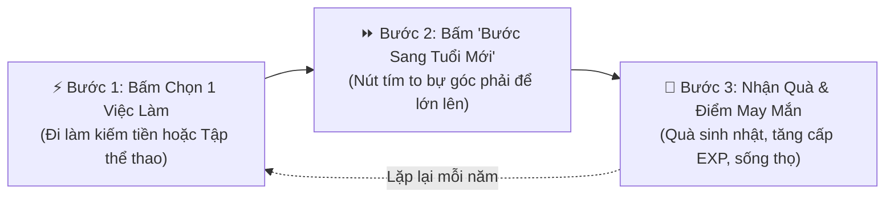
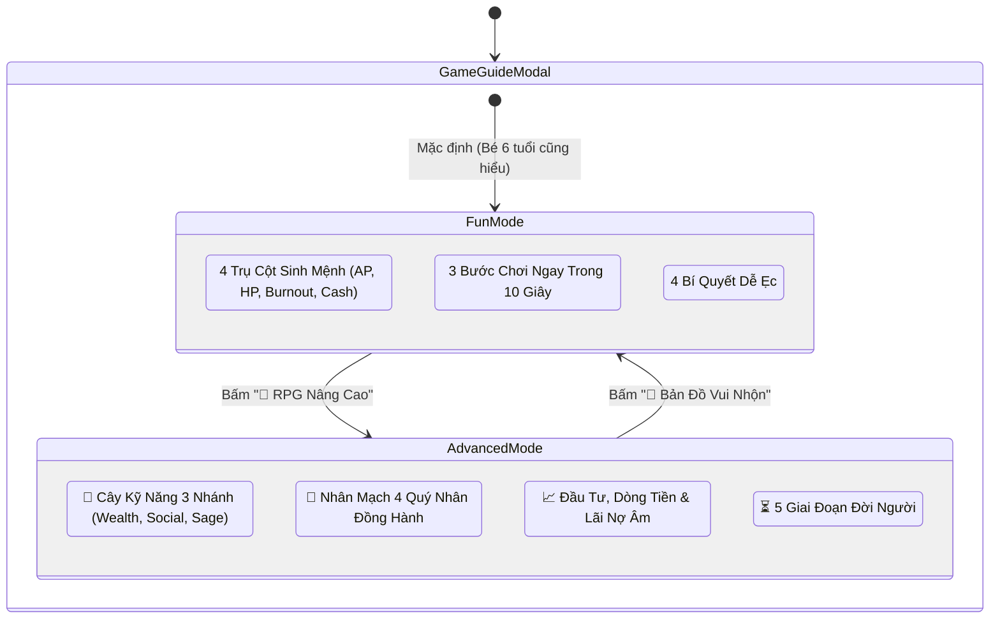
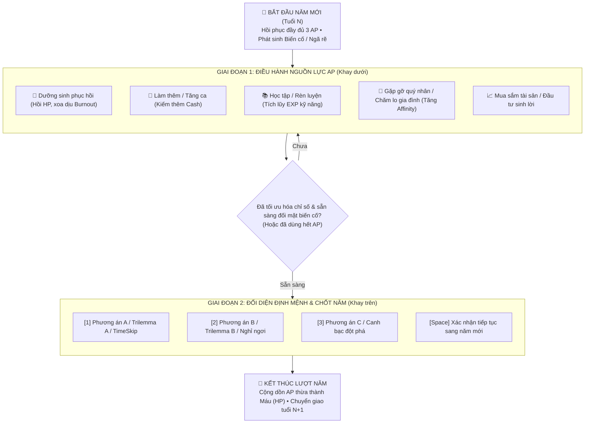

# LifeGraph — Quy Chuẩn Thiết Kế Giao Diện & Trải Nghiệm Người Dùng (UI/UX Standards v2.0)

> **Tài liệu quy chuẩn sản phẩm áp dụng cho trò chơi mô phỏng cuộc đời LifeGraph RPG.**  
> Mục tiêu cốt lõi: Đảm bảo tính nhất quán thẩm mỹ, khả năng tiếp cận toàn diện (Accessibility), phản hồi trực giác tức thời và khả năng thân thiện tối đa với mọi đối tượng người chơi — từ trẻ nhỏ 6 tuổi đến game thủ hardcore RPG.

---

## 1. Triết Lý Thiết Kế Trực Quan Hóa (Visual-First & Kid-Friendly Standard)

Giao diện của LifeGraph được xây dựng trên tôn chỉ **"Giảm tối đa gánh nặng đọc hiểu (Zero-Reading Friction)"**. Người chơi mới hoặc trẻ em có thể nắm bắt trạng thái cuộc sống chỉ trong 3 giây thông qua màu sắc, biểu tượng cảm xúc (Emoji/Icons) và đồ họa trực giác.

### 1.1. Chuẩn Hóa 4 Trụ Cột Sinh Mệnh (The 4 Life Pillars)

Mọi biến số trong game được quy về **4 Đồ chơi Sinh mệnh cốt lõi**. Mỗi trụ cột bắt buộc tuân theo bảng chuẩn màu sắc, biểu tượng và ngữ nghĩa sau:

| Trụ Cột Sinh Mệnh | Biểu Tượng | Thang Màu Chủ Đạo | Giới Hạn & Ngưỡng An Toàn | Ý Nghĩa Trực Quan (Ngôn ngữ Trẻ Em) | Hành Động Điều Chỉnh Tương Ứng |
| :--- | :---: | :--- | :--- | :--- | :--- |
| **Tia Sét Năng Lượng (AP)** | ⚡ | **Amber (Vàng hổ phách)**<br>`from-amber-950/30`<br>`border-amber-500/40` | 3 – 5 AP/năm.<br>Hết điểm = Hết lượt hành động | *Tia sét sức lực*: Dùng để làm việc, đi chơi, khám bệnh. Thừa sét cuối năm tự biến thành máu! | Đi làm, học tập, dưỡng sinh, giao lưu bạn bè |
| **Trái Tim Khỏe Mạnh (HP)** | ❤️ | **Rose (Hồng ngọc / Đỏ)**<br>`from-rose-950/30`<br>`border-rose-500/40` | 0 – 100%.<br>**Báo động khi < 30%**.<br>Về 0% = Tử vong ngay | *Trái tim đập thình thịch*: Hết tim là ngủm! Nhớ ăn ngon ngủ kỹ và đi bác sĩ kịp thời. | Khám bệnh, nâng cấp nhà ở, nghỉ dưỡng, thể thao |
| **Ngọn Lửa Áp Lực (Burnout)** | 💥 / 🔥 | **Orange (Cam rực lửa)**<br>`from-orange-950/30`<br>`border-orange-500/40` | 0 – 100%.<br>**Báo động khi > 75%**.<br>> 80% = Bắt đầu trừ máu trần | *Ngọn lửa mệt mỏi*: Lửa bốc cao quá là kiệt sức xỉu liền! Cần uống cà phê, thư giãn để dập lửa. | Nghỉ ngơi, du lịch, giảm bớt việc làm thêm |
| **Túi Tiền Tiết Kiệm (Cash)** | 💰 | **Emerald (Xanh lục bảo)**<br>`from-emerald-950/30`<br>`border-emerald-500/40` | $ USD.<br>Âm tiền = Phạt lãi nợ 4.5%/năm & +25% Stress | *Túi tiền đồ chơi*: Đi làm gom tiền mua nhà to, mua đồ chơi và chăm sóc ba mẹ. | Cày việc, đầu tư BĐS/cổ phiếu, tối ưu chi phí |

> [!IMPORTANT]
> **Quy Tắc Nhất Quán Trụ Cột (Pillar Consistency Rule):**
> * Tuyệt đối không hoán đổi màu sắc giữa 4 trụ cột (ví dụ: không dùng màu đỏ cho Năng Lượng hay màu vàng cho Máu).
> * Khi chỉ số ở trạng thái nguy hiểm (Máu < 30% hoặc Lửa > 75%), luôn kích hoạt hiệu ứng đập nhịp tim (`animate-pulse` hoặc `animate-bounce`) để thu hút sự chú ý của người chơi.

---

### 1.2. Chuẩn Hóa Vòng Lặp "3 Bước Chơi Ngay Trong 10 Giây" (3-Step Micro-Loop)

Mọi hướng dẫn người mới đều phải quy về vòng lặp hành vi đơn giản nhất:



* **Thiết kế Micro-card 3 bước:**
  * Mỗi bước đặt trong khung thẻ bo góc `rounded-2xl` với biểu tượng kích thước lớn (40x40px).
  * Sử dụng nhãn định danh ngắn: `BƯỚC 1`, `BƯỚC 2`, `BƯỚC 3` bằng font monospace in đậm kèm màu sắc phân biệt (Amber ➔ Purple ➔ Emerald).
  * Lời giải thích dưới 15 chữ, tập trung vào nút bấm cụ thể người chơi cần nhấn.

---

### 1.3. Bộ Flashcard Mẹo Vàng Sinh Tồn (Pro-Tip Visual Flashcards)

Các bài học kinh nghiệm sinh tồn được trình bày theo dạng thẻ bỏ túi (Flashcard) trực quan với 4 biểu tượng cuộc sống:
1. 🏡 **Nâng Cấp Chỗ Ở:** Đổi phòng trọ lên chung cư/biệt thự để ngủ ngon và ít ốm vặt.
2. ☕ **Thư Giãn Đúng Lúc:** Thấy ngọn lửa đỏ > 80% là phải dừng cày cuốc, đi dưỡng sinh ngay.
3. 🤝 **Kết Thân Bạn Bè:** Tương tác với người thân và quý nhân để được cứu nguy khi hoạn nạn.
4. 👶 **Sinh Con Nối Dõi:** Sinh con và lập quỹ tín thác để con cháu tiếp tục cơ nghiệp kiếp sau.

---

## 2. Kiến Trúc Trải Nghiệm Kép (Dual-Mode UX Architecture)

Để phục vụ hài hòa cả người chơi đại chúng/trẻ em lẫn những người chơi RPG chuyên sâu muốn tính toán chi li chỉ số (min-maxers), LifeGraph áp dụng **Kiến Trúc Trải Nghiệm Kép (Dual-Mode UX)** trong hệ thống hướng dẫn và giao diện quản lý.



### 2.1. Phân Tách Hai Chế Độ Trải Nghiệm

| Tiêu Chí | Chế Độ 1: 🧸 Bản Đồ Vui Nhộn (Fun Mode) | Chế Độ 2: 📖 Cẩm Nang Tra Cứu RPG (Advanced Mode) |
| :--- | :--- | :--- |
| **Đối Tượng Mục Tiêu** | Trẻ em (6+), người mới chơi lần đầu, người chơi giải trí casual | Game thủ RPG, người thích tính toán tối ưu tài chính, cày cấp |
| **Khối Lượng Chữ** | Cực ngắn (micro-copy < 2 dòng/thẻ), ưu tiên hình vẽ và emoji | Đầy đủ thông số kỹ thuật, tỷ lệ %, chi phí SP, công thức tính |
| **Bố Cục Trình Bày** | Grid thẻ card lớn `rounded-3xl`, viền màu nổi bật, nút bấm to bự | Tab điều hướng đa tầng, danh sách chỉ số, bảng phân cấp Tier |
| **Thuật Ngữ Sử Dụng** | Đời thường: "Tia sét", "Trái tim", "Lửa mệt mỏi", "Túi tiền" | Thuật ngữ RPG: "Action Points", "Affinity Cấp 3", "Lãi phạt", "Karma" |

### 2.2. Quy Chuẩn Nút Chuyển Đổi Chế Độ (Mode Switcher Toggle)
* **Vị trí:** Luôn nằm tại vị trí trang trọng ở Header bên cạnh tiêu đề modal.
* **Hình thức:** Container dạng viên thuốc viền kép (`bg-slate-950/80 p-1 rounded-2xl border border-slate-800`).
* **Trạng thái Active:** Áp dụng hiệu ứng Gradient rực rỡ (`amber-to-rose` cho Fun Mode, `purple-to-indigo` cho Advanced Mode) kèm đổ bóng màu đặc trưng (`shadow-md shadow-rose-500/30`).
* **Hiệu ứng chuyển cảnh:** Nội dung body chuyển đổi mượt mà với lớp animation `animate-in fade-in duration-200`.

---

## 3. Hệ Thống Thanh Lệnh HUD & Trạng Thái Nguy Cấp (CommandBarHUD & Emergency SOS)

Thanh công cụ `CommandBarHUD` đóng vai trò là bảng điều khiển gắn cố định (Sticky Cockpit Bar) trên buồng lái, giúp người chơi phản xạ nhanh mà không che khuất màn hình chơi.

### 3.1. Bố Cục Phân Vùng Lệnh (Command Bar Layout)

```text
+----------------------------------------------------------------------------------------------------+
| [👁️ Xem Nhanh] [🎬 Cinema D]  |  [⌨️ Phím Tắt: 1 2 3 | Space | ?]  |  [🚨 CẤP CỨU KHẨN CẤP (HP 20%)] |
|        (Trái: Góc Nhìn)        |        (Giữa: Hotkey Badges)       |       (Phải: Cảnh Báo Sinh Tử)     |
+----------------------------------------------------------------------------------------------------+
```

* **Vị trí:** Cố định bên dưới thanh Navigation chính: `sticky top-[53px] z-40`.
* **Hiệu ứng nền:** Thủy tinh mờ `bg-slate-900/80 backdrop-blur-md border-b border-slate-800/80`.
* **Chiều cao:** Tối ưu mỏng nhẹ (40–44px) để bảo toàn diện tích hiển thị sân khấu 3D.

---

### 3.2. Quy Chuẩn Cảnh Báo Sinh Mệnh & Cấp Cứu Khẩn Cấp (Emergency SOS)

Hệ thống liên tục giám sát hai ngưỡng sinh tử của nhân vật:

$$\text{Trạng thái Nguy Cấp} \iff (\text{Vitality} < 30\%) \lor (\text{Burnout} > 75\%)$$

Khi thỏa mãn điều kiện nguy cấp:
1. **Nút SOS Cấp Cứu Khẩn Cấp tự động xuất hiện** ở góc phải thanh HUD:
   * Nền Gradient cảnh báo: `bg-gradient-to-r from-rose-600 via-rose-500 to-amber-600`.
   * Hiệu ứng đập nhịp tim: `animate-pulse` toàn nút và `animate-bounce` trên biểu tượng `<HeartPulse />`.
   * Badge hiển thị chỉ số nguy kịch: `[HP 24%]` hoặc `[Burnout 82%]`.
2. **Nguyên tắc "Cảnh báo đi kèm Hành động (Actionable Alarm)":**
   * Tuyệt đối không chỉ hiển thị chữ cảnh báo tĩnh gây hoang mang.
   * Khi bấm vào nút SOS, lập tức mở hộp thoại cứu trợ sinh mạng với 2 đường thoát cụ thể:
     * **Phương án 1 (Khi còn AP):** Dưỡng Sinh Phục Hồi Toàn Diện (Tốn 1 AP, giảm ngay 40% Stress & hồi 25 HP).
     * **Phương án 2 (Khi cạn sạch 0 AP):** Thỉnh Phước Bảo Mạng tại Đền Thờ Nghiệp Quả Karma (Đổi điểm tích đức tiền kiếp để bảo toàn tính mạng).

---

## 4. Khoang Quyết Định & Hành Động Năm Hợp Nhất (Unified Annual Decision & Action Stage)

Nhằm khắc phục tình trạng phân mảnh thị giác giữa biến cố cuộc đời và khay công cụ hành động, LifeGraph áp dụng kiến trúc **Khoang Quyết Định & Hành Động Năm Hợp Nhất (Unified Annual Decision & Action Stage)**. Thay vì để thẻ biến cố (Dilemma Card) và khay hành động (Action Dock) tách rời thành hai khối hộp riêng biệt gây cảm giác rời rạc và rối mắt, toàn bộ tiến trình của một năm đời được gom chung vào một cấu trúc khung bao bọc hợp nhất nguyên khối.

### 4.1. Thiết Kế Khung Bao Bọc Hợp Nhất (Unified Container & Anti-Clutter Design)

```text
┌───────────────────────────────────────────────────────────────────────────────────────────────────┐
│ 🎯 Vòng Đời Năm Nay (Tuổi 28) — Dùng AP trước khi đưa ra quyết định chốt năm        ⚡ 2 / 3 AP  │
├───────────────────────────────────────────────────────────────────────────────────────────────────┤
│                                                                                                   │
│  [KHU VỰC TRÊN: BIẾN CỐ NĂM — renderInteractionComponent()]                                       │
│  • Thẻ ngã rẽ cuộc đời (Dilemma / Trilemma / TimeSkip / NPC Dialogue Duel / Crisis Survival)      │
│  • Trực quan hóa 3 Bản Ngã & Lựa chọn định mệnh [1], [2], [3]                                     │
│                                                                                                   │
├─────────────────────── ⚡ ĐIỀU HÀNH NGUỒN LỰC AP & HOẠT ĐỘNG NĂM ──────────────────────────────────┤
│                                                                                                   │
│  [KHU VỰC DƯỚI: KHAY HÀNH ĐỘNG — ActionPointHub (isEmbedded={true})]                              │
│  • Danh mục tab hoạt động: Dưỡng sinh, Làm thêm, Học tập, Gia đình, Nhân mạch, Tài sản           │
│  • Tự do sử dụng AP để chuẩn bị thể lực, dòng tiền trước khi chốt năm                             │
│                                                                                                   │
└───────────────────────────────────────────────────────────────────────────────────────────────────┘
```

* **Khung bao bọc ngoài cùng (Outer Unified Card):**
  * Sử dụng container bo góc lớn `w-full rounded-3xl border border-slate-800/90 bg-slate-950/85 backdrop-blur-2xl shadow-2xl overflow-hidden flex flex-col`.
  * Đảm bảo tính liền mạch, sang trọng, mang phong cách buồng lái tương lai (Sci-fi Cockpit).
* **Header hợp nhất định hướng lượt chơi:**
  * Lớp nền `bg-gradient-to-r from-slate-900/95 via-indigo-950/40 to-slate-900/95 border-b border-slate-800/80`.
  * Hiển thị độ tuổi hiện tại (`🎯 Vòng Đời Năm Nay (Tuổi {age})`), thông điệp hướng dẫn ngắn gọn cho người chơi (`— Dùng AP trước khi đưa ra quyết định chốt năm`), và badge đếm số AP khả dụng (`⚡ {action_points} / {total_ap} AP`).
* **Cầu nối chiến lược (Strategic Visual Divider):**
  * Dải phân cách phát sáng tinh tế `bg-gradient-to-r from-transparent via-indigo-500/40 to-transparent` với huy hiệu trung tâm `bg-slate-950 border border-indigo-500/30 text-[10px] font-mono text-indigo-300`.
  * Nhấn mạnh ranh giới giữa việc "chuẩn bị nội lực" và việc "đối mặt với thử thách số phận".

---

### 4.2. Quy Chuẩn Thuộc Tính `isEmbedded` trong `ActionPointHub.tsx`

Một trong những vấn đề nghiêm trọng của thiết kế lồng ghép UI là hiện tượng **"viền lồng viền (nested border clutter)"** và khoảng đệm kép (double padding/margin), khiến giao diện trông chật chội và kém thẩm mỹ.

Thuộc tính `isEmbedded: boolean` được chuẩn hóa trong `ActionPointHubProps` nhằm giải quyết triệt để vấn đề này:

```typescript
// Định nghĩa props trong ActionPointHub.tsx
interface ActionPointHubProps {
  isEmbedded?: boolean; // Cờ kích hoạt chế độ nhúng vào khoang hợp nhất
  actionPoints: number;
  totalAp?: number;
  // ... các props khác
}
```

* **Hành vi khi `isEmbedded === true` (Chế độ nhúng hợp nhất):**
  ```tsx
  className={`w-full ${
    isEmbedded
      ? 'bg-transparent border-0 p-0 shadow-none'
      : 'bg-slate-900/95 border border-amber-500/30 rounded-3xl p-3 md:p-4 shadow-xl backdrop-blur-xl'
  }`}
  ```
  * Loại bỏ hoàn toàn viền (`border-0`), nền đệm trong suốt (`bg-transparent`), xóa bỏ padding thừa (`p-0`) và triệt tiêu bóng đổ lồng (`shadow-none`).
  * Khay hành động hòa quyện 100% vào cấu trúc của khoang hợp nhất, tạo cảm giác như một phân vùng tự nhiên của màn chơi.
* **Hành vi khi `isEmbedded === false` (Chế độ độc lập):**
  * Áp dụng đầy đủ viền vàng hổ phách `border-amber-500/30`, bo góc `rounded-3xl`, đệm `p-3 md:p-4` và bóng mờ `shadow-xl backdrop-blur-xl` khi được sử dụng tại các màn hình độc lập khác.

---

### 4.3. Luồng Chơi 2 Giai Đoạn Chuẩn Mực (2-Phase Annual Turn Loop)

Kiến trúc hợp nhất này củng cố một nguyên lý gameplay chiến lược: **Luồng chơi 2 giai đoạn mỗi năm (2-Phase Turn)** giúp người chơi luôn ở thế chủ động kiểm soát vận mệnh thay vì bị biến cố dồn ép bất ngờ:



1. **Giai đoạn 1 — Chuẩn Bị & Điều Hành Nguồn Lực AP (Resource Preparation Phase):**
   * Người chơi tập trung vào **Khay hành động ở nửa dưới**.
   * Nếu nhân vật đang có chỉ số Máu thấp hoặc Burnout cao, người chơi có thể bấm **Dưỡng sinh (1 AP)** ngay lập tức để hồi phục thể lực *trước khi* bước vào tình huống hiểm nghèo của biến cố năm đó.
   * Nếu biến cố đòi hỏi tiền bạc hoặc chỉ số, người chơi có thể bấm làm thêm hoặc rèn luyện kỹ năng trước.
2. **Giai đoạn 2 — Ra Quyết Định Định Mệnh & Chốt Năm (Destiny Decision & Year Settlement Phase):**
   * Sau khi đã trang bị đầy đủ tài nguyên và tâm thế, người chơi hướng mắt lên **Khu vực biến cố ở nửa trên**.
   * Nhấn các phím <kbd>1</kbd>, <kbd>2</kbd>, <kbd>3</kbd> hoặc <kbd>Space</kbd> để đưa ra lựa chọn chốt hạ.
   * Quyết định này sẽ khóa sổ năm tuổi hiện tại, ghi nhận kết quả và đưa nhân vật bước sang năm tiếp theo.

---

### 4.4. Cơ Chế Synergistic AP (AP Trợ Lực Vào Quyết Định Chiến Lược)

Bên cạnh việc dùng AP cho các hoạt động thường niên tại khay dưới, người chơi có thể trực tiếp đầu tư AP vào một quyết định ngã rẽ cụ thể để **trợ lực chiến lược (Synergistic AP Investment)**:

* **Trực quan nút bấm `[+1 AP Trợ Lực]`:**
  * Xuất hiện tại mỗi thẻ lựa chọn ngã rẽ (`EventCard`, `TrilemmaCard`).
  * Trạng thái chưa đầu tư: `bg-slate-900/90 hover:bg-amber-950/40 border-slate-700 text-slate-300 hover:text-amber-300`.
  * Trạng thái đã đầu tư: `bg-amber-500/25 border-amber-400 text-amber-300 shadow-md shadow-amber-500/25 animate-pulse` với nhãn đổi thành `[Đã Trợ Lực +1 AP]`. Người chơi có thể bấm lại để hoàn trả AP.
* **Quy tắc cộng hưởng chiến lược (Synergistic Mechanics):**
  * **Tăng xác suất thành công khi gieo xúc xắc (Fate Dice):** Mỗi +1 AP trợ lực bổ sung **+2 điểm trực tiếp** vào điểm xúc xắc D20 (`apModifier = investedAp * 2`), làm tăng đáng kể cơ hội vượt qua mốc DC Thách thức.
  * **Khuếch đại lợi nhuận:** Gia tăng **+25% Cash** và **+30% Karma** cho các kết quả tích cực.
  * **Giảm thiểu rủi ro sinh mệnh (Risk Mitigation):** Giảm **50% mức trừ Sinh Lực (HP)** và giảm **50% mức gia tăng Kiệt Sức (Burnout)** nếu lựa chọn xảy ra biến cố tiêu cực.
  * **Ghi danh Di chúc Tiền Kiếp (Heritage Chronicle):** Lịch sử cuộc đời ghi nhận dòng vinh danh đặc biệt: *"Nhờ đầu tư X AP chuẩn bị kỹ lưỡng, bạn đã gia tăng tỷ lệ thành công và hạn chế tối đa rủi ro"*.

---

### 4.5. Hộp Thoại Cảnh Báo Thông Minh Khi Còn AP Dư (Smart Unspent AP Warning)

Nhằm bảo vệ người chơi khỏi việc bấm nhầm chốt năm khi chưa kịp tận dụng hết điểm hành động (AP) mà vẫn tôn trọng quyền tự do lựa chọn tốc độ chơi:

* **Điều kiện kích hoạt:**
  * Tự động xuất hiện dạng banner thông minh ngay khi người chơi bấm vào một lựa chọn ngã rẽ trong khi vẫn còn AP dư (`unspentAP = actionPoints - totalCost > 0`).
* **Thiết kế giao diện Banner (`Smart Unspent AP Warning`):**
  * Nền cảnh báo ấm áp `bg-amber-950/70 border-2 border-amber-500/60 rounded-2xl p-3.5 shadow-xl`, hiệu ứng xuất hiện `animate-in fade-in slide-in-from-top-2 duration-200`.
  * Biểu tượng `⚠️` và dòng thông điệp định hướng rõ ràng: *"Năm nay bạn vẫn còn X AP chưa dùng!"*.
* **Nguyên tắc "Lựa Chọn Kép Minh Bạch (Dual Smart Choices)":**
  1. **Nút 1 — "⚡ Dùng Nốt AP Ngay":** Người chơi có thể quay lại khay hành động năm (Action Dock) để làm thêm việc hoặc bấm `+1 AP Trợ Lực` vào chính lựa chọn này để nhận thưởng lớn hơn.
  2. **Nút 2 — "🌿 Vẫn Chốt Năm (Chuyển AP Dư Thành Máu)":** Tiếp tục thực thi lựa chọn mà không sợ thiệt thòi. Hệ thống cam kết tự động chuyển hóa toàn bộ AP chưa dùng:
     * Mỗi **1 AP dư** ➔ Tự động chuyển thành **+2 HP (Sinh Lực)** và **–5% Burnout (Kiệt Sức)** khi bước sang năm mới.
     * Thông báo kết quả chuyển hóa xuất hiện rõ ràng tại Bản Tin Thường Niên (Annual Digest) và Banner phản hồi tức thì.

---

## 5. Chuẩn Mực Phím Tắt Toàn Cục & Tiếp Cận Bàn Phím (Global Hotkeys & Accessibility)

Nhằm mang lại trải nghiệm điều khiển liên tục (Flow State) như các tựa game RPG kinh điển, LifeGraph thiết lập chuẩn phím tắt toàn cục 1 chạm:

### 5.1. Bảng Quy Chuẩn Phím Tắt Cốt Lõi

| Phím Tắt | Phân Loại | Màu Sắc Badge `<kbd>` | Hành Động Kích Hoạt |
| :---: | :--- | :--- | :--- |
| <kbd>Space</kbd> | Điều Khiển Lượt | `border-emerald-500/40 text-emerald-300 bg-emerald-500/10` | Bước sang năm tiếp theo / Xác nhận tiến trình nhanh |
| <kbd>1</kbd> | Quyết Định Lựa Chọn | `border-amber-500/40 text-amber-300 bg-amber-500/10` | Chọn nhanh Lựa chọn 1 trong Ngã rẽ / Đối thoại / Nghỉ ngơi |
| <kbd>2</kbd> | Quyết Định Lựa Chọn | `border-amber-500/40 text-amber-300 bg-amber-500/10` | Chọn nhanh Lựa chọn 2 trong Ngã rẽ / Đối thoại / Nghỉ ngơi |
| <kbd>3</kbd> | Quyết Định Lựa Chọn | `border-amber-500/40 text-amber-300 bg-amber-500/10` | Chọn nhanh Lựa chọn 3 trong Tam giác nghịch lý Trilemma |
| <kbd>D</kbd> | Trải Nghiệm Không Gian | `border-purple-500/40 text-purple-300 bg-purple-500/10` | Mở/Đóng Phòng Quyết Định Điện Ảnh tỉ lệ 21:9 Cinema |
| <kbd>M</kbd> | Âm Thanh Không Gian | `border-cyan-500/40 text-cyan-300 bg-cyan-500/10` | Bật / Tắt nhanh âm thanh nền (Mute Toggle) |
| <kbd>?</kbd> / <kbd>/</kbd> | Cẩm Nang Trợ Giúp | `border-indigo-500/40 text-indigo-300 bg-indigo-500/10` | Bật nhanh Sổ tay hướng dẫn Dual-Mode Guide |
| <kbd>K</kbd> | Hệ Thống Bàn Phím | `border-amber-500/40 text-amber-300 bg-amber-500/10` | Bật/tắt Bảng danh mục phím tắt toàn cục (Shortcuts Cheatsheet) |
| <kbd>E</kbd> | Sinh Tồn Khẩn Cấp | `border-rose-500/40 text-rose-300 bg-rose-500/10` | Mở Trạm Cứu Hộ Khẩn Cấp (Emergency SOS) khi sinh lực nguy kịch |
| <kbd>Esc</kbd> | Điều Hướng Cửa Sổ | `border-slate-500/40 text-slate-300 bg-slate-500/10` | Đóng nhanh bất kỳ hộp thoại / modal thông tin đang mở |

---

### 5.2. Cơ Chế Cách Ly Nhập Liệu An Toàn (Safe Context-Guarding)

Để tránh hiện tượng kích hoạt phím ngoài ý muốn, hệ thống tuân thủ nghiêm ngặt 3 lớp bảo vệ (Guarding Layers):

1. **Lớp 1 — Input Isolation:** Tự động bỏ qua mọi Hotkey khi con trỏ đang nằm trong `<input>`, `<textarea>`, `<select>` hoặc phần tử mang thuộc tính `contenteditable` (ví dụ: khi người chơi gõ văn bản trò chuyện trực tiếp với AI NPC).
2. **Lớp 2 — Modal & Death Guarding:** Khóa toàn bộ các phím điều khiển thời gian (<kbd>Space</kbd>) và phím chọn nhánh (<kbd>1</kbd>, <kbd>2</kbd>, <kbd>3</kbd>) khi nhân vật đã qua đời (`character.is_deceased === true`) hoặc khi một trong các hộp thoại lớn đang mở (Tái sinh, Kỹ năng, Gia phả, Minigame, Cấp cứu...).
3. **Lớp 3 — OS System Keys Preservation:** Không bao giờ can thiệp (`e.preventDefault()`) vào các tổ hợp phím hệ thống như <kbd>Ctrl</kbd> + <kbd>C</kbd>, <kbd>Alt</kbd> + <kbd>Tab</kbd>, <kbd>Cmd</kbd> + <kbd>R</kbd>, <kbd>F11</kbd>, <kbd>F12</kbd>.

---

### 5.3. Hiển Thị Nhãn Gợi Ý Phím Tắt Trực Quan (Interactive Key Hints)

* Trên các nút bấm có hỗ trợ phím tắt (nút Năm Mới, các nút lựa chọn phương án A/B/C, nút Phòng Điện Ảnh), bắt buộc đính kèm thẻ `<kbd>` nhỏ ở góc phải nút:
  * Ví dụ: `[1]`, `[2]`, `[3]`, `[Space]`, `[D]`.
  * Thẻ `<kbd>` sử dụng font `font-mono text-[10px] font-bold`, có viền nổi nhẹ và màu đồng điệu với nhóm chức năng.
  * Việc này giúp người chơi tự nhiên ghi nhớ phím tắt trong quá trình trải nghiệm mà không cần phải chủ động mở sổ tay tra cứu.

---

## 6. Quy Chuẩn Typography & Kiểu Chữ

* **Phông chữ chủ đạo:** Sử dụng họ phông **Inter** hỗ trợ đầy đủ bộ ký tự tiếng Việt Unicode dựng sẵn; phông `system-ui, sans-serif` làm dự phòng. Chỉ nạp 1 họ phông với trọng số (font-weight) 400, 600, 700, 800 và thuộc tính `font-display: swap`.
* **Thang cỡ chữ (Type Scale):**
  * **Văn bản nội dung chính:** 14px – 16px (tuyệt đối không dùng cỡ dưới 12px cho văn bản người chơi cần đọc).
  * **Nhãn phụ & Chú thích (Captions / Badges):** 11px – 12px font medium/bold.
  * **Tiêu đề phân khu (Section Titles):** 18px – 22px font bold/extrabold.
  * **Tiêu đề màn hình (Hero Headings):** 24px – 32px font black.
* **Chiều cao dòng (Line-height):** Đặt từ `1.5` đến `1.7` cho đoạn văn bản để đảm bảo không bị dính dấu tiếng Việt (huyền, sắc, hỏi, ngã, nặng) vào hàng trên.
* **Định dạng số liệu:** Toàn bộ số liệu tiền tệ ($ USD), chỉ số sinh mệnh (HP, AP, Stress), năm tuổi và tỷ lệ % bắt buộc dùng phông có thuộc tính `tabular-nums` để số không bị nhảy giật khi tăng giảm.

---

## 7. Bố Cục, Khoảng Cách & Thang Màu (Layout & Color System)

* **Hệ thống khoảng cách (Spacing System):** Tuân thủ bội số 4px của Tailwind CSS: `4px`, `8px`, `12px`, `16px`, `24px`, `32px`, `48px`.
* **Bo góc (Border Radius):**
  * Thẻ Card và Hộp thoại lớn: `rounded-3xl` (24px) tạo cảm giác hiện đại, thân thiện.
  * Nút bấm và Thẻ phụ: `rounded-2xl` (16px) hoặc `rounded-xl` (12px).
  * Badge và Kbd tags: `rounded-lg` hoặc `rounded-full`.
* **Độ tương phản màu sắc (WCAG AA Accessibility):**
  * Độ tương phản giữa chữ và nền đạt tối thiểu **4.5:1** cho cỡ chữ thông thường và **3:1** cho chữ lớn.
  * Nền tối chủ đạo: `bg-slate-950` (#020617) kết hợp các lớp panel `bg-slate-900/80` và viền `border-slate-800/80`.
* **Thiết kế thích ứng Di động (Mobile Optimization):**
  * Tự động chuyển đổi layout từ nhiều cột sang cột đơn trên màn hình nhỏ (`< 640px`).
  * Vùng chạm cảm ứng (Touch Target) của mọi nút bấm tối thiểu **44x44px** để tránh bấm nhầm trên màn hình cảm ứng.
  * Ô nhập liệu luôn duy trì `font-size: 16px` trên mobile để ngăn trình duyệt tự động zoom màn hình ngoài ý muốn.

---

## 8. Văn Phong & Ngôn Ngữ Trải Nghiệm (Tone of Voice & Copywriting)

* **Văn phong gần gũi, giàu cảm xúc và hành động:** Sử dụng tiếng Việt chuẩn mực, súc tích. Mỗi lựa chọn đều nêu rõ cái giá phải trả và cơ hội mở ra (Ví dụ: *"Dưỡng sinh phục hồi (-1 AP, +25 Máu)"* thay vì chỉ ghi *"Nghỉ ngơi"*).
* **Tuyệt đối tránh thuật ngữ nội bộ:** Không đưa các từ ngữ dev/engineering vào giao diện người chơi (ví dụ: không dùng *"Cockpit View"*, *"State Machine"*, *"Backend API"*; thay bằng *"Buồng Lái Kiếp Sống"*, *"Quy Luật Sinh Mệnh"*, *"Máy Chủ Trò Chơi"*).
* **Thông báo lỗi mang tính hướng dẫn:** Khi xảy ra lỗi hoặc thiếu tài nguyên, câu thông báo phải chỉ ra giải pháp (Ví dụ: *"Bạn đã cạn sạch Tia Sét Năng Lượng! Hãy bấm Sang Tuổi Mới hoặc dùng Trợ Giúp để hồi sức."*).

---

## 9. Danh Mục Kiểm Tra Trước Phát Hành (Pre-Release UI/UX Checklist)

Mọi cập nhật giao diện trước khi xuất bản lên môi trường Production bắt buộc phải vượt qua danh mục kiểm tra:

- [ ] **Type check & Build:** Lệnh `npm run build` trên thư mục `frontend/` hoàn thành 100% không cảnh báo lỗi type.
- [ ] **Kiểm tra cỡ chữ tối thiểu:** Không có đoạn văn bản đọc hiểu nào dưới 12px.
- [ ] **Kiểm tra Responsive:** Kiểm tra hiển thị chuẩn trên 3 kích thước: Mobile (375px), Tablet (768px), Desktop (1440px+).
- [ ] **Kiểm tra Khoang Hợp Nhất (isEmbedded):** Thẻ Dilemma và ActionPointHub hiển thị liền khối trong container chung `rounded-3xl`, không có hiện tượng viền lồng viền (nested borders).
- [ ] **Kiểm tra Dual-Mode UX:** Chuyển đổi qua lại giữa *Bản Đồ Vui Nhộn* và *Cẩm Nang RPG* mượt mà, không bị tràn khung hay mất dữ liệu.
- [ ] **Kiểm tra Ngưỡng Cấp Cứu SOS:** Đổi chỉ số Máu xuống < 30% hoặc Kiệt Sức lên > 75%, nút SOS nhấp nháy xuất hiện chính xác trên thanh HUD.
- [ ] **Kiểm tra Cách Ly Phím Tắt (Context Guarding):** Nhấp chuột vào ô chat NPC hoặc ô nhập văn bản và gõ các phím `1`, `2`, `3`, `Space`, `D` — đảm bảo chỉ gõ chữ vào ô nhập mà không làm nhảy năm hay kích hoạt ngã rẽ.
- [ ] **Kiểm tra Giảm Chuyển Động (Reduced Motion):** Khi hệ điều hành bật `prefers-reduced-motion`, các hiệu ứng rung lắc/nhấp nháy tự động chuyển sang trạng thái tĩnh.
- [ ] **Kiểm tra Multi-Theme & Anti-FOUC:** Chuyển đổi qua lại giữa 3 theme (Obsidian, Sepia, Cyber), xác nhận giao diện chuyển màu êm dịu, không giật màn hình và lưu đúng vào localStorage.

---

## 10. Tiêu Chuẩn Hệ Thống Multi-Theme & Công Thái Học Thị Giác (Visual Ergonomics)

Nhằm tối ưu hóa trải nghiệm cho các phiên chơi kéo dài (Long-session Gameplay) và bảo vệ thị lực người chơi trong nhiều điều kiện ánh sáng môi trường khác nhau, LifeGraph thiết lập tiêu chuẩn **Công Thái Học Thị Giác (Visual Ergonomics)** thông qua hệ thống Multi-Theme động:

### 10.1. Chi Tiết 3 Phong Cách Thị Giác Cốt Lõi

1. 🌙 **Obsidian Night (Than chì dịu mắt — Mặc Định Khuyên Dùng):**
   * **Bản sắc:** Tông nền than chì tối êm dịu (`#0c0d12`), triệt tiêu độ tương phản gắt của màu đen tuyệt đối (#000000) và sắc xanh kích thích thị giác.
   * **Tác động công thái học:** Giữ đồng tử ở trạng thái thư giãn tự nhiên, giảm thiểu hiện tượng mỏi cơ mắt khi tập trung đọc chữ và tương tác chỉ số trong thời gian dài.
   * **Môi trường phù hợp:** Phiên chơi hàng ngày, môi trường ánh sáng phòng bình thường hoặc màn hình tấm nền OLED/IPS.

2. 📜 **Sepia Warmth (Đêm ấm cúng — Lọc Ánh Sáng Xanh):**
   * **Bản sắc:** Tông giấy ngà cổ điển (`#161412`), sắc chữ vàng ấm dịu (`#ebd8be`), viền nâu hổ phách mềm mại (`rgba(235, 216, 190, 0.12)`).
   * **Tác động công thái học:** Cắt giảm tối đa quang phổ ánh sáng xanh bước sóng ngắn (< 450nm) — tác nhân chính gây ức chế Melatonin và mỏi mắt về đêm. Mang lại cảm giác đọc sách bên ánh đèn vàng ấm áp.
   * **Môi trường phù hợp:** Chơi vào ban đêm, trước khi đi ngủ, hoặc người chơi có cơ địa nhạy cảm với ánh sáng màn hình.

3. ⚡ **Cyber Slate (Neon nguyên bản — Viễn Tưởng Sắc Nét):**
   * **Bản sắc:** Tông xanh đen vũ trụ (`#020617`), viền cyan neon sắc nét (`rgba(56, 189, 248, 0.25)`), điểm nhấn tím điện tử (`rgba(168, 85, 247, 0.50)`).
   * **Tác động công thái học:** Tương phản cao, sắc sảo và hiện đại. Mang đậm phong cách buồng lái phi thuyền viễn tưởng nguyên bản của LifeGraph RPG.
   * **Môi trường phù hợp:** Người chơi yêu thích phong cách Cyberpunk, màn hình Gaming độ sáng cao hoặc chế độ Phòng Điện Ảnh 21:9.

---

### 10.2. Bảng Quy Chuẩn CSS Variables Chuẩn Hóa

Mọi thành phần giao diện (Card, Panel, Text, Border, Header) bắt buộc phải sử dụng các CSS Variables ngữ nghĩa thay vì mã màu cố định cứng:

| CSS Variable | Ý Nghĩa Ngữ Nghĩa | 🌙 Obsidian Night (Mặc định) | 📜 Sepia Warmth (Đêm ấm) | ⚡ Cyber Slate (Neon) |
| :--- | :--- | :--- | :--- | :--- |
| `--bg-canvas` | Nền canvas toàn trang | `#0c0d12` (Than chì đậm) | `#161412` (Nâu ngà ấm) | `#020617` (Xanh đen sâu) |
| `--bg-header` | Nền thanh điều hướng & HUD | `rgba(14, 16, 22, 0.88)` | `rgba(26, 23, 20, 0.90)` | `rgba(2, 6, 23, 0.92)` |
| `--bg-card` | Nền thẻ container chính | `rgba(18, 20, 28, 0.82)` | `rgba(32, 28, 24, 0.82)` | `rgba(15, 23, 42, 0.82)` |
| `--bg-card-subtle` | Nền thẻ phụ & Dock tiện ích | `rgba(26, 29, 39, 0.65)` | `rgba(43, 38, 33, 0.65)` | `rgba(30, 41, 59, 0.65)` |
| `--border-subtle` | Viền ngăn cách nhẹ nhàng | `rgba(255, 255, 255, 0.08)` | `rgba(235, 216, 190, 0.12)` | `rgba(56, 189, 248, 0.25)` |
| `--border-highlight` | Viền nhấn mạnh / Hover | `rgba(251, 191, 36, 0.35)` | `rgba(217, 119, 6, 0.40)` | `rgba(168, 85, 247, 0.50)` |
| `--text-primary` | Màu chữ nội dung chính | `#e2e4e9` (Trắng xám dịu) | `#ebd8be` (Vàng ngà êm) | `#f1f5f9` (Trắng sáng) |
| `--text-secondary` | Màu chữ phụ, nhãn chú thích | `#9da3af` (Xám tro) | `#a89f91` (Nâu xám tro) | `#94a3b8` (Xanh xám tro) |
| `--accent-gold` | Màu nhấn Vàng Năng Lượng | `#f59e0b` | `#d97706` | `#eab308` |
| `--accent-emerald` | Màu nhấn Xanh Sinh Lực | `#10b981` | `#059669` | `#06b6d4` |
| `--accent-rose` | Màu nhấn Đỏ Cảnh Báo | `#f43f5e` | `#e11d48` | `#ec4899` |

---

### 10.3. Kiến Trúc Kỹ Thuật & Phòng Chống FOUC (Anti-FOUC Architecture)

1. **Khởi tạo tức thì (Zero Flash of Unstyled Content - Anti-FOUC):**
   * Một đoạn mã đồng bộ siêu nhỏ được thực thi ngay trong thẻ `<head>` của `frontend/app/layout.tsx` trước khi bất kỳ thành phần React nào được hydrate:
     ```javascript
     var savedTheme = localStorage.getItem('lifegraph_theme') || 'obsidian';
     document.documentElement.setAttribute('data-theme', savedTheme);
     ```
   * Nhờ đó, trình duyệt áp dụng ngay CSS Variables của theme đã chọn, triệt tiêu 100% hiện tượng chớp trắng/chớp màu khi tải lại trang hoặc điều hướng.
2. **Chuyển màu mượt mà (Smooth Visual Transition):**
   * Thuộc tính `body { transition: background-color 0.25s ease, color 0.25s ease; }` đảm bảo việc chuyển đổi giữa các theme diễn ra êm ái trong 250ms, không gây giật thị giác.
3. **Lưu trữ trạng thái bền vững:**
   * Lựa chọn của người chơi được lưu tức thì vào `localStorage.setItem('lifegraph_theme', newTheme)` và đồng bộ trên toàn bộ phiên làm việc.
